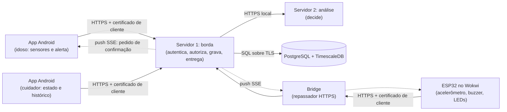

# Flow: monitoramento e assistência a uma pessoa idosa

Projeto da disciplina **Software para Sistemas Ubíquos** (INF0483, Engenharia de Software/UFG, 2026/2).

Idosos que moram sozinhos correm riscos que passam despercebidos: quedas, longos períodos parados e luz inadequada à
noite. O Flow percebe esses sinais com os sensores do **celular do idoso** e de um **dispositivo ESP32** (simulado no
Wokwi), decide no servidor e responde: pede uma confirmação ao idoso (alarme no celular, buzzer no ESP32) e deixa o
**cuidador** acompanhar o estado e o histórico pelo mesmo app.

## Como funciona

| Etapa | O que acontece |
| --- | --- |
| **Produtores** | O app envia a cada segundo acelerômetro, luz/temperatura de cor e localização; o ESP32 envia o acelerômetro e a decisão da sua máquina de imobilidade. Os dois estão ligados à mesma pessoa pela conta. |
| **Decisão** | A análise funde as duas fontes e decide: **queda provável** (impacto seguido de imobilidade), **imobilidade prolongada** e **luz fria à noite**. As regras têm estado e tempo: janelas, prazos, deduplicação e descarte de dado atrasado. |
| **Mudança de contexto** | Dia/noite muda a regra de luz; movimento/repouso muda o estado de imobilidade e de queda. |
| **Resposta (atuadores)** | No celular: alarme, vibração, lanterna, voz e notificação com o botão **Estou bem**. No ESP32: buzzer e LEDs, com o botão **Estou bem**. A resposta (ou a falta dela, no prazo) é gravada e encerra o episódio. |
| **Cuidador** | Vê, no mesmo app, a última comunicação de cada dispositivo, o episódio em aberto e o histórico de alertas e confirmações. |
| **Persistência** | Leituras, alertas, confirmações, episódios, contas e sessões no PostgreSQL com TimescaleDB (leituras numa hypertable). |
| **Segurança** | TLS em todas as pontas com CA própria, certificado de cliente emitido pelo servidor para cada dispositivo, login com tokens, autorização por papel e por pessoa, e segredos fora do Git. |

## Componentes

| Pasta | Componente |
| --- | --- |
| `SensorServer/` | Servidor em Python: **borda** (rotas, autenticação, banco, push) e **análise** (regras), mais o banco em Docker. |
| `SensorApp/` | App Android (Kotlin) do idoso e do cuidador. APK em [releases](https://github.com/UFG-INF-SSU-2026/Flow/releases/latest). |
| `sketch/` | Firmware do ESP32, compilado localmente e simulado no Wokwi pelo VS Code ([`docs/wokwi.md`](docs/wokwi.md)). |
| `Bridge/` | Repassador HTTPS entre o ESP32 simulado e a borda. |
| `testes_integrados/` | Testes de ponta a ponta: firmware simulado → bridge → borda. |

## Como executar

Passo a passo de instalação, configuração e execução de todos os componentes: **[`INSTRUCOES.md`](INSTRUCOES.md)**.

## Testes

| Suíte | Comando |
| --- | --- |
| Servidor | `cd SensorServer && python -m pytest` (com o banco no ar: `python -m pytest -m banco`) |
| Bridge | `cd Bridge && python -m pytest` |
| Ponta a ponta | `cd testes_integrados && python -m pytest` |
| App (JVM) | `cd SensorApp && ./gradlew test` |
| Firmware no PC | ver `sketch/host_test/README.md` |

Módulos cobertos e verificações manuais: [`docs/testes.md`](docs/testes.md). Resultados: relatório técnico.

## Documentação

| Documento | Conteúdo |
| --- | --- |
| [`docs/arquitetura.md`](docs/arquitetura.md) | Arquitetura completa: componentes, comunicação, segurança, regras, falhas e limitações |
| [`docs/schemas.md`](docs/schemas.md) | Contratos de mensagem (fonte legível por máquina em `SensorServer/schemas/`) |
| [`docs/banco.md`](docs/banco.md) | Banco: tabelas, retenção, backup e consultas |
| [`docs/operacao.md`](docs/operacao.md) | Detalhes de operação: certificados, configuração, ajustes e problemas comuns |
| [`docs/wokwi.md`](docs/wokwi.md) | Simulação do ESP32: dependências, compilação local, `wokwigw` e execução |
| [`docs/testes.md`](docs/testes.md) | Como rodar os testes, o que cobrem e o roteiro das verificações manuais |
| [`docs/entregas.md`](docs/entregas.md) | Índice das entregas da disciplina e registro de atendimento ao feedback |
| [`docs/analise-inicial.md`](docs/analise-inicial.md) | Análise inicial do problema (início da disciplina) |
| [`docs/notificacao-cuidador.md`](docs/notificacao-cuidador.md) | Como seria o aviso ativo ao cuidador (não implementado) |

## Entregas

| Entrega | Onde |
| --- | --- |
| Atividades 1 e 2 | [`atividades/`](atividades/) |
| Marcos 1 a 3 | [`docs/analise-inicial.md`](docs/analise-inicial.md) e [`docs/arquitetura.md`](docs/arquitetura.md) |
| Relatório técnico (artigo, com resultados, limitações, contribuições e uso de IA) | [`relatorio.pdf`](relatorio.pdf) |
| Vídeo do Marco 4 | https://www.youtube.com/watch?v=hzzMxxI1THw |
| Marco 4 e entrega final (índice dos itens e registro de feedback) | [`docs/entregas.md`](docs/entregas.md) |

As limitações assumidas estão em [`docs/arquitetura.md`](docs/arquitetura.md), seção 13.2.
