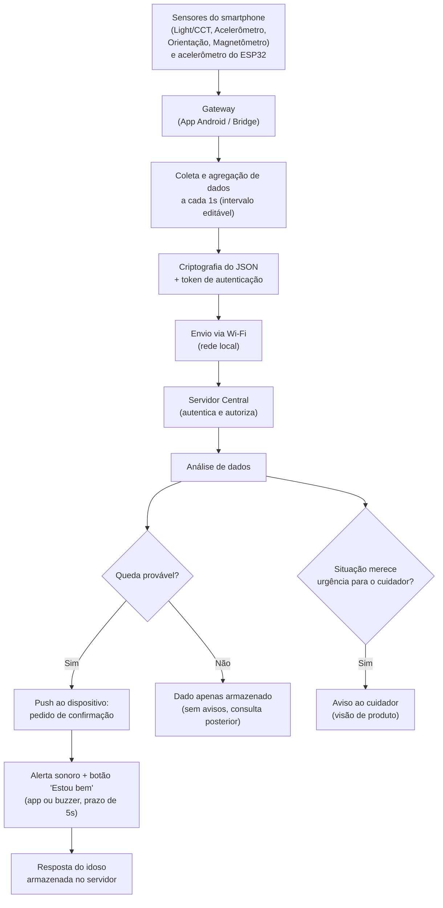

# Software para Sistemas Ubíquos

## Análise inicial de um sistema ubíquo

**Cenário escolhido:** Monitoramento e assistência a uma pessoa idosa

---

## Parte 1 - Compreensão do problema

### 1. Problema e usuários

Idosos que vivem sozinhos ou com supervisão apenas parcial estão sujeitos a riscos que muitas vezes passam despercebidos no dia a dia: quedas, longos períodos de imobilidade, alterações na rotina e exposição à luz em horários inadequados, o que pode prejudicar o sono e o bem-estar geral. O sistema pretende **perceber discretamente sinais do ambiente e do comportamento do idoso**, apoiando tanto a autonomia da pessoa quanto a tranquilidade de quem cuida dela.

- **Usuário primário:** a pessoa idosa monitorada (uso passivo, sem necessidade de interação direta).
- **Usuário secundário:** cuidadores e/ou familiares, que recebem informações e, futuramente, alertas.
- **Situação de uso:** ambiente residencial, com um smartphone Android atuando como coletor de dados, permanecendo fixo ou próximo ao idoso durante o dia.

---

## Estado atual do protótipo

O protótipo tem um APK que extrai dados de sensores que **não exigem permissão especial** e os envia para um servidor na mesma rede local, **a cada 1 segundo** (intervalo editável), e uma simulação Wokwi (ESP32 + acelerômetro) ligada ao mesmo servidor por uma ponte. O APK mais recente está disponível [aqui](https://github.com/UFG-INF-SSU-2026/Flow/releases/latest).

O projeto evolui por marcos, cada um registrado em `docs/`:

| Marco | O que entregou | Documento |
| --- | --- | --- |
| 2 | Ciclo produtor → consumidor: dispositivo (app/wokwi) → gateway → servidor, com regras de decisão | `docs/arquitetura.md` |
| 3 | **Autenticação, autorização e envio de mensagens do servidor** (servidor analisa → envia ao dispositivo) | `docs/arquitetura.md`, `docs/schemas.md` |

Os formatos de dados (versão 3) estão em `docs/schemas.md` e o passo a passo para rodar tudo, incluindo os testes automatizados do servidor (pytest), está em `INSTRUCOES.md`. Este README descreve o sistema no estado do Marco 3.

Os sensores dos quais já foram obtidos dados são:

| Sensor | O que faz (resumo) |
| --- | --- |
| **TCS3701 Light** | Mede a intensidade de luz ambiente (luminosidade). |
| **TCS3701 Light CCT** | Mede a temperatura de cor da luz ambiente (luz "fria" ou "quente"). |
| **LIS2DLC12 Accelerometer** | Mede aceleração do dispositivo nos três eixos; indica movimento. |
| **Device Orientation Wake Up** | Detecta mudanças de orientação que "acordam" o sensor; indica manuseio do aparelho. |
| **Samsung GeoMagnetic Rotation Vector Sensor** | Combina acelerômetro e magnetômetro para calcular orientação absoluta do dispositivo. |
| **Samsung Orientation Sensor** | Fornece a orientação do dispositivo (ângulos de rotação). |
| **MXG4300S Magnetometer** | Mede o campo magnético calibrado; apoia o cálculo de orientação. |
| **MXG4300S Magnetometer Uncalibrated** | Mede o campo magnético sem correção de calibração; mesmo uso de apoio à orientação. |

### Terceiro sensor em validação: localização (GPS)

Os dois sensores já incorporados (luz/CCT e movimento) cobrem duas das três dimensões de
contexto que o grupo pretende usar — falta a terceira, localização, já citada como necessária
desde a análise inicial (saber se o idoso está dentro ou fora de casa, para contextualizar a
regra de imobilidade). Diferente dos sensores atuais, o GPS exige permissão especial de
localização no Android, então antes de incorporá-lo ao app real, sua viabilidade está sendo
validada em um protótipo separado (ESP32), simulando a leitura de localização (dentro/fora de
casa) com uma entrada substituta — já que não há hardware de GPS disponível nesse ambiente de
simulação. Essa validação inclui testar como a informação de zona (dentro/fora) deve persistir
por um tempo mínimo antes de ser considerada confiável, evitando que uma leitura instável
suspenda ou reative a regra de imobilidade de forma incorreta.

---

### 2. Contexto

Já é possível perceber, com o protótipo atual, três dimensões de contexto:

- **Ambiente:** luminosidade e temperatura de cor da luz (CCT) do cômodo.
- **Usuário (indireto):** padrões de movimento e orientação, que servem como indício de atividade, imobilidade ou possíveis quedas.
- **Sistema:** orientação e posição do próprio dispositivo, usada como referência para interpretar os dados dos demais sensores.

Ainda faltam dimensões importantes de contexto (localização dentro da casa, sinais vitais, som ambiente), discutidas mais abaixo, na seção "Fase de crescimento do projeto".

### 3. Dispositivos e comunicação

- **Smartphone Android:** concentra os sensores internos, realiza a coleta contínua e, desde o Marco 3, também **recebe do servidor** o pedido de confirmação quando uma queda é suspeitada.
- **ESP32 simulado (Wokwi) + Bridge:** segundo produtor de dados (acelerômetro MPU6050), com um **buzzer** e um botão "Estou bem". O ESP32 só fala serial; a ponte (bridge) faz a comunicação de rede por ele, nos dois sentidos.
- **Servidor local:** dois processos: a **borda** (Servidor 1) recebe os dados, autentica e autoriza quem os envia, grava no banco (PostgreSQL com TimescaleDB) e entrega as mensagens de volta aos dispositivos; a **análise** (Servidor 2, sem banco e escutando só em `127.0.0.1`) analisa o acelerômetro e decide, chamada apenas pela borda. Tudo na mesma rede Wi-Fi.
- **Comunicação de ida (dispositivo → servidor):** HTTPS (TLS), a cada 1 segundo (intervalo editável), dentro da mesma sub-rede, sem exposição à internet nesta fase.
- **Comunicação de volta (servidor → dispositivo):** push por **SSE**. O dispositivo abre a conexão com o servidor e o servidor empurra as mensagens por ela, então nenhum dispositivo precisa abrir porta para receber. No celular o canal só existe enquanto o app está aberto em primeiro plano (limitação assumida, ver `docs/arquitetura.md`, seção 13.2).
- **Persistência, escalabilidade e acesso remoto por cuidadores** continuam fora do alcance desta fase.

> **Nota sobre produção:** o servidor local usado nesta fase de protótipo é uma solução temporária, pensada apenas para validar a viabilidade técnica dentro da mesma rede local. Em um cenário de produção, esse servidor local **seria substituído por um servidor central**, capaz de atender múltiplos idosos/residências, permitir acesso remoto dos cuidadores (fora da rede local) e resolver as questões de persistência e escalabilidade ainda não tratadas nesta fase.

### 4. Processamento e resposta

A ideia central é que um **servidor central use os dados dos sensores para gerar algum tipo de informação ou ação**. Atualmente o processamento é centralizado no servidor local, que recebe os dados brutos, e já é possível esboçar respostas de valor a partir deles:

- **Recomendação sobre iluminação noturna**, a partir do sensor **TCS3701 Light / CCT**: ao medir a temperatura de cor da luz do quarto no início da noite, o sistema pode identificar se o ambiente está com luz "fria" (alta CCT, rica em luz azul), o que **inibe a produção de melatonina** e prejudica o sono do idoso.
- **Indício de atividade/queda**, a partir do acelerômetro **LIS2DLC12** e dos sensores de orientação (**Device Orientation Wake Up**, **Orientation Sensor**, **Rotation Vector**): variações bruscas seguidas de imobilidade prolongada e mudança de orientação (por exemplo, o dispositivo passando de vertical para horizontal de forma abrupta) são indícios indiretos de queda ou de longos períodos parado no mesmo lugar.
- **Contexto de uso do dispositivo**, a partir do **Device Orientation Wake Up**: indica quando o aparelho é manuseado, o que pode servir como proxy de interação/atividade do idoso com o ambiente.

As ações (atuações) previstas pelo grupo são:

- **Pedir confirmação ao idoso (Marco 3, foco no acelerômetro):** se o servidor concluir que o idoso provavelmente caiu (impacto seguido de imobilidade, ou imobilidade prolongada), ele envia uma mensagem solicitando confirmação. No **Wokwi**, isso aciona um buzzer, silenciado pelo botão "Estou bem"; no **celular**, toca um alerta sonoro e aparece o botão "Estou bem". O botão tem **tempo limite de 5 segundos** (configurável em um único ponto do servidor). A resposta do idoso, ou a falta dela, é **recebida e armazenada pelo servidor**; o que fazer com ela depois ainda não foi decidido.
- **Avisar o cuidador** caso alguma informação obtida pelo sistema mereça ser informada (por exemplo, um possível indício de queda ou uma condição de luz inadequada à noite). Hoje isso é a gravação de um alerta no banco (e de um arquivo, na transição); ainda não existe um app do cuidador.

Outras ações poderão ser adicionadas futuramente.

> **Conclusão de viabilidade:** mesmo restrito a sensores sem permissão especial, o protótipo já demonstra viabilidade técnica — os dados coletados (especialmente luz/CCT e movimento) sustentam recomendações e indícios relevantes para o cuidado do idoso, validando a ideia antes de investir em sensores mais sensíveis.

### 5. Risco principal

O risco escolhido pelo grupo para ser priorizado é a **segurança dos dados**. Como o sistema lida com informações que revelam rotina, hábitos e possíveis condições de saúde do idoso, a segurança no transporte e armazenamento desses dados é tratada como prioridade em relação aos demais riscos identificados (confiabilidade/completude dos dados e consumo de energia/bateria).

O projeto combina quatro mecanismos de segurança:

- **TLS em todas as pontas** (dispositivos ↔ servidor, borda ↔ análise, borda ↔ banco), com uma CA própria do projeto que assina o certificado de cada serviço, e em que cada cliente confia só nela.
- **Criptografia** (AES-256-GCM) de cada mensagem trocada com o servidor, nos dois sentidos, inclusive o push, por cima do TLS.
- **Autenticação (Marco 3):** todo dispositivo entra com uma conta (login com senha, token de curta duração e renovação), em vez de apenas conhecer a chave de criptografia.
- **Autorização (Marco 3):** cada conta tem um papel (hoje `idoso` e `dispositivo`; `cuidador` já reservado) e só envia ou recebe dados da **pessoa monitorada a que está vinculada**. O servidor confere a identidade pelo token, não pelo que o dispositivo declara. Rotas de depuração que expunham dados de todos exigem conta administrativa.
- **Proteções do servidor (Marco 3):** negações (`401`/`403`) e corpos acima de 64 KiB (`413`) são registrados no log, sem o conteúdo da requisição; tentativas repetidas de login levam a bloqueio temporário.

Limitações assumidas: a chave de criptografia continua **compartilhada e fixa**, e a CA do projeto não tem rotação automática nem revogação (quem tem a chave de um serviço se passa por ele). Chave por dispositivo, autoridade gerenciada e rotação ficam como evolução (`docs/arquitetura.md`, seção 13.2).

Vale notar que, mesmo com a comunicação restrita à rede local (sem exposição à internet nesta fase), dados de movimento e uso do dispositivo, ainda que indiretos, revelam rotina e hábitos do idoso — o que reforça a necessidade de cuidado com o armazenamento e o acesso a esses dados.

---

## Elementos já identificáveis (Parte 2)

### Sensores, atuadores e gateway

| Elemento | Itens identificados | Papel no sistema |
| --- | --- | --- |
| **Sensores** | TCS3701 Light / CCT, LIS2DLC12 Accelerometer, Device Orientation Wake Up, Orientation Sensor, GeoMagnetic Rotation Vector, Magnetometer (calibrado e não calibrado); no Wokwi, acelerômetro MPU6050 | Percebem luminosidade, cor da luz, movimento e orientação, formando a base de contexto do sistema |
| **Atuadores** | Alerta sonoro + botão "Estou bem" no app; buzzer + botão "Estou bem" + LEDs no Wokwi; aviso ao cuidador | Pedir confirmação ao idoso quando uma queda é suspeitada; notificar o cuidador quando o servidor identificar uma informação relevante |
| **Gateway** | O smartphone Android (para os sensores do celular) e o `Bridge` (para o ESP32 simulado) | Encaminham os dados ao servidor local via Wi-Fi, a cada 1s, e recebem as mensagens que o servidor envia de volta |

### Classificação

O sistema pode ser caracterizado, nesta fase, como:

- **IoT (Internet das Coisas):** o smartphone atua como dispositivo conectado que envia dados continuamente a um servidor via rede.
- **Aplicação ubíqua:** o sensoriamento é contínuo e não exige interação explícita do idoso, integrando-se de forma discreta à rotina.

Com o Marco 3, o sistema passa a **fechar o laço de percepção → decisão → atuação**: o servidor analisa o movimento e aciona um alerta sonoro (buzzer ou celular) para o idoso, que responde pelo botão. Isso o aproxima de um **sistema ciber-físico**. O aviso ao cuidador ainda não tem canal real de notificação.

### Contexto e adaptação

- **Mudança de contexto:** transição dia/noite (variação de luminosidade e CCT) e transição atividade/imobilidade prolongada.
- **Adaptação esperada:** ao anoitecer, o sistema poderá priorizar o monitoramento de CCT e sugerir ajuste de iluminação; ao detectar imobilidade fora do padrão (ex.: parado por muito tempo em horário normalmente ativo), poderá aumentar a frequência de amostragem do acelerômetro para confirmar se é um possível caso de queda antes de gerar qualquer alerta.

### Fluxo do sistema

O diagrama abaixo representa a modelagem do fluxo do sistema em produção, desde a coleta dos dados nos sensores até a confirmação do idoso e o eventual aviso ao cuidador:

O trecho **Servidor → push → alerta no dispositivo → resposta armazenada** é novo no Marco 3. O trecho do aviso ao cuidador é visão de produto: hoje o servidor apenas grava o alerta no banco.

---

## Fase de crescimento do projeto

**Importante: tudo o que está listado nesta seção são apenas ideias.** Nada aqui foi implementado, nem teve sua viabilidade averiguada — são apenas cenários que o grupo conseguiu observar como possíveis caminhos futuros. O fato de terem sido pensados **não significa que serão implementados**.

Os sensores usados até agora foram escolhidos por não exigirem permissão especial no Android, o que permitiu validar rapidamente a viabilidade técnica do projeto. Para cobrir cenários mais críticos de assistência ao idoso, os seguintes caminhos estão sendo pensados (sem compromisso de implementação):

- **Microfone**, para detecção de sons de queda ou pedidos de ajuda;
- **Contador de passos/giroscópio dedicado**, para refinar a detecção de atividade.

Além disso, está sendo pensada a possibilidade de incorporar dados de uma **pulseira que o idoso usaria** (ex.: sensores de frequência cardíaca, oximetria, etc.). Como o grupo **não viabiliza, em hipótese alguma, a compra de sensores/dispositivos** para a realização do trabalho, todos os dados vindos dessa pulseira seriam **mockados (gerados aleatoriamente) dentro de um limite pré-estabelecido**, apenas para simular esse cenário e permitir explorar a ideia sem depender de hardware real.
