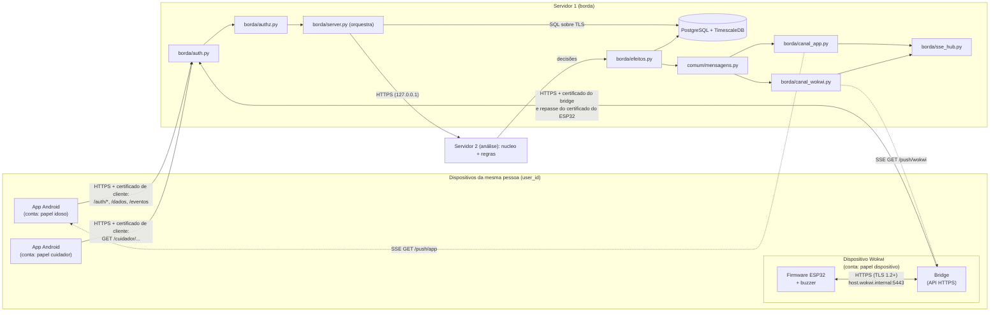
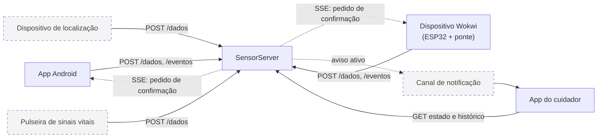
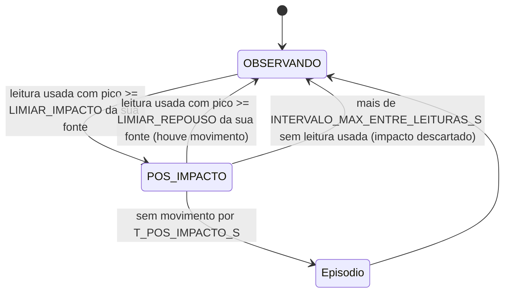
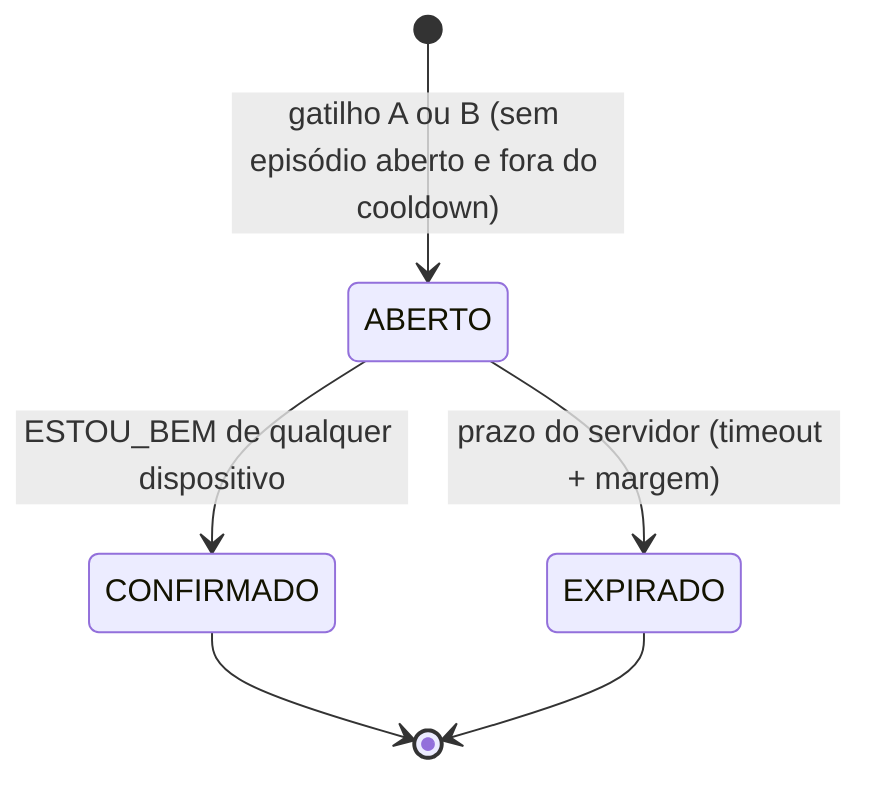
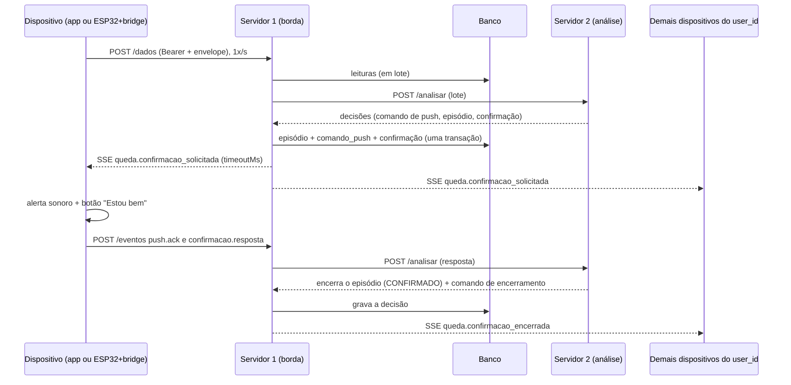

# Arquitetura Geral — Flow

**Disciplina:** Software para Sistemas Ubíquos
**Cenário do projeto:** Monitoramento e assistência a uma pessoa idosa (análise inicial em `docs/analise-inicial.md`)

Este documento é o registro **único e versionável** das decisões de arquitetura do projeto Flow: os componentes envolvidos, o fluxo de comunicação entre eles, a responsabilidade de cada parte, o mecanismo de comunicação escolhido (e por que outros foram descartados) e as condições de falha já consideradas. Ele cobre tanto a visão **geral** (o que vale independentemente de qual protótipo está em campo) quanto o **estado atual do protótipo** (o que já está de fato implementado no código deste repositório).

---

## 1. Cenário e atores

- **Usuário primário:** a pessoa idosa monitorada. Uso passivo: o sistema só pede interação quando suspeita de uma queda.
- **Usuário secundário:** cuidadores e familiares, que acompanham pelo app o estado e o histórico das pessoas vinculadas (papel `cuidador`).
- **Situação de uso:** ambiente residencial, com um ou mais dispositivos junto ao idoso coletando dados continuamente.

O sistema é **IoT** (dispositivos conectados enviando dados continuamente a um servidor) e **ubíquo** (sensoriamento contínuo, sem interação explícita do idoso no uso normal).

- **Concreto:** o laço **percepção → decisão → atuação** está fechado. O servidor analisa o movimento, decide que uma queda é provável, aciona avisos no próprio idoso (alarme, vibração, lanterna, voz e notificação no celular; buzzer e LEDs no ESP32), que responde por um botão, e registra o alerta, que o cuidador vê no app.
- **Abstrato:** o aviso **ativo** ao cuidador (notificação no momento do episódio), novos sensores (sinais vitais) e outras ações de atuação.

Pelo laço concreto o sistema se aproxima de um **sistema ciber-físico**; o efeito completo sobre o cuidador depende da parte abstrata.

---

## 2. Componentes

### 2.1 Papéis lógicos

| Elemento | Papel | Concreto (existe) | Abstrato (visão) |
| --- | --- | --- | --- |
| **Sensores** | Percebem o ambiente e o comportamento do idoso | Luz/CCT, acelerômetro, localização (celular); acelerômetro MPU6050 (ESP32 simulado) | Sinais vitais (pulseira, dados mockados), microfone para sons de queda |
| **Produtor / gateway** | Concentra um ou mais sensores, monta o evento, cifra e envia ao servidor. Também é **consumidor**: recebe do servidor os pedidos de confirmação | App Android; dispositivos simples (Wokwi, ESP32, Arduino) por meio do `Bridge`, cada um com a sua conta | Dispositivo dedicado por sensor não coberto pelo celular (ex.: localização) |
| **Servidor central** | Autentica, autoriza, valida, agrega, decide e envia mensagens de volta | `SensorServer`: um único ponto lógico de consumo, com visão consolidada por pessoa | Atender mais de uma residência (servidor assíncrono, estado externo), **mantendo a topologia em estrela** |
| **Atuadores** | Produzem efeito observável a partir de uma decisão | Alarme, vibração, lanterna, voz, notificação e botão "Estou bem" (app); buzzer, LEDs e botão (Wokwi); alerta registrado e visível ao cuidador no app | Notificação ativa ao cuidador; outras ações |

Cada pessoa monitorada pode ter **mais de um produtor simultâneo** (por exemplo, o celular para luz/movimento e um dispositivo dedicado para localização), todos ligados à mesma pessoa pelo `user_id` da conta com a qual autenticaram.

### 2.2 Componentes concretos

Há dois tipos de cliente do servidor, cada dispositivo com a sua conta: o **app Android** e os **dispositivos simples** (o ESP32 simulado em `sketch/`, placas, simuladores em software). Os dispositivos simples não falam direto com o servidor: chegam a ele pelo **`Bridge/`**, um repassador HTTPS **fino** que serve **vários dispositivos ao mesmo tempo** e não guarda estado. Quem faz o login, guarda os tokens, cifra as mensagens e pede o certificado de cliente é o **próprio dispositivo**. Para o servidor, cada dispositivo é uma conta, um `deviceId` e um conjunto de eventos; o bridge é só o meio pelo qual ele os alcança. O app Android não usa o bridge.

| Pasta | Componente | Responsabilidade |
| --- | --- | --- |
| `SensorApp/` | App Android (Kotlin) | Um só APK para dois papéis. **Idoso:** produtor real (sensores do celular), envia telemetria, mantém o canal de push num serviço em primeiro plano e exibe o pedido de confirmação. **Cuidador:** consulta o estado e o histórico das pessoas vinculadas. Nos dois, obtém a CA do servidor no login, faz login e pede o próprio certificado de cliente. |
| `sketch/` | Dispositivo Wokwi: firmware ESP32 (`sketch.ino` e `transporte_wifi.h`, simulado no Wokwi para VS Code) | Acelerômetro MPU6050, máquina de imobilidade local, buzzer e botões. Fala **só HTTPS**, direto com a API do bridge, pelo WiFi simulado; não há serial para a rede. |
| `Bridge/` | Repassador HTTPS fino (`bridge.py`, `api.py`) | Expõe uma API HTTPS com seis rotas fixas, exige o certificado de cliente do dispositivo nas protegidas e repassa tudo à borda sem ler, cifrar, traduzir nem guardar nada (sem conta, sem token, sem sessão). O firmware do Wokwi a usa direto; não há adaptador em software nem serial. |
| `SensorServer/` | Servidor (Flask) | Módulos abaixo. |

O sistema tem **três partes**: os **dispositivos** (app e Wokwi), o **Servidor 1 — a borda** (`python -m borda`) e o **Servidor 2 — a análise** (`python -m analise`). Só a borda fala com o mundo: autentica, valida, grava no banco, entrega o push e responde às consultas. A análise **só decide** (queda, imobilidade, luz): não tem banco, não tem credencial de dispositivo, não entrega nada e escuta só em `127.0.0.1`. **A borda é o único cliente da análise** (HTTPS local com token compartilhado). **Toda comunicação é cifrada com TLS, em todas as pontas** (dispositivos ↔ borda, borda ↔ análise, borda ↔ banco), com a CA própria do projeto (seção 5); nenhuma ponta fala em texto claro, nem em `127.0.0.1`. Um só `.env`; a análise copia dele apenas as variáveis `FLOW_ANALISE_*` e `FLOW_TLS_*` (caminhos da CA, do certificado e da chave). `python -m borda.server` sobe a mesma borda, sem desligamento ordenado, para desenvolvimento (com `FLOW_DB_FAKE=1`, sem Docker).

Módulos do servidor (pacotes em `SensorServer/`):

| Arquivo | Responsabilidade |
| --- | --- |
| **`borda/`** | Servidor 1: único com porta de rede, banco, segredos de transporte e contas. |
| `borda/server.py` | Rotas; ingestão (aceita e põe a leitura numa fila limitada); thread de descarga (grava `leituras` em lote, manda o lote à análise e aplica as decisões); thread do vigia; thread da retenção (apaga o histórico antigo das tabelas comuns, de hora em hora); rotas do cuidador; entrega da CA (`/auth/ca`); `/estado`, `/dados` (debug) e `/health`. Executa com `python -m borda`. |
| `borda/cliente_analise.py` | Cliente da API da análise (`/analisar`, `/vigiar`, `/restaurar`), por HTTPS e confiando só na CA do projeto: prazo curto, detecta análise fora do ar e `boot_id` novo (análise reiniciada) e manda o estado de volta antes de seguir. |
| `borda/efeitos.py` | Aplicar as decisões: grava confirmações, alertas, estado e, por fim, episódio + comando numa transação; só depois do commit entrega o push (SSE, app e wokwi). Se o banco falha, guarda as decisões e tenta de novo. |
| `borda/servico.py` | Ponto de entrada da borda (`python -m borda`): serve só HTTPS em `FLOW_BORDA_HOST:FLOW_BORDA_PORT` (padrão `0.0.0.0:5000`, todas as interfaces; sem certificado ou sem a CA de dispositivos não sobe), mostra na subida o IP para usar no app (os IPs de rede do certificado da borda), subida e desligamento ordenado. |
| `borda/const.py` | Constantes da borda (porta, tokens, bloqueio de login, limite de corpo, SSE, filas, chamada à análise). Ver 14. |
| `borda/auth.py` | **Autenticação:** contas, senhas, login, refresh, emissão e verificação de tokens (contas e sessões nas tabelas `contas` e `sessoes` do banco, pelo repositório recebido por parâmetro). Não conhece Flask. CLI: `python -m borda.auth criar-conta` (exige o banco no ar). |
| `borda/authz.py` | **Autorização:** papel → permissões e escopo por pessoa; a negação vai para o log (rota, motivo, conta, IP; nunca o conteúdo). |
| `borda/validacao.py` | Validação **estrutural** dos corpos, pelos contratos de `schemas/`. |
| `borda/sse_hub.py` | Mecanismo comum de push por SSE: conexões, fila limitada por conexão, keepalive, replay. |
| `borda/canal_app.py` | **Servidor → app.** Rota `GET /push/app` e envio ao alvo `app`. |
| `borda/canal_wokwi.py` | **Servidor → Wokwi.** Rota `GET /push/wokwi` e envio ao alvo `wokwi`. |
| `borda/tempo.py` | Único ponto de leitura do relógio na borda (`tempo.agora_utc()`): o instante da ingestão e o relógio do vigia. Os testes o congelam (fixture `relogio`). |
| `borda/crypto_utils.py` | Envelope AES-256-GCM. |
| `borda/emissao.py` | **Certificado de dispositivo.** Valida o CSR (EC P-256, ECDSA-SHA256, assinatura própria conferida) e emite o certificado de cliente (`clientAuth`, 7 dias, `CN` = `device_id` e `OU` = conta do token) com a CA de dispositivos. Rota `POST /auth/certificado`, para os papéis com fonte (`idoso`, `dispositivo`, `cuidador`). Também confere o certificado de cliente de cada conexão: direto (app) ou repassado pelo bridge (ESP32). Sem a chave da CA, `503` e o resto da borda segue. |
| **`analise/`** | Servidor 2: decide. Sem banco, sem segredo de transporte; não importa a borda nem `flow_db`. |
| `analise/api.py` | A API HTTP e o estado em memória: `POST /analisar`, `POST /vigiar`, `POST /restaurar`, `GET /saude`, todas com o cabeçalho `X-Flow-Analise-Token`. Cada resposta traz o `boot_id` da subida. Item mais velho que `IDADE_MAX_ACAO_S` só reconstrói estado, sem push. |
| `analise/servico.py` | Ponto de entrada da análise (`python -m analise`), servindo HTTPS em `127.0.0.1:FLOW_ANALISE_PORT` (5100). |
| `analise/nucleo.py` | **Núcleo das regras:** `Leitura`/`Resposta` entram, `Decisoes` saem. Sem relógio global, sem I/O, sem thread; o estado é um `EstadoRegras` explícito (`PADRAO` = tabelas dos módulos de regra; `novo_estado()` = mundo limpo). O vigia é um passo à parte (`nucleo.vigiar`). |
| `analise/regra_queda.py` | Fusão das fontes por usuário, episódios de confirmação, timeout, mapa `messageId` → episódio, registro da resposta. |
| `analise/regra_luz.py`, `analise/regra_imobilidade.py` | Regras de negócio (luz inadequada à noite; imobilidade prolongada). |
| `analise/const.py` | Constantes da análise (limiares, janelas, cooldown, retenções, idade máxima para agir). Ver 14. |
| **`comum/`** | O que os dois lados partilham: constantes comuns e carregador do `.env` (`const.py`), contratos (`schemas.py`, `contratos.py`), mensagem de push (`mensagens.py`) o **contrato da análise** (`contrato_analise.py`: `Leitura`, `Resposta`, `Decisoes` e o seu JSON, com ida e volta) e o **TLS** (`tls.py`: caminhos da CA, do certificado e da chave, contexto HTTPS do servidor, recusa de URL que não seja `https://`). |
| **`flow_db/`** | Só a borda a usa (conexão sempre com TLS, `verify-full`): `Repo` (interface única), `Pg` (PostgreSQL; `leituras` é hypertable do TimescaleDB), `BancoFalso` (memória, para testes e `FLOW_DB_FAKE=1`), uma migração (`0001_base.sql`), CLI `python -m flow_db migrar|status`. |
| `scripts/gerar_certificado.py` | Cria a CA do projeto (`ca.crt`, `ca.key`) e a CA de dispositivos (`ca-dispositivos.*`, nunca recriada pelo script) e emite os certificados da borda, da análise e do banco (e `--nome <x>` para outros; o `bridge` sai também com `clientAuth`) em `certs/` (fora do Git); copia o `ca.crt` para o app e gera `sketch/ca_flow.h`. Idempotente; reemite só o certificado da borda quando o IP de rede muda; `--forcar` reemite os certificados de serviço sem trocar a CA, `--forcar-ca` recria a CA, `--ip` acrescenta um endereço. Detalhes em `docs/operacao.md`. |
| `simular_queda.py` | Utilitário (exige borda e análise rodando): faz login, pede o certificado de cliente e simula um wokwi que sofre impacto e fica imóvel. |
| `tests/` | Suíte pytest (`unit/`, `integration/` e `banco/`); ver 14.1. |

Dependências: a **borda** não importa a análise (fala com ela por HTTPS) e a **análise** não importa a borda nem `flow_db`; `comum/` e `flow_db/` não importam nenhum dos dois (conferido por `tests/unit/test_fronteiras.py`). `canal_*` não conhecem `regra_queda`; `regra_queda` não conhece os canais, `regra_imobilidade` nem `mensagens` (devolve um `PedidoConfirmacao`; o `nucleo.py` monta a mensagem e a `borda/efeitos.py` entrega). `nucleo.py` importa as regras, `comum.mensagens` e `comum.contratos`; nenhuma regra importa o núcleo; `auth` não conhece Flask. Os três `const` (`comum`, `borda`, `analise`) são módulos folha (só o comum lê o `.env`), e os demais fazem `from <pacote> import const as const_<pacote>` e leem `const_<pacote>.X` na hora do uso, de modo que um único ajuste vale para todos os pontos de uso.

### 2.3 Elementos abstratos (visão do sistema)

Ainda sem implementação. Cada um é descrito pelo papel e pelo ponto em que se encaixa na arquitetura concreta.

| Elemento *(abstrato)* | Papel previsto | Ponto de encaixe |
| --- | --- | --- |
| Aviso ativo ao cuidador | Avisar o cuidador no momento do episódio (hoje ele consulta pelo app) | Serviço cliente da borda que lê o histórico do cuidador; receita em `docs/notificacao-cuidador.md`. |
| Dispositivo de localização | Produtor dedicado, para sensor que o celular não cobre | Novo `source`; segue o contrato mínimo de qualquer produtor (6.1). |
| Pulseira de sinais vitais | Frequência cardíaca e oximetria (dados mockados) | Idem. |

---

## 3. Topologia e sentidos de comunicação



- **Ida (dispositivo → servidor):** `POST` HTTPS. Telemetria em `/dados`; eventos discretos (ack e resposta do idoso) em `/eventos`.
- **Volta (servidor → dispositivo):** push por **SSE** (por que SSE, e não WebSocket nem MQTT: seção 10.5). O **dispositivo abre** a conexão (`GET`) e o servidor empurra mensagens por ela. Nenhum dispositivo expõe porta; o servidor nunca precisa conhecer o endereço de um dispositivo.
- **Borda e análise:** o Servidor 1 chama o Servidor 2 por HTTPS local (`/analisar`, `/vigiar`, `/restaurar`); o Servidor 2 nunca chama ninguém e nunca vê o banco. O banco é só do Servidor 1, e a conexão com ele é TLS.
- **Estrela:** cada dispositivo fala com o servidor (a borda); não há nível de decisão entre dispositivos e servidor. Os dispositivos simples chegam ao servidor pelo Bridge, um repassador **sem estado**: sessão, tokens, envelope e certificado são do próprio firmware. Ele existe porque a borda fecha a conexão a cada resposta e um handshake TLS no ESP32 simulado custa cerca de 3,2 s: o bridge mantém aberta a conexão TLS do dispositivo e serve vários dispositivos por uma porta só. O app fala direto com a borda.

### 3.1 Sistema completo (concreto e abstrato)

Contorno contínuo: concreto. Contorno tracejado: abstrato.



As setas tracejadas entre `SensorServer` e os dispositivos concretos são o push SSE (conexão aberta pelo dispositivo); só os três blocos de contorno tracejado e suas setas são abstratos.

---

## 4. Identidade, autenticação e autorização

### 4.1 Contas e papéis

Tudo que se conecta ao servidor é uma **conta** com `papel`, `user_ids` (pessoas monitoradas a que se refere), `fontes` permitidas (`app`, `wokwi`) e, no papel `dispositivo`, a lista de `device_ids` que o login dela pode declarar.

| Papel | Quem usa | Fonte | Observação |
| --- | --- | --- | --- |
| `idoso` | App do idoso | `app` | Exatamente um `user_id`. O `device_id` é **obrigatório** no login, mas livre (sem lista): o app o envia sempre. |
| `dispositivo` | Firmware do ESP32 (faz o próprio login; a ponte só repassa) | `wokwi` | Exatamente um `user_id` e **ao menos um `device_id` permitido** (`--device-id`, repetível, só neste papel). |
| `admin` | Operação/depuração | — | Lê `GET /dados` e `GET /estado/<id>`. |
| `cuidador` | App do cuidador (mesmo APK) | `app` | Um ou mais `user_ids` (as pessoas que acompanha). `device_id` **obrigatório** no login, como o do idoso, porque vai no certificado de cliente. Só lê estado e histórico dessas pessoas. |

O `user_id` é uma consequência da conta: não é digitado no app nem no bridge. Dois produtores da mesma pessoa têm contas apontando para o mesmo `user_id`, e é isso que faz o servidor agregá-los (4.4).

### 4.2 Login e tokens

- **Senhas:** `scrypt` com sal por conta, comparação em tempo constante. Contas criadas por CLI (`python -m borda.auth criar-conta ...`, com `--device-id` para o papel `dispositivo`); não há auto-cadastro. Gravadas na tabela `contas` do banco; nenhum arquivo de dados fica em disco.
- **`POST /auth/login`** (corpo em envelope cifrado): `identificador`, `segredo`, `fonte`, `device_id`. Resposta (também cifrada): `access_token`, `refresh_token`, `expires_in`, `papel`, `user_ids`. A senha nunca trafega em claro. **Quem julga o login é sempre o servidor**: a ponte só repassa o login que o firmware montou e não guarda conta nem decide nada. O servidor confere o hash do segredo, a fonte da conta, o papel e, só então, o `device_id`: para `idoso`, `dispositivo` e `cuidador` ele é **obrigatório** (ausente: `400`, `device_id_obrigatorio`); para `dispositivo` precisa ainda estar na lista da conta (senão `403`, `device_nao_permitido`). Os dois só são avaliados com a senha certa e **não contam como falha de senha**; só o `admin` pode omitir `fonte` e `device_id`. O token carrega o `device_id` aceito.
- **Access token:** JWT HS256, validade padrão 1 h; claims `sub`, `papel`, `user_ids`, `fonte`, `device_id`, `iat`, `exp`, `jti`. Enviado em `Authorization: Bearer`.
- **Refresh token:** opaco, validade padrão 7 dias, **uso único** (rotativo). O servidor guarda só o hash, na tabela `sessoes` do banco, de modo que reiniciar o servidor não derruba as sessões. O consumo é atômico (`DELETE ... RETURNING`) e, no refresh, acontece na mesma transação que grava o par novo: se o banco falhar no meio, a sessão não se perde.
- **Bloqueio:** 5 falhas em 15 minutos para o mesmo identificador bloqueiam novas tentativas por 15 minutos (`429`). A resposta é idêntica para conta inexistente e senha errada. O contador é **por conta**, nunca por IP (todos os dispositivos de uma ponte chegam do mesmo IP). Risco registrado: quem erra a senha de uma conta várias vezes bloqueia aquele dispositivo por um tempo; o dano fica limitado a ele.
- **Segredo de assinatura:** variável `FLOW_JWT_SECRET` (mínimo 32 bytes). Sem ela o servidor não sobe.

### 4.3 Autorização

RBAC com escopo por pessoa, **negando por padrão**.

| Permissão | `idoso` | `dispositivo` | `admin` | `cuidador` |
| --- | --- | --- | --- | --- |
| `dados:enviar` (`POST /dados`) | sim, fonte `app` | sim, fonte `wokwi` | não | não |
| `eventos:enviar` (`POST /eventos`) | sim | sim | não | não |
| `push:receber` (`GET /push/...`) | sim, canal `app` | sim, canal `wokwi` | não | não |
| `dados:ler`, `estado:ler` (`GET`) | não | não | sim | não |
| `certificado:emitir` (`POST /auth/certificado`) | sim | sim | não | sim |
| `cuidador:ler` (`GET /cuidador/...`) | não | não | não | só pessoas vinculadas |

Dois estágios de verificação:

1. **Papel e permissão**, antes de decifrar o corpo (decorador `exige(permissao, fonte=...)`): token válido, papel com a permissão, fonte do token igual à exigida e, para todo token com fonte, **certificado de cliente** cuja conta e `device_id` sejam os do token (seção 5). Falha → `401` ou `403` (`certificado_ausente`, `certificado_incompativel`).
2. **Escopo**, depois de decifrar: `user_id` do payload deve estar em `token.user_ids`, `source` deve ser a `fonte` do token e o `device_id`/`deviceId` do payload, se declarado, deve ser o `device_id` do token (o do login; o bridge usa o `deviceId` do firmware). Falha → `403`. O `device_id` **gravado** em `/dados` e `/eventos` é sempre o do token: um payload sem `deviceId` é aceito e recebe o do token (não existe mais o `device_id` inventado a partir do `user_id`). Falha → `403`. Payload **sem** `source` válido (ausente ou fora de `app`/`wokwi`) é recusado com `400` antes da checagem de escopo, em `/dados` e em `/eventos`: nenhum caminho aceita dado ou evento sem `source`. `source` presente e diferente da fonte do token é `403`. O `user_id` precisa ser um número inteiro JSON; string (mesmo só de dígitos), booleano, decimal, `null` ou ausente é `400`. Esse estágio existe porque o `user_id` está dentro do envelope cifrado.

Nos canais SSE o escopo é implícito: a conexão é registrada no `user_id` do token; o cliente não escolhe de quem recebe.

**Matriz por rota** (conferida contra as rotas da borda):

| Rota | Quem pode | Papel / fonte / escopo |
| --- | --- | --- |
| `POST /auth/login` | Anônimo, com credencial no corpo cifrado | Bloqueio por conta (`429`); banco fora: `503` |
| `POST /auth/refresh` | Quem tem refresh token válido | Uso único; banco fora: `503` |
| `POST /auth/certificado` | Token de `idoso`, `dispositivo` ou `cuidador` (sem certificado) | Identidade do certificado vem do token |
| `POST /auth/ca` | Anônimo, com credencial no corpo cifrado | Devolve a CA pública; mesmo bloqueio do login |
| `POST /dados`, `POST /eventos` | `idoso` (fonte `app`) e `dispositivo` (fonte `wokwi`) | `user_id` e `source` conferidos com o token; `device_id` gravado é o do token (corpo divergente: `403`) |
| `GET /push/app` | `idoso` | Só o `user_id` do token |
| `GET /push/wokwi` | `dispositivo` | Só o `user_id` do token |
| `GET /cuidador/<user_id>/estado`, `/historico` | `cuidador` | Só os `user_ids` do token (`403 fora_de_escopo`); sem localização |
| `GET /dados` | **Só `admin`** | Depuração; inclui localização, quando houver (13.3) |
| `GET /estado/<device_id>` | **Só `admin`** | Procura em todos os usuários |
| `GET /health`, `GET /` | Anônimo | Sem dado pessoal (as únicas rotas abertas, além do login) |
| Análise: `/analisar`, `/vigiar`, `/restaurar`, `/saude` | **Só a borda**, com `X-Flow-Analise-Token` | Comparado em tempo constante; qualquer outro chamador: `401` |
| Banco | A borda e o operador | TLS `verify-full` |

### 4.4 Um idoso com celular e Wokwi (caso de uso principal)

Duas contas com o **mesmo `user_id`**: `idoso1` (papel `idoso`, fonte `app`, `device_id` obrigatório e livre) e `bridge1` (papel `dispositivo`, fonte `wokwi`, com a lista de `device_ids`). Consequências:

- **a)** A máquina de queda é **uma por usuário** e funde as duas fontes (9.2.1).
- **b)** O estado das regras é por `(user_id, device_id)`: o celular e o Wokwi não colidem.
- **c)** O pedido de confirmação é publicado nos **dois** canais (`/push/app` e `/push/wokwi`) e a resposta de qualquer um encerra o episódio.
- **d)** A falha de um canal não impede o outro.
- **e)** O `device_id` do firmware precisa estar na lista da conta; senão o login leva `403`.

O hub SSE entrega por `(user_id, canal)`. Duas contas `dispositivo` com `user_id` diferentes nunca recebem o comando uma da outra; vários `device_ids` na **mesma** conta (mesmo `user_id`) compartilham os comandos. Para isolar simulações, use uma conta e um `user_id` por simulação.

**Registro das negações:** toda negação (`401`/`403`, e também `413` por corpo grande, com o motivo `corpo_grande`) vai para o log (rota, motivo, conta, IP), nunca o conteúdo da requisição. Não há auditoria em arquivo nem em banco por ora.

---

## 5. Transporte e criptografia

- **HTTPS (TLS 1.2 ou superior) em todas as pontas:** dispositivos ↔ Servidor 1, Servidor 1 ↔ Servidor 2 e Servidor 1 ↔ Banco. Nenhuma ponta de dados fala em texto claro, nem em `127.0.0.1`; há **duas exceções de rede**, descritas em «Exceções fora do HTTPS», ao fim desta lista.
- **CA própria do projeto**, gerada por `python scripts/gerar_certificado.py` (`SensorServer/certs/`, fora do Git): `ca.crt` (pública) e `ca.key` (segredo; só o script a lê, nenhum serviço a usa nem a monta). A CA assina **um certificado por serviço**, cada um com a sua chave: `borda.crt`, `analise.crt` e `banco.crt` (e `<nome>.crt` com `--nome`, p. ex. `bridge`, para uma API HTTPS do bridge). Cada serviço apresenta só o seu; o container do banco monta apenas `banco.crt` e `banco.key`.
- **Os clientes confiam só na CA** (`FLOW_TLS_CA`, padrão `certs/ca.crt`): a borda (para a análise e para o banco, `sslmode=verify-full`, ou `verify-ca` em `FLOW_DB_SSLMODE`), a ponte, o firmware (`sketch/ca_flow.h`) e o app (a CA obtida do servidor no login, importada por arquivo ou, se houver, a cópia embutida `res/raw/flow_cert.pem`; uma só âncora de confiança por vez, com HTTP em texto claro proibido pela configuração de segurança de rede). Os clientes **não** confiam nas autoridades do sistema, e a verificação do certificado e do nome nunca é desligada.
- Cada certificado vale para os nomes e IPs listados nele: o da borda, `localhost`, `127.0.0.1`, `::1`, o IP do computador na rede (detectado) e os de `--ip`/`--dns`; os da análise e do banco, `localhost` e `127.0.0.1`. Cliente que acessa por outro endereço recusa a conexão; a correção é reemitir com `--forcar` e o endereço novo. **Reemitir um certificado de serviço não troca a CA**: o app e a ponte continuam confiando, sem recompilar. O script reemite sozinho o certificado da borda quando o IP de rede muda. Trocar a CA (`--forcar-ca`) exige recompilar o firmware e reemitir os certificados `--nome`; o app busca a CA nova no login.
- **Onde a borda escuta:** só em HTTPS, em `FLOW_BORDA_HOST` (padrão `0.0.0.0`, todas as interfaces, para o app alcançá-la em qualquer rede; `127.0.0.1` restringe ao próprio computador) e `FLOW_BORDA_PORT` (padrão 5000). Na subida, a borda mostra o IP a usar no app. A análise e o banco escutam sempre só em `127.0.0.1`. Não existe listener HTTP em porta nenhuma.
- **Sem proxy reverso, de propósito:** nada fica entre os dispositivos e a borda. A própria borda termina o TLS com o certificado dela e autentica e autoriza cada chamada; um proxy criaria um segundo ponto de terminação, de configuração e de confiança sem ganho para este escopo.
- **Certificado de cliente (mTLS) dos dispositivos:** uma segunda CA, a **CA de dispositivos** (`certs/ca-dispositivos.*`, independente da raiz; só a borda lê a chave), assina um certificado de cliente de 7 dias por dispositivo. O dispositivo começa sem certificado, gera a chave EC P-256 no próprio aparelho e envia só o CSR a `POST /auth/certificado`; a identidade do certificado (conta e `device_id`) vem do token. O **app** apresenta o certificado direto à borda. O **ESP32** o apresenta ao bridge, que termina o TLS dele e, ao chamar a borda, se identifica com o próprio `bridge.crt` (CA raiz, `clientAuth`, `CN=bridge`) e repassa o certificado do dispositivo no cabeçalho `X-Flow-Certificado-Cliente`; a borda só aceita esse cabeçalho de uma conexão do bridge e confere o certificado de novo. Em toda chamada protegida, a borda compara conta e `device_id` do certificado com os do token. Sem rotação automática e sem revogação: a validade curta é a proteção.
- **Envelope AES-256-GCM** em todo corpo, por cima do TLS: `{"nonce": "<base64>", "ciphertext": "<base64>"}` (nonce de 12 bytes aleatório por mensagem, tag de 128 bits ao final do ciphertext).
- O mesmo envelope cifra o **push**: o `data:` de cada evento SSE é um envelope.
- Implementações equivalentes em Python (`borda/crypto_utils.py`, no servidor), Kotlin (`CryptoUtils.kt`, `javax.crypto`) e C++ (`sketch/envelope.h`, mbedTLS do ESP32). O **bridge não cifra nem decifra**: o envelope vai do firmware à borda sem ser aberto. Conferido: `sketch/host_test/verificar_contra_python.py` mostra que, com o mesmo nonce, o firmware produz exatamente o mesmo ciphertext e tag que o Python, e que cada lado decifra o do outro.
- O firmware fala **HTTPS (TLS 1.2+) direto com a API do bridge** (`sketch/transporte_wifi.h`), conferindo o certificado do bridge contra a CA do projeto (`sketch/ca_flow.h`, gerado; a verificação nunca é desligada) e usando `FLOW_BRIDGE_URL`, que precisa ser `https://` (uma URL `http://` **não compila**: `static_assert`). Não há serial para a rede. O firmware **cifra o envelope AES** e faz o próprio login: o segredo da conta mora no firmware e vai só no corpo cifrado do login, por dentro da conexão TLS (nunca é guardado em disco nem impresso na serial); os tokens ficam só em RAM. No caminho, o ESP32 simulado alcança o PC pelo gateway de rede do Wokwi (`host.wokwi.internal`, `[net] gateway` no `wokwi.toml`, o `wokwigw`), que apenas transporta os bytes TLS.

Por que HTTP (agora sobre TLS) e não MQTT, gRPC ou Kafka: o sistema tem um único consumidor lógico, eventos pequenos e periódicos e nenhuma necessidade de replay ou fan-out; HTTP é o menor mecanismo que atende. O volume e o número de consumidores são a premissa que, se mudar, reabre essa decisão; a topologia, mesmo assim, continua em estrela.

---

## 6. Contratos de mensagem

### 6.1 Campos de roteamento

Todo payload de produtor traz, no texto decifrado:

| Campo | Papel |
| --- | --- |
| `schemaVersion` (raiz) | Versão do schema daquele payload. Cada schema tem versão própria; as versões atuais ficam em `docs/schemas.md`. |
| `user_id` | Pessoa monitorada; deve estar nas claims do token. |
| `source` | `"app"` ou `"wokwi"`; deve ser a fonte do token. |

Fora disso **não há schema de aplicação unificado**: cada produtor define seu contrato (campos, unidades, tipo de evento). O servidor exige de qualquer fonte nova: um identificador de evento, um identificador do dispositivo e um contador de sequência para deduplicação, e o instante gerado na origem.

### 6.2 Contratos existentes

| Contrato | Origem | Rota | Conteúdo |
| --- | --- | --- | --- |
| Telemetria do app | App | `POST /dados` | `sensores`, `leitura_ambiente` (luz/CCT), `acelerometro` (`magnitude`, `magnitude_max_janela`, `amostras`, `janela_ms`) e `localizacao` (`latitude`, `longitude`, `precisao_m`, `instante_medicao`; seção 13.3). |
| Telemetria do Wokwi | Firmware via bridge | `POST /dados` | `imobilidade.leitura` (com `value` e `valueMax`) e `imobilidade.decisao`. |
| Retorno | App ou firmware | `POST /eventos` | `push.ack` (`ATIVADO`, `REJEITADO`) e `confirmacao.resposta` (`ESTOU_BEM`, `SEM_RESPOSTA`), com o `messageId` a que respondem. |
| Push | Servidor | SSE | `queda.confirmacao_solicitada` (`timeoutMs`, `motivo`) e `queda.confirmacao_encerrada` (`resultado`). |
| Push do servidor | Servidor → firmware (pelo bridge) | `GET /push/wokwi`, SSE, cada `data:` um envelope AES com a mensagem da seção 6 do `schemas.md` | O firmware abre o stream com o certificado de cliente, decifra, valida (`schemaVersion` 3, `userId`, `messageId`, tipo, `timeoutMs` inteiro, `resultado`) e atua. Não há mais linhas `CMD;...` nem login por iniciativa de ninguém além do firmware. |
| Diagnóstico do firmware | Firmware via bridge | `POST /dados` | `sistema.erro`, com o código da falha (hoje `MPU_NAO_ENCONTRADO`, quando o MPU6050 não é detectado). Fica fora do vocabulário que o servidor processa: é descartado e logado, sem alerta e sem resposta de erro (`200`). |
| Autenticação | App e firmware (pelo bridge) | `POST /auth/*` | Seção 4.2; certificado em `docs/schemas.md`, seção 11. |

Detalhe campo a campo em `docs/schemas.md`.

### 6.3 Regras de contrato

- **`timeoutMs` é relativo**, nunca um prazo absoluto: celular e servidor não têm relógios sincronizados. `issuedAt`/`expiresAt` servem ao servidor e ao bridge.
- **Idempotência:** o dispositivo ignora `messageId` já tratado.
- **Faixa física plausível:** aceleração de `0` a `160` m/s² (o sensor do Wokwi opera em ±8 g, magnitude máxima mensurável ≈136 m/s²; o teto é o mesmo do app).
- **Versionamento tolerante, por schema:** a versão atual de cada schema está em `docs/schemas.md` e é definida em um único lugar do servidor (as constantes `SCHEMA_VERSION_*` de `SensorServer/comum/const.py`); nenhum outro ponto do código escreve o número. Versão ausente = 1. Versão de `1` até a atual é **aceita e usada**, e as regras logam o aviso de "desatualizada". Versão maior que a atual, abaixo da mínima ou que não seja inteiro é descartada e logada (resposta em 7). Na análise de queda a versão tem papel próprio: entre as leituras de um usuário vale a de maior versão presente (9.2).

---

## 7. API do servidor

| Rota | Método | Autorização | Papel |
| --- | --- | --- | --- |
| `/auth/login`, `/auth/refresh` | POST | pública | Autenticação (corpo cifrado). |
| `/auth/certificado` | POST | `certificado:emitir` | Troca o CSR do dispositivo por um certificado de cliente (`docs/schemas.md`, seção 11). |
| `/auth/ca` | POST | pública, com credencial no corpo cifrado | Entrega a CA do projeto (só o certificado público) para o app confiar no servidor. |
| `/cuidador/<user_id>/estado`, `/cuidador/<user_id>/historico` | GET | `cuidador:ler` | Estado atual (última comunicação de cada dispositivo, episódio aberto, últimos alertas) e histórico de 90 dias (alertas, confirmações, episódios), cifrados; sem localização nem leituras brutas. |
| `/dados` | POST | `dados:enviar` | Ingestão de telemetria. |
| `/eventos` | POST | `eventos:enviar` | Eventos de retorno; vão à análise pela mesma fila das leituras. |
| `/push/app` | GET (SSE) | `push:receber`, fonte `app` | Canal servidor → app. |
| `/push/wokwi` | GET (SSE) | `push:receber`, fonte `wokwi` | Canal servidor → bridge. |
| `/dados` | GET | `dados:ler` (admin) | Depuração: as últimas leituras **gravadas em `leituras`**, da mais nova para a mais velha (`?user_id=` filtra por pessoa; `?limite=`, até `LIMITE_GET_DADOS`, 200). Uma leitura só aparece depois de gravada. Banco fora: `503`. |
| `/estado/<device_id>` | GET | `estado:ler` (admin) | Resumo do estado da imobilidade por dispositivo, **lido de `estado_dispositivo`** (gravado pela borda a partir das decisões da análise); reflete a última decisão, não a leitura que acabou de chegar. |
| `/`, `/health` | GET | pública | Disponibilidade da borda e saúde da análise: `analise.estado` é `ok` ou `degradado` (a última chamada a ela falhou), `analise.fila` é o que espera por ela e `analise.ultima_resposta_ha_s` são os segundos desde a última resposta boa (`null` se nunca respondeu); `borda` traz as filas (a de leituras inclui o lote que está sendo gravado), os descartes e `localizacao_rejeitadas` (13.3). Sempre `200`. |

O servidor escuta só em HTTPS, em `FLOW_BORDA_HOST:FLOW_BORDA_PORT` (padrão `0.0.0.0:5000`; seção 5), e roda com `threaded=True` (uma thread por stream SSE). Falhas de autenticação/autorização são `4xx`. **Corpo acima de `MAX_CONTENT_LENGTH` (64 KiB) é `413`** em qualquer rota com corpo (`/dados`, `/eventos`, `/auth/*`): o servidor não processa o conteúdo e a negação vai para o log sem ele. O maior corpo legítimo é um envelope de telemetria, de poucos KB. Sem token, a resposta continua `401`, antes de o corpo ser lido. conteúdo inválido de um evento já autenticado é descartado internamente e responde `200`.

Entrada malformada **antes** de haver conteúdo interpretável é `400`: corpo decifrado que não é um objeto JSON, `source` ausente ou inválido, `user_id` inválido, `device_id` inválido no login (não string ou acima de 64 caracteres). `Last-Event-ID` inválido nunca é erro: vale `0`. `schemaVersion` não suportado em `/dados` e `/eventos` responde `200` com `descartado: true` e `motivo: "schemaVersion_nao_suportado"`, e o conteúdo não é gravado nem chega às regras; em `/auth/login` e `/auth/refresh`, a versão maior que a atual ou inválida é `400` (a ausência é aceita).

---

## 8. Ingestão e processamento

```markdown
DISPOSITIVO        SERVIDOR 1 (borda)                                   SERVIDOR 2 (análise)
envelope cifrado → authn/authz → decifra → authz (escopo) → valida (schema)
                   ↓ fila em memória → grava em lote ──→ banco: leituras
                   ↓ manda o lote ── POST /analisar ──────────────────→ núcleo (deduplicação, estado, regras)
                   ↓ ←──────────────── decisões ───────────────────────┘
                   ↓ uma transação: confirmacoes, alertas, estado_dispositivo, episodios + comandos_push
                   ↓ depois do commit: push por SSE (app e wokwi)
vigia (a cada 0,25 s): POST /vigiar ──→ decisões de expiração ──→ mesma aplicação
```

**Responsabilidades:** o dispositivo captura, gera o tempo do evento e descarta leituras claramente inválidas; a **borda** autentica, valida a estrutura, grava, pergunta à análise, grava as decisões e entrega; a **análise** deduplica, mantém o estado das regras em memória e decide. A resposta do dispositivo é correlacionada pelo `messageId`; a identidade vem do token (nunca do corpo).

**Contrato borda ↔ análise** (`comum/contrato_analise.py`):

1. A borda só manda à análise o que **já gravou** no banco (a leitura) ou aceitou (a resposta do dispositivo). A análise só devolve **decisões**; quem as grava e entrega é a borda, e só depois de gravar.
2. A análise gera os `message_id` e `episodio_id`. `comandos_push.message_id` é único: regravar um comando não o duplica.
3. Cada resposta traz o `boot_id` da subida da análise. Se for diferente do último conhecido, o estado em memória foi perdido: a borda chama `/restaurar` (leituras dos últimos `JANELA_RESTAURACAO_S` s, episódios abertos e recentes e as mensagens deles, tudo do banco) e repete a chamada.
4. Leitura ou resposta com mais de `IDADE_MAX_ACAO_S` (30 s) só reconstrói estado: não gera push. A exceção é a resposta que encerra um episódio real.
5. Análise fora do ar (rede, prazo de 1 s, erro 5xx): a borda continua aceitando e gravando leituras; o que espera a análise fica numa fila limitada (`MAX_FILA_ANALISE`), e o `/health` mostra `degradado`.

**Se a borda cai e volta:** reinicia limpa; na primeira chamada manda a restauração (do banco) à análise. **Se o banco cai:** as leituras ficam na fila limitada (`MAX_FILA_LEITURAS`) e nenhuma decisão é aplicada nem push enviado até o banco confirmar; as decisões já tomadas ficam guardadas e são regravadas ao voltar. Só **login e refresh** dependem do banco (contas e sessões moram nele) e respondem `503` (`servico_indisponivel`, sem contar como falha de senha); o access token é um JWT conferido sem banco, então quem já está logado segue enviando leituras.

### 8.1 Leituras em lote

A requisição não espera o banco nem a análise: a leitura entra numa fila limitada e a thread de descarga (a cada `INTERVALO_DESCARGA_S`) grava lotes de até `TAMANHO_LOTE_LEITURAS` em `leituras` (uma só escritora). Com a fila cheia, as mais antigas saem (descarte contado e logado). Cada leitura leva o `instante_ingestao` (relógio do servidor ao aceitar) e a identidade do token (`conta_id`).

### 8.2 Regra "luz inadequada à noite" (`analise/regra_luz.py`, dados do app)

Validação (`luminosidade >= 0`, `1000 <= cct <= 12000`, `event_time` ISO 8601), deduplicação por `device_id`+`seq_num`, condição noturna (18h–6h) com `cct > 4500K`, debounce de 3 leituras consecutivas, sem repetição no mesmo episódio. Atuação: linha em `alertas`.

### 8.3 Regra "imobilidade prolongada" (`analise/regra_imobilidade.py` + `sketch.ino`)

Decisão compartilhada. No firmware: máquina `NORMAL → AGUARDANDO_CONFIRMACAO → ALERTA_CONFIRMADO` com histerese (`LIMIAR_BAIXO`/`LIMIAR_ALTO`), persistência (`T_PERSISTENCIA_MS`), janela de confirmação humana (`T_CONFIRMACAO_MS`, botão "Estou bem") e rearme manual. No servidor: validação em cascata (`eventType` → `state` → faixa de `value`), deduplicação por `sequence`, resumo de estado por `device_id` (gravado em `estado_dispositivo` só quando muda, exposto em `GET /estado/<device_id>`) e atuação só quando chega `ALERTA_IMOBILIDADE` sem alerta ativo no episódio, gravando o alerta em `alertas`. O servidor não confia cegamente no firmware: só rearma ao receber um estado que encerra o episódio.

---

## 9. Análise de queda e ciclo de confirmação

`analise/regra_queda.py` recebe as leituras de aceleração das duas fontes, decide se há **queda provável** e devolve um `PedidoConfirmacao`; o núcleo (`analise/nucleo.py`) o transforma em mensagem (`comum/mensagens.py`) e em comando de push, devolvido à borda nas `Decisoes`; a `borda/efeitos.py` o grava e entrega.

### 9.1 Entrada normalizada

As fontes medem coisas diferentes: no Wokwi o repouso é magnitude ≈ 0; no celular é ≈ 9,81 m/s² (gravidade). A regra compara **aceleração dinâmica**:

| Fonte | Leitura | Dinâmica atual | Pico da janela |
| --- | --- | --- | --- |
| `wokwi` | `imobilidade.leitura`: `value`, `valueMax` | `value` | `valueMax` |
| `app` | `acelerometro`: `magnitude`, `magnitude_max_janela` | `abs(magnitude − 9,81)` | `max(magnitude_max_janela − 9,81; 0)` |

O pico existe porque uma amostra por segundo perderia o impacto, que dura frações de segundo: o firmware amostra o sensor a cada ~50 ms e o app a ~50 Hz, e ambos enviam o máximo da janela.

**Só leitura válida e não repetida alimenta a regra.** A telemetria do wokwi passa antes pela validação e pela deduplicação de `regra_imobilidade` (evento inválido ou duplicado não chega a `regra_queda`). A deduplicação compara o `sequence` com o último aceito do dispositivo; como o firmware recomeça o contador em 1 quando reinicia, um `eventTimeMs` que recua mais que `REINICIO_FIRMWARE_MS` (5 s) é tratado como reinício: a contagem e o alerta em aberto daquele dispositivo são esquecidos (com uma linha no log da análise) e o evento é aceito. Um recuo menor é evento atrasado ou repetido e continua descartado. A do app é deduplicada pelo `timestamp_envio` (epoch ms, raiz do payload), por `(user_id, source, device_id)`: valor menor ou igual ao último aceito é duplicado; se regredir mais que `TOLERANCIA_RELOGIO_S` (60 s), considera-se reajuste de relógio do celular e o valor vira a nova referência, para não bloquear a análise. Payload sem `acelerometro` aproveitável, ou wokwi sem os campos de leitura, simplesmente não contribui. Como o `device_id` vem do cliente, a tabela de referências da deduplicação é limitada a `MAX_REFERENCIAS_DEDUP` (1000): passando disso, sai a mais antiga.

### 9.2 Gatilhos

| Gatilho | `motivo` | Fontes | Detecção |
| --- | --- | --- | --- |
| **A** (preferencial) impacto seguido de imobilidade | `IMPACTO_SEGUIDO_DE_IMOBILIDADE` | app e wokwi | Máquina de estados **por usuário**, alimentada pelas leituras de todas as fontes (9.2.1). |
| **B** imobilidade prolongada | `IMOBILIDADE_PROLONGADA` | wokwi | Alerta de `regra_imobilidade`, repassado pelo núcleo a `regra_queda.abrir_por_imobilidade`. |



### 9.2.1 Fusão de fontes e prioridade por versão

O mesmo idoso pode estar com o celular e com o dispositivo Wokwi ao mesmo tempo. A máquina é **uma por usuário** e usa as leituras das duas fontes, de modo que um movimento visto por qualquer dispositivo cancela a suspeita de impacto visto por outro.

| Termo | Definição |
| --- | --- |
| Leitura | Amostra aproveitável de uma fonte, já validada e deduplicada (9.1): fonte, `device_id`, versão, dinâmica atual, pico da janela e instante de chegada (relógio do servidor). |
| Leitura fresca | A última leitura de cada dispositivo (`fonte` + `device_id`) com no máximo `JANELA_FUSAO_S` (2 s) de idade. |
| Versão de referência | A **maior** versão entre as leituras frescas do usuário naquele instante. É relativa ao que está presente, não à versão atual do contrato: assim o modo degradado funciona quando só há dispositivos antigos. |
| Leitura usada | Leitura fresca da versão de referência. Entre várias leituras usadas vale o máximo (qualquer uma pode abrir ou cancelar a suspeita). |
| Leitura desatualizada | Leitura fresca de versão menor que a de referência. Fica **fora do sinal**, é logada (no máximo uma vez a cada 60 s por usuário, fonte e versão) e não renova o relógio da máquina. |
| Impacto | Leitura usada com pico `>= LIMIAR_IMPACTO` da sua fonte. |
| Movimento | Leitura usada com pico `>= LIMIAR_REPOUSO` da sua fonte. O que conta é o **pico da janela**, não a última amostra: um movimento entre amostras não passa despercebido. |

Cada leitura usada move a máquina **uma única vez, na chegada**; a leitura de impacto não é recontada como movimento nem como novo impacto quando outra fonte chega depois. Os limiares são por fonte, então combinar por máximo equivale a "alguma leitura usada alcança o limiar da sua própria fonte", sem misturar unidades. Consequência assumida: para concluir "parado", **nenhuma** leitura usada pode ter alcançado o repouso da sua fonte.

Regras da máquina:

- Em `OBSERVANDO`, um impacto leva a `POS_IMPACTO` e guarda o instante.
- Em `POS_IMPACTO`, um movimento volta a `OBSERVANDO`; se a mesma leitura também for impacto, recomeça em `POS_IMPACTO` com novo instante. Sem movimento por `T_POS_IMPACTO_S`, abre o episódio.
- Em `POS_IMPACTO`, se passar mais de `INTERVALO_MAX_ENTRE_LEITURAS_S` (2 s, a calibrar: o ciclo do firmware é de cerca de 1,0 s, com jitter) sem nenhuma leitura usada, o impacto é descartado: uma única leitura calma depois de um silêncio longo não prova imobilidade.

Dados degradados:

| Situação | Tratamento |
| --- | --- |
| App v1 ou v2 (sem bloco `acelerometro`) | Não gera leitura de queda; continua alimentando a regra de luz. |
| Wokwi v1 ou v2 (sem `valueMax`) | Gera leitura com pico igual ao valor da amostra e marca `degradada`. Se só houver dispositivos antigos, eles são a referência. |
| Versão maior que a atual | Descartada antes de chegar à regra (6.3). |

Nada disso altera o gatilho B, o episódio único, o cooldown nem o ciclo de confirmação. Quando os dois gatilhos disparam, vale o primeiro a chegar.

A preferência pelo gatilho A é temporal: ele age cerca de `T_POS_IMPACTO_S` (3 s) depois do impacto, enquanto o B só chega depois da persistência (5 s) e da janela de confirmação local (8 s) do firmware. O B cobre quedas sem impacto detectável (desmaio, queda lenta).

### 9.3 Episódios



- **Um único episódio aberto por `user_id`**, qualquer que seja o número de fontes e gatilhos; após o encerramento, `COOLDOWN_S` até o próximo.
- O pedido vai a **todos os dispositivos** do usuário com canal ativo, na mesma mensagem (mesmo `messageId`).
- A primeira resposta `ESTOU_BEM` encerra o episódio (`CONFIRMADO`) e o servidor envia `queda.confirmacao_encerrada` aos canais, para que o outro dispositivo cale o alarme. Resposta tardia é armazenada como tardia e não reabre nada.
- **O episódio de um retorno é o da sua `messageId`**, resolvido por um mapa `messageId` → (usuário, episódio, validade) preenchido a cada pedido emitido. Retorno (`push.ack`, `SEM_RESPOSTA` ou `ESTOU_BEM`) de episódio já encerrado, inclusive de um anterior ao mais recente, é gravado com `tardia: true`. Retorno de `messageId` desconhecida ou de outro usuário é gravado com `episodeId: null` e `mensagem_desconhecida: true` e não encerra nada. Só `ESTOU_BEM` de mensagem conhecida com episódio aberto encerra como `CONFIRMADO`. O mapa é podado pelo vigia, `RETENCAO_MENSAGENS_S` (1 h) depois de a mensagem expirar.
- Um vigia (a cada `INTERVALO_VIGIA_S`, 0,25 s) encerra como `EXPIRADO` o episódio cujo prazo venceu: uma thread da borda chama `POST /vigiar` com o relógio real menos `ATRASO_VIGIA_S` (cobre o dado ainda em trânsito) e aplica as decisões de expiração como as demais. Falha ao gravar o encerramento não impede os demais nem derruba a thread (a decisão fica guardada e é regravada no passo seguinte). A entrega do aviso (`queda.confirmacao_encerrada`) é da borda, depois do commit.



### 9.4 Parâmetros (`comum/const.py` e `analise/const.py`)

| Constante | Padrão | Observação |
| --- | --- | --- |
| `TIMEOUT_CONFIRMACAO_S` | **5** | **Fonte única** do tempo do botão; viaja na mensagem como `timeoutMs`. |
| `MARGEM_SERVIDOR_S` | 2 | Prazo do servidor = timeout + margem. |
| `LIMIAR_IMPACTO` | wokwi 20, app 15 (m/s²) | Valores iniciais, a calibrar. |
| `LIMIAR_REPOUSO` | wokwi 2, app 1,5 (m/s²) | |
| `T_POS_IMPACTO_S` | 3 | Imobilidade exigida após o impacto. |
| `COOLDOWN_S` | 10 | Entre episódios do mesmo usuário, contado do encerramento do anterior. |
| `JANELA_FUSAO_S` | 0,5 | Idade máxima de uma leitura para participar da fusão (9.2.1). |
| `INTERVALO_MAX_ENTRE_LEITURAS_S` | 2 | Sem leitura usada por mais que isso, o impacto é descartado. A calibrar. |
| `LOG_DESATUALIZADA_INTERVALO_S` | 60 | Frequência máxima do log de leitura desatualizada. |
| `TOLERANCIA_RELOGIO_S` | 60 | Regressão de `timestamp_envio` acima da qual a deduplicação do app assume reajuste de relógio. |
| `RETENCAO_MENSAGENS_S` | 3600 | Tempo que o mapa `messageId` → episódio guarda a entrada depois de a mensagem expirar. |
| `TTL_ENCERRAMENTO_S` | 10 | Validade da mensagem `queda.confirmacao_encerrada`. Deve ser maior que `TIMEOUT_CONFIRMACAO_S` + `MARGEM_SERVIDOR_S`, para o encerramento sobreviver ao pedido no replay após reconexão. |
| `MAX_REFERENCIAS_DEDUP` | 1000 | Dispositivos do app rastreados na deduplicação (9.1). |

### 9.5 Armazenamento

Tabelas `confirmacoes` (uma linha por ocorrência), `episodios` e `comandos_push` (histórico das mensagens, de onde a restauração tira os `messageId` de cada episódio). Cada linha de `confirmacoes` tem `dados` com `timestamp` e `tipo`: `episodio.aberto`, `push.ack`, `confirmacao.resposta`, `episodio.encerrado`. Todo retorno leva o `episodeId` da sua `messageId` (ou `null`, com `mensagem_desconhecida: true`) e, quando o episódio já estava encerrado, `tardia: true`. A linha `episodio.aberto` do gatilho A registra também a fusão: `fonte_do_disparo`, `versao_referencia`, `fontes_usadas` e `fontes_desatualizadas` (campos em `docs/schemas.md`). O resultado da entrega do push por canal vai só para o log (`[push] ... canal=... -> ...`). **É tudo que o servidor faz com a resposta do idoso**; o uso posterior dessa informação não está definido.

---

## 10. Push servidor → dispositivo

### 10.1 Mensagem

```json
{
  "schemaVersion": 3,
  "messageId": "<uuid>",
  "messageType": "queda.confirmacao_solicitada",
  "userId": 1,
  "episodeId": "<uuid>",
  "issuedAt": "2026-10-09T18:30:00.000Z",
  "expiresAt": "2026-10-09T18:30:07.000Z",
  "payload": { "timeoutMs": 5000, "motivo": "IMPACTO_SEGUIDO_DE_IMOBILIDADE" }
}
```

`schemaVersion` é a versão atual do schema de push (no exemplo, 3). `expiresAt` é verificado pelo servidor (antes de enviar) e pela ponte do Wokwi; o app não depende de relógio absoluto e usa apenas `timeoutMs` (6.3).

Tipos: `queda.confirmacao_solicitada` e `queda.confirmacao_encerrada` (`payload.resultado`: `CONFIRMADO`, `EXPIRADO`, `CANCELADO`). Mensagem expirada não é entregue nem executada.

### 10.2 Hub SSE (`borda/sse_hub.py`)

- Registro `(user_id, canal) → conexões`. Nova conexão do mesmo `device_id` substitui a anterior. A conexão só é registrada quando o stream de fato começa; um cliente que cai antes disso não deixa conexão fantasma.
- Cada evento SSE: `id:` (contador por usuário e canal), `event: push`, `data:` (envelope cifrado). Comentário `: keepalive` a cada 15 s. O contador parte de um valor derivado do instante de subida do servidor (em segundos, para caber em inteiro de 32 bits), de modo que o `Last-Event-ID` guardado pelo cliente nunca fica à frente do contador depois de um reinício.
- **Fila por conexão:** pequena (`TAMANHO_FILA_CONEXAO`, 16), em memória. É só o amortecedor entre quem publica e a thread que escreve no stream, não uma fila de mensagens. Cliente que não consome e enche a fila tem a conexão fechada e não conta como entregue; ao reconectar com `Last-Event-ID` recebe o que ainda não expirou.
- **Replay:** anel das últimas 20 mensagens por usuário e canal; na reconexão com `Last-Event-ID`, reenvia só o **não expirado**, com `timeoutMs` **recalculado** para o tempo restante. O replay entra na fila antes de a conexão ficar visível para novas publicações, então os `id` saem em ordem crescente; se houver mais pendentes que a fila comporta, vão os mais recentes. O servidor não define o cabeçalho `Connection` (é específico de salto e fica com o servidor HTTP).
- **Presença:** o hub informa se há conexão ativa por canal, de onde vem o resultado de entrega `ENTREGUE_AO_CANAL` ou `SEM_CANAL_ATIVO` (`ERRO_NO_CANAL` quando o canal levanta exceção).

### 10.3 Canais

`canal_app.py` e `canal_wokwi.py` expõem a mesma interface: a constante `CANAL` e `enviar(user_id, mensagem)` que devolve o resultado de entrega. Diferem na rota, na fonte exigida e nos tipos de mensagem que o alvo suporta, e evoluem separadamente. `server.py` percorre a lista `CANAIS`.

No Wokwi, `ENTREGUE_AO_CANAL` significa apenas que o **bridge** está conectado; que o firmware recebeu e agiu só é conhecido pelo `push.ack`.

### 10.4 Ciclo de vida do stream

1. O cliente chama `GET /push/<canal>` com `Authorization: Bearer`.
2. O servidor limita a duração do stream ao `exp` do token; a poucos segundos do vencimento envia `event: reautenticar` e fecha.
3. O cliente renova o token e reconecta com `Last-Event-ID`.
4. Qualquer queda de conexão: reconexão com recuo exponencial (1 s até 30 s). `401` → renovar o token; `403` → parar.

### 10.5 Por que SSE (e não WebSocket nem MQTT)

A pergunta que decide é: **o que o servidor precisa dizer ao dispositivo, e por onde o dispositivo responde?** O servidor
só precisa *empurrar* mensagens pontuais e raras (o pedido de confirmação e o seu encerramento). Tudo o que o dispositivo
diz ao servidor (telemetria, `push.ack`, `confirmacao.resposta`) já tem um caminho próprio, o `POST` autenticado. Com o
retorno resolvido, o canal de volta precisa ser **unidirecional**, e é isso que o SSE é.

**Os argumentos que valem para este sistema** (e que pesariam mesmo que WebSocket fosse tão simples quanto SSE):

1. **Mantém o bridge fino.** O SSE é uma resposta HTTP em fluxo. O bridge, que não guarda estado nem entende o protocolo
   (11.3), o repassa como qualquer outra resposta. Com WebSocket, o bridge teria de virar um proxy do protocolo: terminar
   um WebSocket com certificado de cliente do lado do ESP32 e abrir outro, com o próprio certificado e o cabeçalho de
   repasse, do lado da borda. Seria devolver ao bridge a responsabilidade que ele deixou de ter.
2. **Reusa a pilha do ESP32.** O firmware já fala HTTPS com certificado de cliente para todas as rotas; o push é mais um
   `GET` pela mesma pilha, com um leitor de linhas de texto (`push.h`). WebSocket exigiria outra biblioteca no ESP32, com
   suporte a certificado de cliente a verificar.
3. **Autoriza tudo como rota comum.** A abertura do canal passa pela mesma autorização de qualquer rota (token,
   permissão, fonte e certificado de cliente), e cada resposta do dispositivo é uma requisição autenticada e autorizada
   por si. Num WebSocket, a autorização aconteceria só na abertura; cada mensagem dentro dele precisaria de um desenho
   próprio de autorização.
4. **Retoma o que se perdeu sem protocolo próprio.** Cada evento tem `id:`; ao reconectar, o cliente manda o
   `Last-Event-ID` e a borda reenvia só o que ainda não expirou, com `timeoutMs` recalculado (10.2). Em WebSocket, a
   retomada seria inteiramente projeto nosso.

| Critério | SSE (escolhido) | WebSocket | MQTT (broker) |
| --- | --- | --- | --- |
| Direção | Servidor → dispositivo, o que o caso exige; o retorno vai por `POST` | Bidirecional; o sentido extra duplicaria o `POST` | Publicação e assinatura nos dois sentidos |
| Papel do bridge | Repassa uma resposta HTTP, sem entender o protocolo | Proxy do protocolo, com dois handshakes e certificado em cada lado | Cliente ou ponte do broker |
| Autorização | A de qualquer rota, na abertura e em cada resposta | Só na abertura; por mensagem, desenho próprio | Usuários e ACLs do broker: um segundo sistema de identidade, paralelo ao da borda |
| Retomada | `Last-Event-ID`, padrão do protocolo | Projeto próprio | Sessão persistente e QoS do broker |
| Infraestrutura | Nenhuma além da borda | Biblioteca no servidor, no app e no ESP32 | Mais um serviço para operar, proteger com TLS e certificados, e manter no ar |
| Conexão morta | Keepalive do servidor (15 s) e prazo de leitura do cliente (40 s) | Ping/pong nativo (ponto a favor) | Keepalive do protocolo |

Para o MQTT pesa ainda a premissa da seção 5: um único consumidor lógico (a borda), mensagens pequenas e raras e nenhum
fan-out. Um broker acrescentaria um ponto de falha e de configuração de segurança sem nada a ganhar nessa escala.

**O que se aceita ao escolher SSE:**

- **Só um sentido.** Não pesa: o retorno é pontual e já passa por `POST`, e o desenho se beneficia de a resposta não
  depender de o canal de push estar vivo naquele instante.
- **Uma conexão aberta por cliente** e, no servidor do Werkzeug, uma thread por stream. Seria igual com WebSocket no
  Flask; não pesa na escala de uma residência.
- **Keepalive e reconexão escritos à mão**, com recuo exponencial. São poucas linhas em cada cliente, testadas.
- **Conexão que morre em silêncio** (sem fechar). O app e o bridge só a percebem quando estoura o prazo de leitura
  (40 s); no firmware, quando o transporte acusa o erro. Já o pedido de confirmação vale cerca de 7 s
  (`TIMEOUT_CONFIRMACAO_S` mais `MARGEM_SERVIDOR_S`). Se a conexão morrer assim logo antes de um pedido, ele não chega a
  tempo e o episódio fecha como `EXPIRADO`, o que fica registrado. Não é uma propriedade do SSE (um ping lento no
  WebSocket teria o mesmo efeito), e sim do ajuste: o caminho é encurtar o keepalive e o prazo de leitura, ao custo de mais
  tráfego. Registrado em 13.2.

**Evidência.** `tests/integration/test_push_sse.py` e `test_push_resiliencia.py` (entrega, reconexão com
`Last-Event-ID`, expiração, fila cheia), `Bridge/tests/integration/test_sse.py` (repasse em fluxo, sem acumular),
`testes_integrados/` (push pelo bridge com certificado) e `sketch/host_test` (leitura do SSE em pedaços no firmware). As
medições de latência e de reconexão estão no roteiro de `docs/testes.md` (V10 e V11).

**Quando reavaliar:** se o mesmo canal precisar carregar tráfego de **alta frequência nos dois sentidos**, se surgirem
**payloads binários**, ou se o número de clientes exigir um servidor assíncrono em que o WebSocket seja o modelo natural.
Como `sse_hub.py` isola o mecanismo de entrega e os canais (`canal_app.py`, `canal_wokwi.py`) expõem só
`enviar(user_id, mensagem)`, trocar o transporte de um alvo não altera as regras nem o contrato da mensagem.

---

## 11. Dispositivos

Os dois dispositivos concretos são o **app Android** (11.1) e o **dispositivo Wokwi** (11.2 e 11.3), que é um só dispositivo composto por firmware e ponte.

### 11.1 App Android

Um só APK; depois do login, a tela depende do papel da conta (`idoso` ou `cuidador`; outros recebem "tipo de conta ainda
não suportado").

- **Login e confiança:** em Configurações, IP, porta, usuário e senha. O app obtém a CA do servidor quando ainda não tem
  uma ou quando o servidor mudou (`DecisaoCa`, `CaServidor`), ou usa uma importada por arquivo (`CaProjeto`). Depois do
  login, gera a chave no Android Keystore e pede o certificado de cliente (`CsrDispositivo`, `EmissorCertificado`), que
  renova na metade da validade; o pedido sai por um cliente sem certificado e o certificado guardado só é trocado se a
  emissão der certo. A verificação do servidor nunca é desligada.
- **Idoso, ciclo de vida:** **Iniciar** liga o monitoramento. O canal de push fica num serviço em primeiro plano
  (`MonitorService`), então o pedido chega com a tela apagada ou o app em segundo plano; fechar o app encerra o
  monitoramento. Sem FCM: o próprio app abre a conexão.
- **Idoso, sensores:** acelerômetro (~50 Hz; a cada envio, a magnitude da última amostra e o máximo desde o envio
  anterior), luz e temperatura de cor, e localização (opcional, "Enviar localização"; seção 13.3).
- **Idoso, alerta:** `AlertaController` e `Atuadores` ligam juntos alarme, vibração, lanterna, voz e o aviso visual, com
  o botão "Estou bem" e a contagem regressiva de `timeoutMs`; sem a tela, vira notificação com a ação "Estou bem". Envia
  `push.ack` ao apresentar e `confirmacao.resposta` ao tocar ou ao esgotar o tempo. Um atuador indisponível não impede os
  outros. **Testar alerta** aciona os avisos sem o servidor.
- **Cuidador:** `CuidadorActivity` mostra, da pessoa escolhida, a última comunicação de cada dispositivo, o episódio em
  aberto e o histórico, por polling a cada poucos segundos, só com a tela visível. Sem conexão, mantém o último dado e
  mostra há quanto tempo foi atualizado. Não liga sensores nem o serviço.
- **Componentes de rede:** `AuthClient` (login, renovação, interceptor e authenticator do OkHttp; refresh recusado pelo
  banco fora mantém a sessão), `FlowHttp` (TLS com a CA do projeto e o certificado de cliente), `PushClient` (SSE com
  reconexão; confere a forma da mensagem antes de entregá-la).
- **Credenciais:** usuário e senha só no login; o aparelho guarda os tokens.

### 11.2 Dispositivo Wokwi: firmware (`sketch.ino`)

- MPU6050 em **±8 g** (`ACCEL_CONFIG = 0x10`, 4096 LSB/g), teto plausível 160 m/s²; amostragem a cada ~50 ms para o `valueMax` do ciclo de 1 s.
- **Protocolo no firmware** (arquivos em `sketch/`): `envelope.h` (AES-256-GCM, `FLOW_CHAVE_AES_B64` em `segredos.h`), `certificado.h` (chave EC P-256 e CSR gerados no dispositivo; a chave privada fica só em RAM), `sessao.h` (login, tokens, renovação 5 min antes de vencer, emissão do certificado, envio cifrado) e `push.h` (stream SSE lido sem bloquear o laço, decodificação de chunks, validação e deduplicação das mensagens, reconexão com `Last-Event-ID`). Boot, uma operação bloqueante por volta do `loop()`: login → chave e CSR → `POST /auth/certificado` → online. **Nada** vai às rotas protegidas antes de existir o certificado (falha fechada), e sem horário por NTP nada é enviado. Cada evento leva `user_id` (da sessão) e `source` (`wokwi`): o bridge não carimba mais nada. `401` numa chamada: renova uma vez e repete uma vez. Certificado recusado pela borda (`401 certificado_ausente`, `403 certificado_incompativel`): descarta o certificado e pede outro (CSR da mesma chave) **com o mesmo token**, sem renovar o token nem refazer o login; uma conexão derrubada no handshake só conta depois de 3 falhas seguidas. Os pedidos de certificado esperam 5 s, 10 s... até 60 s; `400 csr_invalido` não repete em laço. Falha de rede: o evento é descartado (sem fila), a rede fica em silêncio por 3 s e o login/emissão repete a cada 5 s, então o bridge pode subir depois do firmware.
- **Push:** `queda.confirmacao_solicitada` liga o buzzer e `queda.confirmacao_encerrada` o desliga. Descartes com log curto (sem conteúdo): `schemaVersion` diferente de 3, `userId` de outra conta, forma inválida, `messageId` fora de `A-Z a-z 0-9 -` (1 a 39 caracteres), `timeoutMs` que não é inteiro, `resultado` inválido, tipo desconhecido, envelope ou JSON inválido, evento acima de 2 KB e pedido já vencido (`expiresAt`, só com o relógio válido). `messageId` repetido é ignorado sem log. Ao cair, o stream reabre em 1 s; falhas de abertura dobram a espera até 10 s. O evento `reautenticar` renova os tokens e reabre o stream na hora. Faixa do `timeoutMs`: quem a confere é o firmware (`push.ack REJEITADO`).
- **Buzzer** (pino D13, `tone`/`noTone`): liga com timeout válido (`0 < t ≤ BUZZER_MAX_MS`), responde `push.ack`. Com o buzzer tocando, um pedido com o **mesmo** `messageId` é ignorado (não reinicia o tempo nem repete o `push.ack`); com `messageId` **diferente**, substitui o episódio em curso. O botão "Estou bem" o desliga e emite `confirmacao.resposta ESTOU_BEM`; o fim do tempo emite `SEM_RESPOSTA`.
- **Diagnóstico:** se não encontra o MPU6050, o firmware fica "parado" (sem ler nem decidir), mas a rede segue e, quando há sessão, emite `sistema.erro` (`MPU_NAO_ENCONTRADO`) a cada 10 s até `/dados`; o servidor o descarta e loga (6.2).
- **Teto de segurança** `BUZZER_MAX_MS` (30 s): independente do servidor, impede que o buzzer fique ligado se o bridge ou o servidor falharem. É a única exceção a "o timeout vem só do servidor": `TIMEOUT_CONFIRMACAO_S` (em ms) precisa ser `≤ BUZZER_MAX_MS`, senão o firmware rejeita todo pedido (`push.ack REJEITADO`).
- O botão "Estou bem" tem o mesmo significado na máquina de imobilidade do Marco 2 e no pedido do servidor: um clique vale para os dois. Em `AGUARDANDO_CONFIRMACAO` e em `ALERTA_CONFIRMADO` ele volta a máquina local para `NORMAL` (`CONFIRMADO_OK`); se a pessoa seguir parada, a contagem recomeça do zero (5 s para a suspeita, mais 8 s para o alerta). O "Rearme" continua existindo e encerra só o alerta local (`REARMADO_MANUAL`), por exemplo quando não houve episódio no servidor.
- **LEDs exclusivos:** o **amarelo** é a suspeita (a máquina local fora de `NORMAL`) e o **vermelho** é a certeza (o servidor pediu a confirmação e o buzzer toca); nunca ficam acesos juntos. Quando o vermelho liga, o amarelo apaga. Quando o vermelho apaga com o "Estou bem", o amarelo também apaga. Quando apaga sem clique (fim do tempo, ou o servidor encerra como `EXPIRADO` ou `CANCELADO`), o amarelo volta se a suspeita local continua. Se o servidor encerra como `CONFIRMADO` com o buzzer tocando (alguém confirmou em outro dispositivo), vale como o "Estou bem" daqui. Um encerramento recebido sem o buzzer tocando (reenvio na reconexão) não altera o alerta local.

### 11.3 Bridge (`Bridge/`): repassador HTTPS fino

O bridge não conhece Wokwi nem placa e **não entende o protocolo**: é só um repassador entre o firmware e a borda, em duas conexões TLS independentes (`api.py`, Flask, servido pelo `cheroot` sobre TLS 1.2+; a conexão TLS do dispositivo é reaproveitada entre as chamadas e fechada depois de `CONEXAO_OCIOSA_S` (10 s) ociosa). **Sem estado**: reiniciar o bridge é invisível ao firmware, que tem a própria sessão e o próprio certificado. **Não existe adaptador serial, adaptador em software nem porta RFC2217**: a única entrada é HTTPS.

```text
firmware --HTTPS (TLS 1.2+, mTLS nas rotas protegidas)--> bridge --HTTPS--> borda
(login, AES, tokens, chave)                               (so repassa)       (autentica e autoriza)
```

- **Rotas** (lista fixa; o resto é `404` e nem chega à borda): `POST /auth/login`, `POST /auth/refresh`, `POST /auth/certificado`, `POST /dados`, `POST /eventos` e `GET /push/wokwi`. Mesmo método e caminho da borda; corpo e cabeçalhos úteis (`Authorization`, `Content-Type`, `Accept`, `Last-Event-ID`) vão como vieram. Respostas `2xx` e `4xx` da borda voltam como vieram (inclusive `401 certificado_ausente` e `403 certificado_incompativel`); `5xx` ou borda fora viram `502` e borda lenta vira `504`, sem retentativa e sem fila. Corpo acima de 16 KiB: `413`. O push é repassado como fluxo contínuo, sem acumular; se o dispositivo sai, a conexão com a borda é fechada. **O bridge não decide por rota quem precisa de certificado**: quem decide é a borda (`borda/authz.py`), para não haver duas listas para manter iguais.
- **Certificado do dispositivo (mTLS) e o repasse:** o firmware começa sem certificado (login e emissão) e depois o apresenta. O TLS do dispositivo termina no bridge, que o pede de forma **opcional** e o confere só contra a **CA de dispositivos** (`FLOW_CA_DISPOSITIVOS_CERT`, só o certificado público; um emitido pela raiz **não** vale): outra CA, vencido ou só `serverAuth` derrubam a conexão no handshake. Para a borda, o bridge (1) se identifica em **toda** chamada, inclusive na abertura do SSE, com o **próprio** certificado (`certs/bridge.crt`, emitido pela CA raiz, com `serverAuth` e `clientAuth` e `CN=bridge`) e (2) **apaga sempre** o `X-Flow-Certificado-Cliente` que vier do dispositivo e só então, se o handshake trouxe certificado válido, acrescenta o verdadeiro (DER em base64, sem quebras). A borda só lê o cabeçalho numa conexão do bridge, confere o certificado repassado de novo (CA, validade, `clientAuth`) e compara conta e `device_id` com o token (`borda/emissao.py`, `borda/authz.py`). O bridge não liga certificado a token nem extrai identidade do certificado. O bridge **não sobe** se o `bridge.crt` não tiver `clientAuth` e `CN=bridge` (um emitido antes dessa mudança precisa de `--forcar`). Cada chamada do bridge à borda abre uma conexão TLS nova (a borda responde `Connection: close`); o custo é local.
- **Emissão:** a chave EC P-256 nasce no dispositivo; a borda recebe só o CSR (`POST /auth/certificado`, `docs/schemas.md`, seção 11), valida e assina com a CA de dispositivos (`borda/emissao.py`). O certificado vale 7 dias e **não há revogação nem rotação automática**: o firmware pede um novo a cada partida (e outro quando a borda o recusa: `401 certificado_ausente`, `403 certificado_incompativel`, com o mesmo token e espera crescente), e o prazo curto é a única proteção contra um certificado vazado. A chave da CA de dispositivos só a borda lê; o bridge nunca a vê.
- **Chaves e confiança:** o bridge tem a chave privada e o certificado da sua API (`certs/bridge.crt`/`bridge.key`, emitidos pela CA do projeto); o firmware leva só a chave **pública** da CA (`sketch/ca_flow.h`). Para falar com a borda, o bridge confia só na CA do projeto.
- **O que o bridge vê:** o envelope AES é opaco para ele (não tem a chave), mas as rotas, os tamanhos e os tempos são visíveis, e o `Authorization` passa por ele. O log de acesso tem só hora, método, caminho sem query string e status, sem corpo, sem cabeçalhos e sem certificado; falhas repetidas da borda geram no máximo uma linha por 10 s.
- **Firmware → bridge (único caminho do Wokwi):** `sketch/transporte_wifi.h`. O ESP32 simulado entra no WiFi `Wokwi-GUEST`, acerta o relógio por NTP (sem o horário certo o certificado não valida e nada é enviado) e abre até três conexões TLS, cada uma com o seu cliente: sem certificado (login e emissão), com certificado (chamadas) e com certificado (o SSE do push). O certificado só vale em conexão **nova**: ao recebê-lo, as conexões são fechadas e reabertas. `host.wokwi.internal` é o PC visto de dentro da simulação, pelo **gateway de rede do Wokwi** (`wokwigw`, aberto, configurado em `[net] gateway` no `wokwi.toml`); o gateway só transporta os bytes TLS. O certificado do bridge precisa listar esse nome (`gerar_certificado.py --nome bridge --dns host.wokwi.internal`).
- **Estado de verificação:** verificados automaticamente: o bridge (unitário e com TLS real em loopback contra uma borda falsa), o servidor, o conjunto cliente-de-teste → bridge → borda reais (`testes_integrados/`) e a lógica do firmware no PC (`sketch/host_test`, com o envelope e o CSR conferidos contra o código do servidor). **Não verificado:** o `transporte_wifi.h` e o `certificado.h` no ESP32/Wokwi (handshake com certificado de cliente, `HTTPClient` com três clientes, leitura do SSE em chunks, uso de `lastError`, memória, tempos e a API do mbedTLS do core); a compilação para o ESP32; o comportamento do `wokwigw` com conexões longas. Roteiro manual em `docs/testes.md`.

---

## 12. Resiliência e falhas

A telemetria é leitura de estado, não comando irreversível; por isso a resiliência é por **substituição** (a leitura seguinte prevalece), não por reenvio.

| Situação | Comportamento |
| --- | --- |
| Falha de rede no envio (app ou firmware) | Evento descartado; o ciclo seguinte envia dados frescos. Sem fila. |
| Bridge indisponível para o firmware | O firmware descarta o evento, silencia a rede por 3 s e, sem sessão, tenta o login de novo a cada 5 s (sem fila; a leitura seguinte prevalece). Bridge reiniciado: invisível ao firmware (sessão e certificado são dele). |
| Certificado de cliente recusado ou vencido | `401 certificado_ausente` ou `403 certificado_incompativel` da borda (repassados pelo bridge): o firmware descarta o certificado e pede outro com o mesmo token, com espera crescente (5 a 60 s); nada protegido sai nesse intervalo. Conexão derrubada pelo bridge no handshake (certificado vencido, de outra CA ou só `serverAuth`): depois de 3 falhas seguidas, o mesmo. Sem a chave da CA de dispositivos na borda, a emissão dá `503` (o bridge a mostra como `502`) e o firmware repete com espera crescente; a borda não sobe sem o certificado da CA de dispositivos. |
| Nenhum canal ativo no pedido | O resultado (`SEM_CANAL_ATIVO`) vai para o log; o episódio segue até o prazo e fecha `EXPIRADO`. Não há retransmissão pela borda: o anel guarda a mensagem só até expirar, e um dispositivo que conecte antes do `expiresAt` a recebe com `timeoutMs` reduzido. Depois de expirar, o pedido não vale. |
| Firmware mudo (simulação pausada) | Entrega ao canal, mas nenhum `push.ack`; o firmware descarta pedido vencido ao voltar e tem o teto do buzzer. |
| Conexão SSE cai | Reconexão com recuo exponencial e `Last-Event-ID`; reenvio só do não expirado, `timeoutMs` recalculado. |
| Cliente SSE conectado que não consome | Fila de 16 enche, o servidor fecha a conexão; o cliente reconecta e recebe o não expirado. |
| Falha ao entregar a um canal, ao gravar decisões ou nas threads de fundo | Registrada no log; não derruba as threads (descarga e vigia) nem impede os demais canais. Canal que levanta exceção é logado (`ERRO_NO_CANAL`) e os outros recebem a mensagem. Decisões que o banco não aceitou ficam guardadas e são regravadas, e o push só sai depois do commit. Banco fora do ar: leituras na fila limitada, nenhuma decisão aplicada. A resposta de `/dados` e `/eventos` não depende da análise nem da entrega e segue `200`. |
| Análise parada | A borda segue aceitando e gravando leituras; o que espera a análise fica numa fila limitada e `/health` mostra `analise.estado = degradado` e `analise.ultima_resposta_ha_s` crescendo (quanto tempo faz que ela respondeu pela última vez). Na volta (ou reinício, com `boot_id` novo e restauração), a análise recebe a fila; item mais velho que `IDADE_MAX_ACAO_S` só reconstrói estado e não age. |
| Borda parada | A análise fica ociosa (só a borda a chama); nada é aceito nem entregue. Ao voltar, a borda reinicia limpa e restaura a análise a partir do banco; o que não expirou volta a valer. |
| Token expira com o stream aberto | `event: reautenticar`, fechamento, renovação e reconexão. |
| Refresh recusado | O firmware refaz o login sozinho; o app pede nova autenticação. Com o banco fora (`503`), o app mantém a sessão e tenta depois. |
| Reinício | Borda: sessões persistem (estão no banco), os streams reconectam e a análise recebe o estado de volta do banco. Análise: ao voltar, o `boot_id` novo faz a borda mandar `/restaurar` (leituras recentes, episódios abertos e `messageId`s, do banco) antes da próxima chamada; os novos `id` de push são maiores que os da execução anterior. |
| `messageId` repetido | Ignorado pelo dispositivo. |
| Resposta duplicada ou tardia | Armazenada com `tardia: true` e o `episodeId` da sua mensagem; não reabre nem altera episódio encerrado. `messageId` desconhecida: `mensagem_desconhecida: true`. |
| Duas fontes ou dois gatilhos disparam | Um episódio só. |
| Dispositivos de versões diferentes do mesmo usuário | Vale a maior versão presente; as menores ficam fora do sinal e são logadas (9.2.1). |
| Credencial errada repetida | Bloqueio temporário; negação no log. |
| Corpo de requisição acima de 64 KiB | `413` sem processar o conteúdo; negação no log (sem o corpo). |
| Falha que se repete a cada passo (log) | Cada tipo de falha do pipeline (banco fora, análise fora, lote recusado pela análise, fila de leituras ou de espera cheia com descarte, passo da thread de fundo que levanta, vigia que falha, decisões que o banco não aceitou) escreve **no máximo uma linha por `INTERVALO_LOG_FALHA_S`** (10 s), com limite **próprio por tipo**: uma falha não esconde a outra. As linhas dos descartes trazem o total acumulado, também visível em `/health` (`borda.leituras_descartadas`). |
| Retenção das tabelas que crescem | `leituras`: política do TimescaleDB, 14 dias. `alertas`, `confirmacoes`, `episodios` encerrados e `comandos_push`: `DELETE` horário da borda (`passo_retencao`, com `flow_borda`), 90 dias; episódio aberto nunca é apagado. Banco fora do ar: uma linha de log (limite de repetição) e nova tentativa na hora seguinte. Os prazos superam de longe o que a restauração da análise usa (30 s de leituras, 1 h de episódios). |
| Tabelas em memória com chave vinda do cliente | Limitadas (`MAX_IDENTIFICADORES_LOGIN`, `MAX_ESTADOS_LEGADOS`, `MAX_REFERENCIAS_DEDUP`): ao estourar, saem as mais antigas, para o consumo de memória não crescer sem limite. |
| Dispositivo silencioso *(abstrato)* | Política registrada (alerta de "sem comunicação"), ainda sem rotina que a dispare; os dados para calculá-la existem (`ultima_atualizacao` na tabela de estado). |
| Entrada inválida ou repetida | Descartada e logada; resposta `200`. |
| MPU6050 não encontrado *(firmware)* | O firmware emite `sistema.erro` (`MPU_NAO_ENCONTRADO`); o servidor o descarta e loga, sem alerta ao cuidador. |

---

## 13. Segurança

### 13.1 Mecanismos

- **Confidencialidade e integridade** no transporte: TLS em todas as pontas (seção 5) e, por cima, AES-256-GCM em todo corpo e no push.
- **Autenticação** por conta (senha com scrypt, tokens de curta duração, refresh rotativo, bloqueio por tentativas) e, para os dispositivos, **certificado de cliente** emitido pelo servidor e ligado à conta e ao `device_id` do token (seção 5).
- **Autorização** negando por padrão, em dois estágios, com a identidade vinda do token e nunca do que o cliente declara.
- **Auditoria** de negações.
- **Banco com privilégio mínimo:** a borda entra como `flow_borda` (só `SELECT`/`INSERT`/`UPDATE`/`DELETE`, sem DDL); a credencial administrativa fica fora dos serviços (só `docker compose`, `python -m flow_db` e backup).
- **Segredos fora do repositório:** `FLOW_JWT_SECRET` em `SensorServer/.env` (fora do Git) ou variável de ambiente; a pasta `certs/` (a CA e as chaves privadas do TLS) ignorada pelo Git (contas e sessões ficam no banco, não em arquivo); sem o segredo, ou sem o certificado, o servidor não sobe; a chave da CA (`ca.key`) só o script de geração lê, e a da CA de dispositivos só a borda; `sketch/segredos.h` (conta do firmware) e `local.properties` também ficam fora do Git.

### 13.2 Limitações assumidas (projeto acadêmico)

São escolhas de escopo; cada uma traz o caminho para produção.

- **Chave AES fixa e compartilhada**, embutida no código dos dois lados. Produção: chave por dispositivo, negociada no pareamento (ECDH) ou guardada no Android Keystore.
- **CA própria, sem rotação nem revogação:** quem tem a chave de um serviço (`certs/borda.key`, ...) se passa por ele, e quem tem a da CA (`certs/ca.key`) emite certificados que todos aceitam; os certificados de serviço valem 730 dias e a CA, dez anos. Trocar a CA exige recompilar o firmware (o app a busca no login). Produção: autoridade gerenciada, rotação e revogação automáticas.
- **Criptografia do dispositivo simples:** firmware ↔ bridge e bridge ↔ servidor são HTTPS, e o envelope AES vai do firmware à borda sem ser aberto. Não há trecho em texto claro, nem serial, salvo as duas exceções da seção 5.
- **Banco sem recusa forçada de conexão sem TLS:** o compose liga `ssl=on` e a borda exige `verify-full`, mas o projeto não configura o PostgreSQL para recusar clientes sem TLS; a porta só é publicada em `127.0.0.1`. **Comportamento não verificado** (o container não foi executado para isto). Produção: exigir `hostssl` no controle de acesso do PostgreSQL.
- **A varredura de `http://` é textual:** não detecta endereço montado por concatenação nem confere o comportamento do firmware ou do app em execução; o `static_assert` do firmware e o `cleartextTrafficPermitted="false"` do app são configuração, **não verificada** aqui em compilação, aparelho ou Wokwi.
- **Testes que sobem processos:** o comportamento deles no Windows **não foi verificado**.
- **Conexão ociosa por mais de 10 s é fechada** no bridge, e a chamada seguinte paga um handshake (cerca de 3,2 s no ESP32 simulado, medido no login e na retomada depois de uma pausa maior que 10 s). Produção: ajustar o `timeout` ao perfil do dispositivo, ou manter a conexão com tráfego periódico.
- **Servidor do bridge em `cheroot`, com um adaptador que depende de internos da biblioteca** (por isso `cheroot>=11.1,<12`; o certificado de cliente chega pelas variáveis `SSL_CLIENT_*` do ambiente WSGI do `cheroot`). Produção: fixar a versão e revisar a cada atualização.
- **Certificado de dispositivo sem revogação e sem rotação:** validade de 7 dias, um por partida; a chave AES do envelope é fixa e compartilhada. A borda confia no bridge para provar que o dispositivo tem a chave: quem tiver `bridge.key` e o certificado público de um dispositivo se passa por ele na borda (ainda precisa do token dele); `bridge.key` é segredo como as demais chaves. O bridge ainda vê o `Authorization` em trânsito (não o guarda). Aceitável só para este protótipo.
- **Servidor do bridge no Python 3.14 e no Windows:** **não verificado** (nem os testes que sobem o bridge).
- **Log de acesso mínimo no bridge:** hora, método, caminho sem query string e status, sem corpo e sem cabeçalhos. Não é trilha de auditoria.
- **Push no celular sem FCM:** o pedido de confirmação depende do serviço em primeiro plano do app; com o app fechado, ou se o sistema encerrar o serviço, ele não chega. Produção: FCM no `canal_app.py`, sem mudar o contrato.
- **Tokens no aparelho** em `SharedPreferences` privado; produção: Android Keystore.
- **Detecção de queda** por limiares iniciais, sem validação com dados reais.
- **Conexão de push que morre em silêncio** leva até 40 s para ser percebida pelo app e pelo bridge, mais que a validade de um pedido de confirmação (cerca de 7 s); um pedido nesse intervalo fecha como `EXPIRADO` (10.5). Produção: keepalive e prazo de leitura mais curtos.
- **Cuidador por consulta:** o cuidador vê estado e histórico quando abre o app (polling); não é avisado no momento do episódio.

### 13.3 Localização (dado sensível)

A telemetria do app pode trazer o bloco opcional `localizacao` (contrato em `docs/schemas.md`, 4.3).

- **Validação no servidor.** O app só remove absurdos, mas a borda **não confia nele**: confere o bloco pelo schema (faixas e números finitos) antes de enfileirar a leitura. Bloco inválido, ou enviado por uma fonte que não seja `app`, é retirado da leitura e **não é gravado**; o resto da telemetria segue (`200`). O aviso no terminal traz só os nomes dos campos (`[dados] localizacao rejeitada: ...`), com limite de repetição, e o contador `borda.localizacao_rejeitadas` do `/health` sobe. Não há tabela nem canal ao administrador para isso.
- **Não vai à análise.** O bloco válido é gravado no `payload` de `leituras` (e herda a retenção dela), mas é retirado antes de a leitura seguir à análise e à restauração: nenhuma regra o usa.
- **Quem envia e quem lê.** Só a conta `idoso` (fonte `app`) envia; só o `admin` lê, por `GET /dados`.
- **Sem valor em log.** Nem a borda nem a análise escrevem latitude ou longitude; as mensagens de erro do validador trazem só o caminho e a regra.
- **"Cifrada" vale em trânsito** (TLS e envelope AES-GCM). No banco, o `payload` é `jsonb` em claro, protegido pelo acesso (papel `flow_borda`, credencial administrativa fora dos serviços) e pela retenção.

---

## 14. Configuração e operação

| Item | Onde | Observação |
| --- | --- | --- |
| `FLOW_JWT_SECRET` | `SensorServer/.env` ou ambiente | Obrigatório; ≥ 32 bytes. |
| `FLOW_ANALISE_TOKEN`, `FLOW_ANALISE_PORT`, `FLOW_ANALISE_URL` | `SensorServer/.env` ou ambiente | Token compartilhado entre borda e análise (obrigatório, ≥ 16 caracteres); porta da análise (padrão 5100, só em `127.0.0.1`); endereço que a borda usa (padrão `https://127.0.0.1:5100`; precisa ser `https://`). Um só `.env`: a análise lê dele apenas o que começa com `FLOW_ANALISE_` ou `FLOW_TLS_`. |
| `FLOW_TLS_CA`, `FLOW_TLS_CERT`, `FLOW_TLS_KEY` | `SensorServer/.env` ou ambiente | Opcionais (caminho relativo vale a partir de `SensorServer/`). `FLOW_TLS_CA` é a confiança dos clientes (padrão `certs/ca.crt`); `FLOW_TLS_CERT` e `FLOW_TLS_KEY` são o par de quem serve (padrão `certs/borda.*` na borda e `certs/analise.*` na análise). Tudo gerado por `scripts/gerar_certificado.py`. A borda e a análise não sobem sem o par; a borda usa a CA para conferir a análise e o banco. Como há um só `.env`, definir o par ali valeria para os dois serviços: deixe os padrões. |
| `FLOW_BORDA_HOST`, `FLOW_BORDA_PORT` | `SensorServer/.env` ou ambiente | Onde a borda escuta, só em HTTPS (padrão `0.0.0.0`, todas as interfaces, e `5000`). `127.0.0.1` restringe ao próprio computador. |
| `FLOW_CA_DISPOSITIVOS_CERT`, `FLOW_CA_DISPOSITIVOS_KEY` | `SensorServer/.env` ou ambiente | Opcionais (padrão `certs/ca-dispositivos.*`). A borda não sobe sem o certificado; sem a chave, só a emissão dá `503`. |
| `FLOW_DB_SSLMODE` | `SensorServer/.env` ou ambiente | `verify-full` (padrão) ou `verify-ca`; não há modo sem TLS. |
| `FLOW_DB_PASSWORD`, `FLOW_DB_USER`, `FLOW_DB_NAME`, `FLOW_DB_HOST`, `FLOW_DB_PORT` | `SensorServer/.env` ou ambiente | O papel da **borda** no banco (`flow_borda` por padrão, sem DDL); só a senha é obrigatória. |
| `FLOW_DB_ADMIN_USER`, `FLOW_DB_ADMIN_PASSWORD` | `SensorServer/.env` | O papel **administrativo** (o que o `docker-compose.yml` cria): lido só pelo `docker compose`, por `python -m flow_db` e pelo backup. O carregador do `.env` **não** o põe no ambiente da borda, do modo de desenvolvimento, da CLI de contas nem da análise. |
| `FLOW_DB_FAKE` | ambiente (dev/testes) | `1` usa o banco falso em memória, sem Docker (os dados somem ao parar a borda). |
| `FLOW_SEM_THREADS` | ambiente do servidor (testes) | `1` desliga as threads de fundo da borda (descarga e vigia) e a exigência do segredo e da análise na subida; usado pela suíte de testes. |
| `FLOW_SENHA` | ambiente da CLI `borda/auth.py` | Opcional; senha sem prompt ao criar contas. |
| `FLOW_SEM_DOTENV` | ambiente (testes) | `1` impede a leitura dos `.env` reais; a suíte do servidor e a do bridge o definem. Variável de ambiente já definida sempre vence o `.env`. |
| `FLOW_SERVIDOR`, `FLOW_TLS_CA`, `FLOW_BRIDGE_HOST`, `FLOW_BRIDGE_PORT`, `FLOW_BRIDGE_API_CERT`, `FLOW_BRIDGE_API_KEY`, `FLOW_BRIDGE_MAX_SIMULACOES` | `Bridge/.env` ou ambiente | Todas têm padrão. `FLOW_SERVIDOR` precisa ser `https://` (padrão `https://127.0.0.1:5000`); `FLOW_TLS_CA` é a CA do projeto (`ca.crt`), a única confiança do bridge; `FLOW_CA_DISPOSITIVOS_CERT` (padrão `../SensorServer/certs/ca-dispositivos.crt`) confere o certificado do firmware; a API escuta em `127.0.0.1:5443` com o par `bridge.crt`/`bridge.key`, que também identifica o bridge na borda. O bridge não tem conta: a conta de cada dispositivo (identificador e segredo) está no firmware (`sketch/segredos.h`) e o `deviceId` é o do firmware. |
| Usuário e senha, IP e porta | tela "Configurações" do app | O app usa sempre `https://`; o IP precisa estar no certificado (a borda o mostra ao subir). |
| Timeout do botão | `SensorServer/comum/const.py` | Sem recompilar app nem firmware. |
| Limiares, cooldown, fusão de fontes, retenções | `SensorServer/analise/const.py` | Idem. |
| Limite de corpo (`MAX_CONTENT_LENGTH`), validade dos tokens, bloqueio de login, fila do SSE, filas e prazos da chamada à análise | `SensorServer/borda/const.py` | Idem. |
| Versão atual de cada contrato | `SensorServer/comum/const.py` | Cada constante tem comentário com unidade e efeito. |
| Versão do core ESP32 | `arduino-cli core list` | 3.x (usa `tone`/`noTone`). |

Ordem de subida: CA e certificados TLS e banco (`scripts/preparar.*` fazem os dois) → contas criadas → borda e análise (a ordem entre as duas é indiferente) → bridge → `wokwigw` → simulação Wokwi (aba visível) → app. O firmware refaz o login sozinho a cada 5 s, então a ordem entre bridge e simulação é indiferente; o `wokwigw` precisa estar de pé antes da simulação. O firewall do computador libera a **entrada** na porta 5000 (celular e bridge conectam *no servidor*; nada conecta no celular).


### 14.1 Testes

Comandos, módulos cobertos, resultados, relação com os requisitos e o roteiro das verificações manuais:
`docs/testes.md`. Em resumo:

| Alvo | Como |
| --- | --- |
| Servidor | `cd SensorServer && python -m pytest` (unitários e integração; os de certificado de cliente, push e queda ponta a ponta com TLS real em loopback) e `python -m pytest -m banco` (contrato do repositório no PostgreSQL real) |
| Bridge | `cd Bridge && python -m pytest` (bridge real em TLS contra uma borda falsa) |
| Servidor + bridge | `cd testes_integrados && python -m pytest` (cliente no papel do firmware → bridge real → borda real) |
| Firmware | `sketch/host_test/` (lógica do firmware no PC; envelope e CSR conferidos contra o servidor) |
| App | `cd SensorApp && ./gradlew test` (lógica pura na JVM) |
| Fim a fim sem hardware | `SensorServer/simular_queda.py` contra borda e análise reais |

---

## 15. Evolução

Itens abstratos que **não** são elementos novos do sistema (esses estão em 2.3), e sim decisões ou rotinas em aberto sobre o que já existe:

- **Aviso ativo ao cuidador:** hoje o cuidador consulta; avisá-lo no momento do episódio é um serviço à parte (2.3).
- **Destino da confirmação:** definir o que fazer com a resposta do idoso (escalar ao cuidador, silenciar regras). Hoje o servidor só armazena.
- **Dispositivo silencioso:** rotina que dispare o alerta de "sem comunicação"; os dados para calculá-la já existem.
- **Segurança de transporte:** chave AES por dispositivo, e rotação automática e revogação dos certificados (13.2).
- **Calibração da detecção de queda** com dados reais (9.4).

### 15.1 Pendências registradas

- **Serviço de notificação aos cuidadores:** seria um terceiro serviço, **cliente da borda** (conta com papel `cuidador`, HTTPS, token e certificado), nunca do banco nem da análise; leria a rota de histórico do cuidador, que já existe. Receita em `docs/notificacao-cuidador.md`; o serviço não existe.
- **Chave AES por dispositivo:** hoje fixa e compartilhada (13.2).
- **Compressão e resumos contínuos** (hora/dia): não feitos, de propósito, porque nenhuma regra os usa. A retenção existe (`leituras` 14 dias pela política do TimescaleDB; `alertas`, `confirmacoes`, `episodios` encerrados e `comandos_push`, 90 dias, por um passo horário da borda). Ver `docs/banco.md`.
- **Auditoria de negações em banco:** hoje a negação vai só para o log; guardar em tabela fica para quando for necessária.
- **Fila de espera durável:** as filas de leituras e de itens à espera da análise são em memória; se a borda cair com a fila cheia, o que não foi gravado se perde (a análise se refaz do banco).
