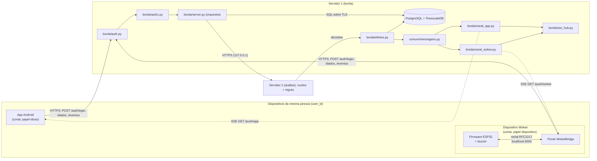
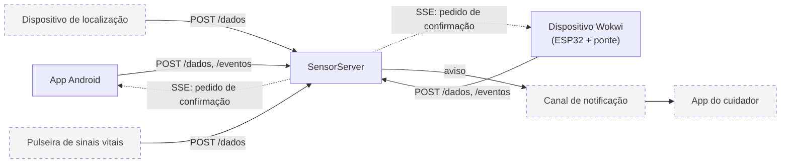
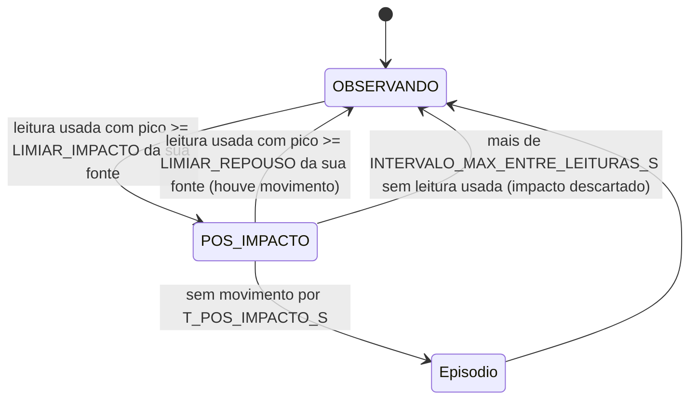
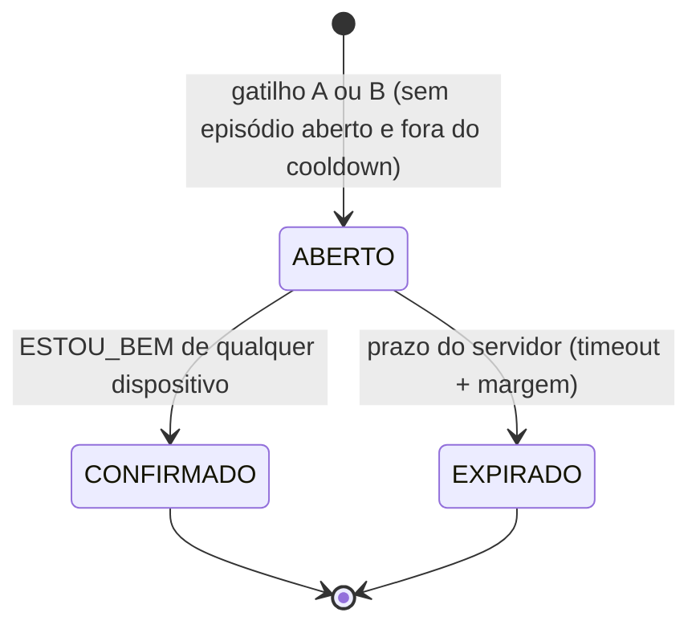
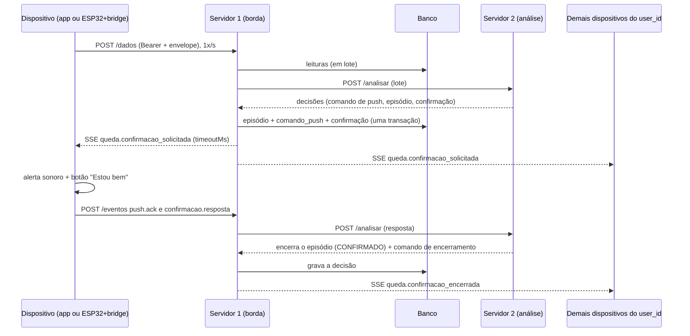

# Arquitetura Geral — Flow

**Disciplina:** Software para Sistemas Ubíquos
**Cenário do projeto:** Monitoramento e assistência a uma pessoa idosa (ver `README.md` para a análise inicial completa)

Este documento é o registro **único e versionável** das decisões de arquitetura do projeto Flow: os componentes envolvidos, o fluxo de comunicação entre eles, a responsabilidade de cada parte, o mecanismo de comunicação escolhido (e por que outros foram descartados) e as condições de falha já consideradas. Ele cobre tanto a visão **geral** (o que vale independentemente de qual protótipo está em campo) quanto o **estado atual do protótipo** (o que já está de fato implementado no código deste repositório).

---

## 1. Cenário e atores

- **Usuário primário:** a pessoa idosa monitorada. Uso passivo: o sistema só pede interação quando suspeita de uma queda.
- **Usuário secundário *(abstrato)*:** cuidadores e familiares, que receberão informações e alertas (papel `cuidador`, reservado no modelo de contas).
- **Situação de uso:** ambiente residencial, com um ou mais dispositivos junto ao idoso coletando dados continuamente.

O sistema é **IoT** (dispositivos conectados enviando dados continuamente a um servidor) e **ubíquo** (sensoriamento contínuo, sem interação explícita do idoso no uso normal).

- **Concreto:** o laço **percepção → decisão → atuação** está fechado. O servidor analisa o movimento, decide que uma queda é provável, aciona um alerta sonoro no próprio idoso (celular e buzzer), que responde por um botão, e registra um aviso ao cuidador (alerta no banco).
- **Abstrato:** o aviso ao cuidador chegando a ele por um canal real, novos sensores (localização, sinais vitais) e outras ações de atuação.

Pelo laço concreto o sistema se aproxima de um **sistema ciber-físico**; o efeito completo sobre o cuidador depende da parte abstrata.

---

## 2. Componentes

### 2.1 Papéis lógicos

| Elemento | Papel | Concreto (existe) | Abstrato (visão) |
| --- | --- | --- | --- |
| **Sensores** | Percebem o ambiente e o comportamento do idoso | Luz/CCT, acelerômetro, orientação, magnetômetro (celular); acelerômetro MPU6050 (ESP32 simulado) | Localização, sinais vitais (pulseira, dados mockados), microfone para sons de queda |
| **Produtor / gateway** | Concentra um ou mais sensores, monta o evento, cifra e envia ao servidor. Também é **consumidor**: recebe do servidor os pedidos de confirmação | App Android; dispositivo Wokwi (firmware ESP32 + ponte `WokwiBridge`, um único dispositivo lógico) | Dispositivo dedicado por sensor não coberto pelo celular (ex.: localização) |
| **Servidor central** | Autentica, autoriza, valida, agrega, decide e envia mensagens de volta | `SensorServer`: um único ponto lógico de consumo, com visão consolidada por pessoa | Atender mais de uma residência (servidor assíncrono, estado externo), **mantendo a topologia em estrela** |
| **Atuadores** | Produzem efeito observável a partir de uma decisão | Alerta sonoro e botão "Estou bem" (app); buzzer e botão (Wokwi); aviso ao cuidador registrado em `alertas` | Notificação real ao cuidador; histórico consultável; outras ações |

Cada pessoa monitorada pode ter **mais de um produtor simultâneo** (por exemplo, o celular para luz/movimento e um dispositivo dedicado para localização), todos ligados à mesma pessoa pelo `user_id` da conta com a qual autenticaram.

### 2.2 Componentes concretos

Há **dois dispositivos** concretos, cada um com a sua conta e falando diretamente com o servidor: o **app Android** e o **dispositivo Wokwi**. Este último é formado por duas pastas, `sketch/` (firmware) e `WokwiBridge/` (ponte), que **juntas representam um único dispositivo**: para o servidor há uma conta, um `user_id` e um conjunto de eventos, e a ponte é apenas o meio pelo qual o ESP32 simulado, que só fala serial, alcança a rede.

| Pasta | Componente | Responsabilidade |
| --- | --- | --- |
| `SensorApp/` | App Android (Kotlin) | Produtor real: sensores do celular. Faz login, envia telemetria, mantém o canal de push aberto e exibe o pedido de confirmação. |
| `sketch/` | Dispositivo Wokwi: firmware ESP32 (`sketch.ino`, simulado no Wokwi) | Acelerômetro MPU6050, máquina de imobilidade local, buzzer e botões. Só fala serial. |
| `WokwiBridge/` | Dispositivo Wokwi: ponte (`bridge.py`) | Parte do dispositivo que o liga à rede: autentica-se, repassa a telemetria da serial ao servidor e traduz as mensagens de push em comandos de texto para o firmware. |
| `SensorServer/` | Servidor (Flask) | Módulos abaixo. |

O sistema tem **três partes**: os **dispositivos** (app e Wokwi), o **Servidor 1 — a borda** (`python -m borda`) e o **Servidor 2 — a análise** (`python -m analise`). Só a borda fala com o mundo: autentica, valida, grava no banco, entrega o push e responde às consultas. A análise **só decide** (queda, imobilidade, luz): não tem banco, não tem credencial de dispositivo, não entrega nada e escuta só em `127.0.0.1`. **A borda é o único cliente da análise** (HTTPS local com token compartilhado). **Toda comunicação é cifrada com TLS, em todas as pontas** (dispositivos ↔ borda, borda ↔ análise, borda ↔ banco), com a CA própria do projeto (seção 5); nenhuma ponta fala em texto claro, nem em `127.0.0.1`. Um só `.env`; a análise copia dele apenas as variáveis `FLOW_ANALISE_*` e `FLOW_TLS_*` (caminhos da CA, do certificado e da chave). `python -m borda.server` sobe a mesma borda, sem desligamento ordenado, para desenvolvimento (com `FLOW_DB_FAKE=1`, sem Docker).

Módulos do servidor (pacotes em `SensorServer/`):

| Arquivo | Responsabilidade |
| --- | --- |
| **`borda/`** | Servidor 1: único com porta de rede, banco, segredos de transporte e contas. |
| `borda/server.py` | Rotas; ingestão (aceita e põe a leitura numa fila limitada); thread de descarga (grava `leituras` em lote, manda o lote à análise e aplica as decisões); thread do vigia; thread da retenção (apaga o histórico antigo das tabelas comuns, de hora em hora); `/estado`, `/dados` (debug) e `/health`. Executa com `python -m borda`. |
| `borda/cliente_analise.py` | Cliente da API da análise (`/analisar`, `/vigiar`, `/restaurar`), por HTTPS e confiando só na CA do projeto: prazo curto, detecta análise fora do ar e `boot_id` novo (análise reiniciada) e manda o estado de volta antes de seguir. |
| `borda/efeitos.py` | Aplicar as decisões: grava confirmações, alertas, estado e, por fim, episódio + comando numa transação; só depois do commit entrega o push (SSE, app e wokwi). Se o banco falha, guarda as decisões e tenta de novo. |
| `borda/servico.py` | Ponto de entrada da borda (`python -m borda`): serve só HTTPS em `FLOW_BORDA_HOST:FLOW_BORDA_PORT` (padrão `127.0.0.1:5000`; sem certificado não sobe), subida e desligamento ordenado. |
| `borda/const.py` | Constantes da borda (porta, tokens, bloqueio de login, limite de corpo, SSE, filas, chamada à análise). Ver 14. |
| `borda/auth.py` | **Autenticação:** contas, senhas, login, refresh, emissão e verificação de tokens (contas e sessões nas tabelas `contas` e `sessoes` do banco, pelo repositório recebido por parâmetro). Não conhece Flask. CLI: `python -m borda.auth criar-conta` (exige o banco no ar). |
| `borda/authz.py` | **Autorização:** papel → permissões e escopo por pessoa; a negação vai para o log (rota, motivo, conta, IP; nunca o conteúdo). |
| `borda/validacao.py` | Validação **estrutural** dos corpos, pelos contratos de `schemas/`. |
| `borda/sse_hub.py` | Mecanismo comum de push por SSE: conexões, fila limitada por conexão, keepalive, replay. |
| `borda/canal_app.py` | **Servidor → app.** Rota `GET /push/app` e envio ao alvo `app`. |
| `borda/canal_wokwi.py` | **Servidor → Wokwi.** Rota `GET /push/wokwi` e envio ao alvo `wokwi`. |
| `borda/tempo.py` | Único ponto de leitura do relógio na borda (`tempo.agora_utc()`): o instante da ingestão e o relógio do vigia. Os testes o congelam (fixture `relogio`). |
| `borda/crypto_utils.py` | Envelope AES-256-GCM. |
| **`analise/`** | Servidor 2: decide. Sem banco, sem segredo de transporte; não importa a borda nem `flow_db`. |
| `analise/api.py` | A API HTTP e o estado em memória: `POST /analisar`, `POST /vigiar`, `POST /restaurar`, `GET /saude`, todas com o cabeçalho `X-Flow-Analise-Token`. Cada resposta traz o `boot_id` da subida. Item mais velho que `IDADE_MAX_ACAO_S` só reconstrói estado, sem push. |
| `analise/servico.py` | Ponto de entrada da análise (`python -m analise`), servindo HTTPS em `127.0.0.1:FLOW_ANALISE_PORT` (5100). |
| `analise/nucleo.py` | **Núcleo das regras:** `Leitura`/`Resposta` entram, `Decisoes` saem. Sem relógio global, sem I/O, sem thread; o estado é um `EstadoRegras` explícito (`PADRAO` = tabelas dos módulos de regra; `novo_estado()` = mundo limpo). O vigia é um passo à parte (`nucleo.vigiar`). |
| `analise/regra_queda.py` | Fusão das fontes por usuário, episódios de confirmação, timeout, mapa `messageId` → episódio, registro da resposta. |
| `analise/regra_luz.py`, `analise/regra_imobilidade.py` | Regras de negócio (luz inadequada à noite; imobilidade prolongada). |
| `analise/const.py` | Constantes da análise (limiares, janelas, cooldown, retenções, idade máxima para agir). Ver 14. |
| **`comum/`** | O que os dois lados partilham: constantes comuns e carregador do `.env` (`const.py`), contratos (`schemas.py`, `contratos.py`), mensagem de push (`mensagens.py`) o **contrato da análise** (`contrato_analise.py`: `Leitura`, `Resposta`, `Decisoes` e o seu JSON, com ida e volta) e o **TLS** (`tls.py`: caminhos da CA, do certificado e da chave, contexto HTTPS do servidor, recusa de URL que não seja `https://`). |
| **`flow_db/`** | Só a borda a usa (conexão sempre com TLS, `verify-full`): `Repo` (interface única), `Pg` (PostgreSQL; `leituras` é hypertable do TimescaleDB), `BancoFalso` (memória, para testes e `FLOW_DB_FAKE=1`), uma migração (`0001_base.sql`), CLI `python -m flow_db migrar|status`. |
| `scripts/gerar_certificado.py` | Cria a CA do projeto (`ca.crt`, `ca.key`) e emite os certificados da borda, da análise e do banco (e `--nome <x>` para outros, como `bridge`) em `certs/` (fora do Git); copia o `ca.crt` para o app. Idempotente; `--forcar` reemite os certificados de serviço sem trocar a CA, `--forcar-ca` recria a CA, `--ip` acrescenta um endereço. |
| `simular_queda.py` | Utilitário (exige borda e análise rodando): simula um wokwi que sofre impacto e fica imóvel. |
| `tests/` | Suíte pytest (`unit/`, `integration/` e `banco/`); ver 14.1. |

Dependências: a **borda** não importa a análise (fala com ela por HTTP) e a **análise** não importa a borda nem `flow_db`; `comum/` e `flow_db/` não importam nenhum dos dois (conferido por `tests/unit/test_fronteiras.py`). `canal_*` não conhecem `regra_queda`; `regra_queda` não conhece os canais, `regra_imobilidade` nem `mensagens` (devolve um `PedidoConfirmacao`; o `nucleo.py` monta a mensagem e a `borda/efeitos.py` entrega). `nucleo.py` importa as regras, `comum.mensagens` e `comum.contratos`; nenhuma regra importa o núcleo; `auth` não conhece Flask. Os três `const` (`comum`, `borda`, `analise`) são módulos folha (só o comum lê o `.env`), e os demais fazem `from <pacote> import const as const_<pacote>` e leem `const_<pacote>.X` na hora do uso, de modo que um único ajuste vale para todos os pontos de uso.

### 2.3 Elementos abstratos (visão do sistema)

Ainda sem implementação. Cada um é descrito pelo papel e pelo ponto em que se encaixa na arquitetura concreta.

| Elemento *(abstrato)* | Papel previsto | Ponto de encaixe |
| --- | --- | --- |
| App ou painel do cuidador | Receber alertas e consultar o histórico das pessoas vinculadas | Conta de papel `cuidador` (`user_ids` como lista, leitura escopada pelas claims); recebe push por um canal próprio. |
| Canal de notificação ao cuidador | Entregar o aviso ao cuidador (hoje só registrado em `alertas`) | Novo módulo `canal_*.py` com a mesma interface `enviar(user_id, mensagem)`. |
| Dispositivo de localização | Produtor dedicado, para sensor que o celular não cobre | Novo `source`; segue o contrato mínimo de qualquer produtor (6.1). |
| Pulseira de sinais vitais | Frequência cardíaca e oximetria (dados mockados) | Idem. |
| Push em segundo plano | Alertar o idoso com a tela bloqueada | Foreground Service e/ou FCM no `canal_app.py`, sem mudar o contrato da mensagem. |

---

## 3. Topologia e sentidos de comunicação



- **Ida (dispositivo → servidor):** `POST` HTTPS. Telemetria em `/dados`; eventos discretos (ack e resposta do idoso) em `/eventos`.
- **Volta (servidor → dispositivo):** push por **SSE** (por que não WebSocket: seção 10.5). O **dispositivo abre** a conexão (`GET`) e o servidor empurra mensagens por ela. Nenhum dispositivo expõe porta; o servidor nunca precisa conhecer o endereço de um dispositivo.
- **Borda e análise:** o Servidor 1 chama o Servidor 2 por HTTPS local (`/analisar`, `/vigiar`, `/restaurar`); o Servidor 2 nunca chama ninguém e nunca vê o banco. O banco é só do Servidor 1, e a conexão com ele é TLS.
- **Estrela:** cada dispositivo fala diretamente com o servidor (a borda); não há nível intermediário entre dispositivos e servidor. O dispositivo Wokwi é um só: firmware e ponte compartilham uma conta e uma conexão com o servidor, e a ponte existe porque o ESP32 simulado só fala serial.

### 3.1 Sistema completo (concreto e abstrato)

Contorno contínuo: concreto. Contorno tracejado: abstrato.



As setas tracejadas entre `SensorServer` e os dispositivos concretos são o push SSE (conexão aberta pelo dispositivo); só os quatro blocos de contorno tracejado e suas setas são abstratos.

---

## 4. Identidade, autenticação e autorização

### 4.1 Contas e papéis

Tudo que se conecta ao servidor é uma **conta** com `papel`, `user_ids` (pessoas monitoradas a que se refere), `fontes` permitidas (`app`, `wokwi`) e, no papel `dispositivo`, a lista de `device_ids` que o login dela pode declarar.

| Papel | Quem usa | Fonte | Observação |
| --- | --- | --- | --- |
| `idoso` | App do idoso | `app` | Exatamente um `user_id`. O `device_id` é **obrigatório** no login, mas livre (sem lista): o app o envia sempre. |
| `dispositivo` | Dispositivo Wokwi (a conta é usada pela ponte, em nome do conjunto firmware + ponte) | `wokwi` | Exatamente um `user_id` e **ao menos um `device_id` permitido** (`--device-id`, repetível, só neste papel). |
| `admin` | Operação/depuração | — | Lê `GET /dados` e `GET /estado/<id>`. |
| `cuidador` *(abstrato)* | App do cuidador | — | Reservado; `user_ids` é lista para vincular várias pessoas. A política vigente concede **conjunto vazio** de permissões (negar por padrão); a coluna `cuidador` da tabela 4.3 é o desenho futuro, sem implementação. |

O `user_id` é uma consequência da conta: não é digitado no app nem no bridge. Dois produtores da mesma pessoa têm contas apontando para o mesmo `user_id`, e é isso que faz o servidor agregá-los (4.4).

### 4.2 Login e tokens

- **Senhas:** `scrypt` com sal por conta, comparação em tempo constante. Contas criadas por CLI (`python -m borda.auth criar-conta ...`, com `--device-id` para o papel `dispositivo`); não há auto-cadastro. Gravadas na tabela `contas` do banco; nenhum arquivo de dados fica em disco.
- **`POST /auth/login`** (corpo em envelope cifrado): `identificador`, `segredo`, `fonte`, `device_id`. Resposta (também cifrada): `access_token`, `refresh_token`, `expires_in`, `papel`, `user_ids`. A senha nunca trafega em claro. **Quem julga o login é sempre o servidor**: a ponte só repassa o que o firmware forneceu (a linha do firmware usa `deviceId`; a ponte a traduz para `device_id`, o nome do contrato `auth-login`) e não guarda conta nem decide nada. O servidor confere o hash do segredo, a fonte da conta, o papel e, só então, o `device_id`: para `idoso` e `dispositivo` ele é **obrigatório** (ausente: `400`, `device_id_obrigatorio`); para `dispositivo` precisa ainda estar na lista da conta (senão `403`, `device_nao_permitido`). Os dois só são avaliados com a senha certa e **não contam como falha de senha**; só o `admin` pode omitir `fonte` e `device_id`. O token carrega o `device_id` aceito.
- **Access token:** JWT HS256, validade padrão 1 h; claims `sub`, `papel`, `user_ids`, `fonte`, `device_id`, `iat`, `exp`, `jti`. Enviado em `Authorization: Bearer`.
- **Refresh token:** opaco, validade padrão 7 dias, **uso único** (rotativo). O servidor guarda só o hash, na tabela `sessoes` do banco, de modo que reiniciar o servidor não derruba as sessões. O consumo é atômico (`DELETE ... RETURNING`) e, no refresh, acontece na mesma transação que grava o par novo: se o banco falhar no meio, a sessão não se perde.
- **Bloqueio:** 5 falhas em 15 minutos para o mesmo identificador bloqueiam novas tentativas por 15 minutos (`429`). A resposta é idêntica para conta inexistente e senha errada. O contador é **por conta**, nunca por IP (todos os dispositivos de uma ponte chegam do mesmo IP). Risco registrado: quem erra a senha de uma conta várias vezes bloqueia aquele dispositivo por um tempo; o dano fica limitado a ele.
- **Segredo de assinatura:** variável `FLOW_JWT_SECRET` (mínimo 32 bytes). Sem ela o servidor não sobe.

### 4.3 Autorização

RBAC com escopo por pessoa, **negando por padrão**.

| Permissão | `idoso` | `dispositivo` | `admin` | `cuidador` *(abstrato)* |
| --- | --- | --- | --- | --- |
| `dados:enviar` (`POST /dados`) | sim, fonte `app` | sim, fonte `wokwi` | não | não |
| `eventos:enviar` (`POST /eventos`) | sim | sim | não | não |
| `push:receber` (`GET /push/...`) | sim, canal `app` | sim, canal `wokwi` | não | canal próprio |
| `dados:ler`, `estado:ler` (`GET`) | não | não | sim | só pessoas vinculadas |

Dois estágios de verificação:

1. **Papel e permissão**, antes de decifrar o corpo (decorador `exige(permissao, fonte=...)`): token válido, papel com a permissão, fonte do token igual à exigida. Falha → `401` ou `403`.
2. **Escopo**, depois de decifrar: `user_id` do payload deve estar em `token.user_ids`, `source` deve ser a `fonte` do token e o `device_id`/`deviceId` do payload, se declarado, deve ser o `device_id` do token (o do login; o bridge usa o `deviceId` do firmware). Falha → `403`. O `device_id` **gravado** em `/dados` e `/eventos` é sempre o do token: um payload sem `deviceId` é aceito e recebe o do token (não existe mais o `device_id` inventado a partir do `user_id`). Falha → `403`. Payload **sem** `source` válido (ausente ou fora de `app`/`wokwi`) é recusado com `400` antes da checagem de escopo, em `/dados` e em `/eventos`: nenhum caminho aceita dado ou evento sem `source`. `source` presente e diferente da fonte do token é `403`. O `user_id` precisa ser um número inteiro JSON; string (mesmo só de dígitos), booleano, decimal, `null` ou ausente é `400`. Esse estágio existe porque o `user_id` está dentro do envelope cifrado.

Nos canais SSE o escopo é implícito: a conexão é registrada no `user_id` do token; o cliente não escolhe de quem recebe.

**Matriz por rota** (conferida contra as rotas da borda):

| Rota | Quem pode | Papel / fonte / escopo |
| --- | --- | --- |
| `POST /auth/login` | Anônimo, com credencial no corpo cifrado | Bloqueio por conta (`429`); banco fora: `503` |
| `POST /auth/refresh` | Quem tem refresh token válido | Uso único; banco fora: `503` |
| `POST /dados`, `POST /eventos` | `idoso` (fonte `app`) e `dispositivo` (fonte `wokwi`) | `user_id` e `source` conferidos com o token; `device_id` gravado é o do token (corpo divergente: `403`) |
| `GET /push/app` | `idoso` | Só o `user_id` do token |
| `GET /push/wokwi` | `dispositivo` | Só o `user_id` do token |
| `GET /dados` | **Só `admin`** | Depuração; inclui localização, quando houver (13.3) |
| `GET /estado/<device_id>` | **Só `admin`** | Procura em todos os usuários |
| `GET /health`, `GET /` | Anônimo | Sem dado pessoal (as únicas rotas abertas, além do login) |
| Análise: `/analisar`, `/vigiar`, `/restaurar`, `/saude` | **Só a borda**, com `X-Flow-Analise-Token` | Comparado em tempo constante; qualquer outro chamador: `401` |
| Banco | A borda e o operador | TLS `verify-full` |

### 4.4 Um idoso com celular e Wokwi (caso de uso principal)

Duas contas com o **mesmo `user_id`**: `idoso1` (papel `idoso`, fonte `app`, `device_id` obrigatório e livre) e `bridge1` (papel `dispositivo`, fonte `wokwi`, com a lista de `device_ids`). Consequências:

- **a)** A máquina de queda é **uma por usuário** e funde as duas fontes (9.2.1).
- **b)** O estado das regras é por `(user_id, device_id)`: o celular e o Wokwi não colidem.
- **c)** O pedido de confirmação é publicado nos **dois** canais (`/push/app` e `/push/wokwi`) e a resposta de qualquer um encerra o episódio.
- **d)** A falha de um canal não impede o outro.
- **e)** O `device_id` do firmware precisa estar na lista da conta; senão o login leva `403`.

O hub SSE entrega por `(user_id, canal)`. Duas contas `dispositivo` com `user_id` diferentes nunca recebem o comando uma da outra; vários `device_ids` na **mesma** conta (mesmo `user_id`) compartilham os comandos. Para isolar simulações, use uma conta e um `user_id` por simulação.

**Registro das negações:** toda negação (`401`/`403`, e também `413` por corpo grande, com o motivo `corpo_grande`) vai para o log (rota, motivo, conta, IP), nunca o conteúdo da requisição. Não há auditoria em arquivo nem em banco por ora.

---

## 5. Transporte e criptografia

- **HTTPS (TLS 1.2 ou superior) em todas as pontas:** dispositivos ↔ Servidor 1, Servidor 1 ↔ Servidor 2 e Servidor 1 ↔ Banco. Nenhuma ponta fala em texto claro, nem em `127.0.0.1`.
- **CA própria do projeto**, gerada por `python scripts/gerar_certificado.py` (`SensorServer/certs/`, fora do Git): `ca.crt` (pública) e `ca.key` (segredo; só o script a lê, nenhum serviço a usa nem a monta). A CA assina **um certificado por serviço**, cada um com a sua chave: `borda.crt`, `analise.crt` e `banco.crt` (e `<nome>.crt` com `--nome`, p. ex. `bridge`, para uma API HTTPS do bridge). Cada serviço apresenta só o seu; o container do banco monta apenas `banco.crt` e `banco.key`.
- **Os clientes confiam só na CA** (`FLOW_TLS_CA`, padrão `certs/ca.crt`): a borda (para a análise e para o banco, `sslmode=verify-full`, ou `verify-ca` em `FLOW_DB_SSLMODE`), a ponte e o app (cópia do `ca.crt` embutida como única âncora de confiança, `res/raw/flow_cert.pem`, com HTTP em texto claro proibido pela configuração de segurança de rede). Os clientes **não** confiam nas autoridades do sistema, e a verificação do certificado e do nome nunca é desligada.
- Cada certificado vale para os nomes e IPs listados nele: o da borda, `localhost`, `127.0.0.1`, `::1`, o IP do computador na rede (detectado) e os de `--ip`/`--dns`; os da análise e do banco, `localhost` e `127.0.0.1`. Cliente que acessa por outro endereço recusa a conexão; a correção é reemitir com `--forcar` e o endereço novo. **Reemitir um certificado de serviço não troca a CA**: o app e a ponte continuam confiando, sem recompilar. Trocar a CA (`--forcar-ca`) exige recompilar o app e reemitir os certificados `--nome`.
- **Onde a borda escuta:** só em HTTPS, em `FLOW_BORDA_HOST` (padrão `127.0.0.1`, isto é, só no próprio computador) e `FLOW_BORDA_PORT` (padrão 5000). Para o app e a ponte em outra máquina, `FLOW_BORDA_HOST` recebe o IP do computador na rede, o mesmo que consta no certificado da borda. A análise e o banco escutam sempre só em `127.0.0.1`. Não existe listener HTTP em porta nenhuma.
- **Sem proxy reverso, de propósito:** nada fica entre os dispositivos e a borda. A própria borda termina o TLS com o certificado dela e autentica e autoriza cada chamada; um proxy criaria um segundo ponto de terminação, de configuração e de confiança sem ganho para este escopo.
- Escopo mínimo, de projeto acadêmico: sem rotação automática, sem revogação e sem mTLS (o servidor não pede certificado ao cliente; quem se autentica é a conta, por token).
- **Envelope AES-256-GCM** em todo corpo, por cima do TLS: `{"nonce": "<base64>", "ciphertext": "<base64>"}` (nonce de 12 bytes aleatório por mensagem, tag de 128 bits ao final do ciphertext).
- O mesmo envelope cifra o **push**: o `data:` de cada evento SSE é um envelope.
- Implementações equivalentes em Python (`borda/crypto_utils.py` no servidor e `crypto_utils.py` no bridge) e Kotlin (`CryptoUtils.kt`, `javax.crypto`); ambas oferecem `encrypt` e `decrypt`.
- O firmware **não** faz rede nem criptografia: a cifragem do Wokwi começa no bridge. A serial entre ESP32 e bridge é local e em texto.

Por que HTTP (agora sobre TLS) e não MQTT, gRPC ou Kafka: o sistema tem um único consumidor lógico, eventos pequenos e periódicos e nenhuma necessidade de replay ou fan-out; HTTP é o menor mecanismo que atende. O volume e o número de consumidores são a premissa que, se mudar, reabre essa decisão; a topologia, mesmo assim, continua em estrela.

---

## 6. Contratos de mensagem

### 6.1 Campos de roteamento

Todo payload de produtor traz, no texto decifrado:

| Campo | Papel |
| --- | --- |
| `schemaVersion` (raiz) | Versão do schema daquele payload. Cada schema tem versão própria; as versões atuais ficam em `docs/schemas.md`. |
| `user_id` | Pessoa monitorada; deve estar nas claims do token. |
| `source` | `"app"` ou `"wokwi"`; deve ser a fonte do token. |

Fora disso **não há schema de aplicação unificado**: cada produtor define seu contrato (campos, unidades, tipo de evento). O servidor exige de qualquer fonte nova: um identificador de evento, um identificador do dispositivo e um contador de sequência para deduplicação, e o instante gerado na origem.

### 6.2 Contratos existentes

| Contrato | Origem | Rota | Conteúdo |
| --- | --- | --- | --- |
| Telemetria do app | App | `POST /dados` | `sensores`, `leitura_ambiente` (luz/CCT), `acelerometro` (`magnitude`, `magnitude_max_janela`, `amostras`, `janela_ms`) e `localizacao` (`latitude`, `longitude`, `precisao_m`, `instante_medicao`; seção 13.3). |
| Telemetria do Wokwi | Firmware via bridge | `POST /dados` | `imobilidade.leitura` (com `value` e `valueMax`) e `imobilidade.decisao`. |
| Retorno | App ou firmware | `POST /eventos` | `push.ack` (`ATIVADO`, `REJEITADO`) e `confirmacao.resposta` (`ESTOU_BEM`, `SEM_RESPOSTA`), com o `messageId` a que respondem. |
| Push | Servidor | SSE | `queda.confirmacao_solicitada` (`timeoutMs`, `motivo`) e `queda.confirmacao_encerrada` (`resultado`). |
| Comando serial | Ponte (servidor → firmware) | Serial local, texto, sem `schemaVersion` | `CMD;BUZZER_ON;<messageId>;<timeoutMs>` e `CMD;BUZZER_OFF;<messageId>;<motivo>`. |
| Diagnóstico do firmware | Firmware via bridge | `POST /dados` | `sistema.erro`, com o código da falha (hoje `MPU_NAO_ENCONTRADO`, quando o MPU6050 não é detectado). Fica fora do vocabulário que o servidor processa: é descartado e logado, sem alerta e sem resposta de erro (`200`). |
| Autenticação | App e bridge | `POST /auth/*` | Seção 4.2. |

Detalhe campo a campo em `docs/schemas.md`.

### 6.3 Regras de contrato

- **`timeoutMs` é relativo**, nunca um prazo absoluto: celular e servidor não têm relógios sincronizados. `issuedAt`/`expiresAt` servem ao servidor e ao bridge.
- **Idempotência:** o dispositivo ignora `messageId` já tratado.
- **Faixa física plausível:** aceleração de `0` a `160` m/s² (o sensor do Wokwi opera em ±8 g, magnitude máxima mensurável ≈136 m/s²; o teto é o mesmo do app).
- **Versionamento tolerante, por schema:** a versão atual de cada schema está em `docs/schemas.md` e é definida em um único lugar do servidor (as constantes `SCHEMA_VERSION_*` de `SensorServer/comum/const.py`); nenhum outro ponto do código escreve o número. Versão ausente = 1. Versão de `1` até a atual é **aceita e usada**, e as regras logam o aviso de "desatualizada". Versão maior que a atual, abaixo da mínima ou que não seja inteiro é descartada e logada (resposta em 7). Na análise de queda a versão tem papel próprio: entre as leituras de um usuário vale a de maior versão presente (9.2).

---

## 7. API do servidor

| Rota | Método | Autorização | Papel |
| --- | --- | --- | --- |
| `/auth/login`, `/auth/refresh` | POST | pública | Autenticação (corpo cifrado). |
| `/dados` | POST | `dados:enviar` | Ingestão de telemetria. |
| `/eventos` | POST | `eventos:enviar` | Eventos de retorno; vão à análise pela mesma fila das leituras. |
| `/push/app` | GET (SSE) | `push:receber`, fonte `app` | Canal servidor → app. |
| `/push/wokwi` | GET (SSE) | `push:receber`, fonte `wokwi` | Canal servidor → bridge. |
| `/dados` | GET | `dados:ler` (admin) | Depuração: as últimas leituras **gravadas em `leituras`**, da mais nova para a mais velha (`?user_id=` filtra por pessoa; `?limite=`, até `LIMITE_GET_DADOS`, 200). Uma leitura só aparece depois de gravada. Banco fora: `503`. |
| `/estado/<device_id>` | GET | `estado:ler` (admin) | Resumo do estado da imobilidade por dispositivo, **lido de `estado_dispositivo`** (gravado pela borda a partir das decisões da análise); reflete a última decisão, não a leitura que acabou de chegar. |
| `/`, `/health` | GET | pública | Disponibilidade da borda e saúde da análise: `analise.estado` é `ok` ou `degradado` (a última chamada a ela falhou), `analise.fila` é o que espera por ela e `analise.ultima_resposta_ha_s` são os segundos desde a última resposta boa (`null` se nunca respondeu); `borda` traz as filas, os descartes e `localizacao_rejeitadas` (13.3). Sempre `200`. |

O servidor escuta só em HTTPS, em `FLOW_BORDA_HOST:FLOW_BORDA_PORT` (padrão `127.0.0.1:5000`; seção 5), e roda com `threaded=True` (uma thread por stream SSE). Falhas de autenticação/autorização são `4xx`. **Corpo acima de `MAX_CONTENT_LENGTH` (64 KiB) é `413`** em qualquer rota com corpo (`/dados`, `/eventos`, `/auth/*`): o servidor não processa o conteúdo e a negação vai para o log sem ele. O maior corpo legítimo é um envelope de telemetria, de poucos KB. Sem token, a resposta continua `401`, antes de o corpo ser lido. conteúdo inválido de um evento já autenticado é descartado internamente e responde `200`.

Entrada malformada **antes** de haver conteúdo interpretável é `400`: corpo decifrado que não é um objeto JSON, `source` ausente ou inválido, `user_id` inválido, `device_id` inválido no login (não string ou acima de 64 caracteres). `Last-Event-ID` inválido nunca é erro: vale `0`. `schemaVersion` não suportado em `/dados` e `/eventos` responde `200` com `descartado: true` e `motivo: "schemaVersion_nao_suportado"`, e o conteúdo não é gravado nem chega às regras; em `/auth/login` e `/auth/refresh`, a versão maior que a atual ou inválida é `400` (a ausência é aceita).

---

## 8. Ingestão e processamento

```markdown
DISPOSITIVO        SERVIDOR 1 (borda)                                   SERVIDOR 2 (análise)
envelope cifrado → authn/authz → decifra → authz (escopo) → valida (schema)
                   ↓ fila em memória → grava em lote ──→ banco: leituras
                   ↓ manda o lote ── POST /analisar ──────────────────→ núcleo (deduplicação, estado, regras)
                   ↓ ←──────────────── decisões ───────────────────────┘
                   ↓ uma transação: confirmacoes, alertas, estado_dispositivo, episodios + comandos_push
                   ↓ depois do commit: push por SSE (app e wokwi)
vigia (a cada 0,25 s): POST /vigiar ──→ decisões de expiração ──→ mesma aplicação
```

**Responsabilidades:** o dispositivo captura, gera o tempo do evento e descarta leituras claramente inválidas; a **borda** autentica, valida a estrutura, grava, pergunta à análise, grava as decisões e entrega; a **análise** deduplica, mantém o estado das regras em memória e decide. A resposta do dispositivo é correlacionada pelo `messageId`; a identidade vem do token (nunca do corpo).

**Contrato borda ↔ análise** (`comum/contrato_analise.py`):

1. A borda só manda à análise o que **já gravou** no banco (a leitura) ou aceitou (a resposta do dispositivo). A análise só devolve **decisões**; quem as grava e entrega é a borda, e só depois de gravar.
2. A análise gera os `message_id` e `episodio_id`. `comandos_push.message_id` é único: regravar um comando não o duplica.
3. Cada resposta traz o `boot_id` da subida da análise. Se for diferente do último conhecido, o estado em memória foi perdido: a borda chama `/restaurar` (leituras dos últimos `JANELA_RESTAURACAO_S` s, episódios abertos e recentes e as mensagens deles, tudo do banco) e repete a chamada.
4. Leitura ou resposta com mais de `IDADE_MAX_ACAO_S` (30 s) só reconstrói estado: não gera push. A exceção é a resposta que encerra um episódio real.
5. Análise fora do ar (rede, prazo de 1 s, erro 5xx): a borda continua aceitando e gravando leituras; o que espera a análise fica numa fila limitada (`MAX_FILA_ANALISE`), e o `/health` mostra `degradado`.

**Se a borda cai e volta:** reinicia limpa; na primeira chamada manda a restauração (do banco) à análise. **Se o banco cai:** as leituras ficam na fila limitada (`MAX_FILA_LEITURAS`) e nenhuma decisão é aplicada nem push enviado até o banco confirmar; as decisões já tomadas ficam guardadas e são regravadas ao voltar. Só **login e refresh** dependem do banco (contas e sessões moram nele) e respondem `503` (`servico_indisponivel`, sem contar como falha de senha); o access token é um JWT conferido sem banco, então quem já está logado segue enviando leituras.

### 8.1 Leituras em lote

A requisição não espera o banco nem a análise: a leitura entra numa fila limitada e a thread de descarga (a cada `INTERVALO_DESCARGA_S`) grava lotes de até `TAMANHO_LOTE_LEITURAS` em `leituras` (uma só escritora). Com a fila cheia, as mais antigas saem (descarte contado e logado). Cada leitura leva o `instante_ingestao` (relógio do servidor ao aceitar) e a identidade do token (`conta_id`).

### 8.2 Regra "luz inadequada à noite" (`analise/regra_luz.py`, dados do app)

Validação (`luminosidade >= 0`, `1000 <= cct <= 12000`, `event_time` ISO 8601), deduplicação por `device_id`+`seq_num`, condição noturna (18h–6h) com `cct > 4500K`, debounce de 3 leituras consecutivas, sem repetição no mesmo episódio. Atuação: linha em `alertas`.

### 8.3 Regra "imobilidade prolongada" (`analise/regra_imobilidade.py` + `sketch.ino`)

Decisão compartilhada. No firmware: máquina `NORMAL → AGUARDANDO_CONFIRMACAO → ALERTA_CONFIRMADO` com histerese (`LIMIAR_BAIXO`/`LIMIAR_ALTO`), persistência (`T_PERSISTENCIA_MS`), janela de confirmação humana (`T_CONFIRMACAO_MS`, botão "Estou bem") e rearme manual. No servidor: validação em cascata (`eventType` → `state` → faixa de `value`), deduplicação por `sequence`, resumo de estado por `device_id` (gravado em `estado_dispositivo` só quando muda, exposto em `GET /estado/<device_id>`) e atuação só quando chega `ALERTA_IMOBILIDADE` sem alerta ativo no episódio, gravando o alerta em `alertas`. O servidor não confia cegamente no firmware: só rearma ao receber um estado que encerra o episódio.

---

## 9. Análise de queda e ciclo de confirmação

`analise/regra_queda.py` recebe as leituras de aceleração das duas fontes, decide se há **queda provável** e devolve um `PedidoConfirmacao`; o núcleo (`analise/nucleo.py`) o transforma em mensagem (`comum/mensagens.py`) e em comando de push, devolvido à borda nas `Decisoes`; a `borda/efeitos.py` o grava e entrega.

### 9.1 Entrada normalizada

As fontes medem coisas diferentes: no Wokwi o repouso é magnitude ≈ 0; no celular é ≈ 9,81 m/s² (gravidade). A regra compara **aceleração dinâmica**:

| Fonte | Leitura | Dinâmica atual | Pico da janela |
| --- | --- | --- | --- |
| `wokwi` | `imobilidade.leitura`: `value`, `valueMax` | `value` | `valueMax` |
| `app` | `acelerometro`: `magnitude`, `magnitude_max_janela` | `abs(magnitude − 9,81)` | `max(magnitude_max_janela − 9,81; 0)` |

O pico existe porque uma amostra por segundo perderia o impacto, que dura frações de segundo: o firmware amostra o sensor a cada ~50 ms e o app a ~50 Hz, e ambos enviam o máximo da janela.

**Só leitura válida e não repetida alimenta a regra.** A telemetria do wokwi passa antes pela validação e pela deduplicação de `regra_imobilidade` (evento inválido ou duplicado não chega a `regra_queda`). A do app é deduplicada pelo `timestamp_envio` (epoch ms, raiz do payload), por `(user_id, source, device_id)`: valor menor ou igual ao último aceito é duplicado; se regredir mais que `TOLERANCIA_RELOGIO_S` (60 s), considera-se reajuste de relógio do celular e o valor vira a nova referência, para não bloquear a análise. Payload sem `acelerometro` aproveitável, ou wokwi sem os campos de leitura, simplesmente não contribui. Como o `device_id` vem do cliente, a tabela de referências da deduplicação é limitada a `MAX_REFERENCIAS_DEDUP` (1000): passando disso, sai a mais antiga.

### 9.2 Gatilhos

| Gatilho | `motivo` | Fontes | Detecção |
| --- | --- | --- | --- |
| **A** (preferencial) impacto seguido de imobilidade | `IMPACTO_SEGUIDO_DE_IMOBILIDADE` | app e wokwi | Máquina de estados **por usuário**, alimentada pelas leituras de todas as fontes (9.2.1). |
| **B** imobilidade prolongada | `IMOBILIDADE_PROLONGADA` | wokwi | Alerta de `regra_imobilidade`, repassado pelo núcleo a `regra_queda.abrir_por_imobilidade`. |



### 9.2.1 Fusão de fontes e prioridade por versão

O mesmo idoso pode estar com o celular e com o dispositivo Wokwi ao mesmo tempo. A máquina é **uma por usuário** e usa as leituras das duas fontes, de modo que um movimento visto por qualquer dispositivo cancela a suspeita de impacto visto por outro.

| Termo | Definição |
| --- | --- |
| Leitura | Amostra aproveitável de uma fonte, já validada e deduplicada (9.1): fonte, `device_id`, versão, dinâmica atual, pico da janela e instante de chegada (relógio do servidor). |
| Leitura fresca | A última leitura de cada dispositivo (`fonte` + `device_id`) com no máximo `JANELA_FUSAO_S` (2 s) de idade. |
| Versão de referência | A **maior** versão entre as leituras frescas do usuário naquele instante. É relativa ao que está presente, não à versão atual do contrato: assim o modo degradado funciona quando só há dispositivos antigos. |
| Leitura usada | Leitura fresca da versão de referência. Entre várias leituras usadas vale o máximo (qualquer uma pode abrir ou cancelar a suspeita). |
| Leitura desatualizada | Leitura fresca de versão menor que a de referência. Fica **fora do sinal**, é logada (no máximo uma vez a cada 60 s por usuário, fonte e versão) e não renova o relógio da máquina. |
| Impacto | Leitura usada com pico `>= LIMIAR_IMPACTO` da sua fonte. |
| Movimento | Leitura usada com pico `>= LIMIAR_REPOUSO` da sua fonte. O que conta é o **pico da janela**, não a última amostra: um movimento entre amostras não passa despercebido. |

Cada leitura usada move a máquina **uma única vez, na chegada**; a leitura de impacto não é recontada como movimento nem como novo impacto quando outra fonte chega depois. Os limiares são por fonte, então combinar por máximo equivale a "alguma leitura usada alcança o limiar da sua própria fonte", sem misturar unidades. Consequência assumida: para concluir "parado", **nenhuma** leitura usada pode ter alcançado o repouso da sua fonte.

Regras da máquina:

- Em `OBSERVANDO`, um impacto leva a `POS_IMPACTO` e guarda o instante.
- Em `POS_IMPACTO`, um movimento volta a `OBSERVANDO`; se a mesma leitura também for impacto, recomeça em `POS_IMPACTO` com novo instante. Sem movimento por `T_POS_IMPACTO_S`, abre o episódio.
- Em `POS_IMPACTO`, se passar mais de `INTERVALO_MAX_ENTRE_LEITURAS_S` (3 s, a calibrar) sem nenhuma leitura usada, o impacto é descartado: uma única leitura calma depois de um silêncio longo não prova imobilidade.

Dados degradados:

| Situação | Tratamento |
| --- | --- |
| App v1 ou v2 (sem bloco `acelerometro`) | Não gera leitura de queda; continua alimentando a regra de luz. |
| Wokwi v1 ou v2 (sem `valueMax`) | Gera leitura com pico igual ao valor da amostra e marca `degradada`. Se só houver dispositivos antigos, eles são a referência. |
| Versão maior que a atual | Descartada antes de chegar à regra (6.3). |

Nada disso altera o gatilho B, o episódio único, o cooldown nem o ciclo de confirmação. Quando os dois gatilhos disparam, vale o primeiro a chegar.

A preferência pelo gatilho A é temporal: ele age cerca de `T_POS_IMPACTO_S` (3 s) depois do impacto, enquanto o B só chega depois da persistência (5 s) e da janela de confirmação local (8 s) do firmware. O B cobre quedas sem impacto detectável (desmaio, queda lenta).

### 9.3 Episódios



- **Um único episódio aberto por `user_id`**, qualquer que seja o número de fontes e gatilhos; após o encerramento, `COOLDOWN_S` até o próximo.
- O pedido vai a **todos os dispositivos** do usuário com canal ativo, na mesma mensagem (mesmo `messageId`).
- A primeira resposta `ESTOU_BEM` encerra o episódio (`CONFIRMADO`) e o servidor envia `queda.confirmacao_encerrada` aos canais, para que o outro dispositivo cale o alarme. Resposta tardia é armazenada como tardia e não reabre nada.
- **O episódio de um retorno é o da sua `messageId`**, resolvido por um mapa `messageId` → (usuário, episódio, validade) preenchido a cada pedido emitido. Retorno (`push.ack`, `SEM_RESPOSTA` ou `ESTOU_BEM`) de episódio já encerrado, inclusive de um anterior ao mais recente, é gravado com `tardia: true`. Retorno de `messageId` desconhecida ou de outro usuário é gravado com `episodeId: null` e `mensagem_desconhecida: true` e não encerra nada. Só `ESTOU_BEM` de mensagem conhecida com episódio aberto encerra como `CONFIRMADO`. O mapa é podado pelo vigia, `RETENCAO_MENSAGENS_S` (1 h) depois de a mensagem expirar.
- Um vigia (a cada `INTERVALO_VIGIA_S`, 0,25 s) encerra como `EXPIRADO` o episódio cujo prazo venceu: uma thread da borda chama `POST /vigiar` com o relógio real menos `ATRASO_VIGIA_S` (cobre o dado ainda em trânsito) e aplica as decisões de expiração como as demais. Falha ao gravar o encerramento não impede os demais nem derruba a thread (a decisão fica guardada e é regravada no passo seguinte). A entrega do aviso (`queda.confirmacao_encerrada`) é da borda, depois do commit.



### 9.4 Parâmetros (`comum/const.py` e `analise/const.py`)

| Constante | Padrão | Observação |
| --- | --- | --- |
| `TIMEOUT_CONFIRMACAO_S` | **5** | **Fonte única** do tempo do botão; viaja na mensagem como `timeoutMs`. |
| `MARGEM_SERVIDOR_S` | 2 | Prazo do servidor = timeout + margem. |
| `LIMIAR_IMPACTO` | wokwi 20, app 15 (m/s²) | Valores iniciais, a calibrar. |
| `LIMIAR_REPOUSO` | wokwi 2, app 1,5 (m/s²) | |
| `T_POS_IMPACTO_S` | 3 | Imobilidade exigida após o impacto. |
| `COOLDOWN_S` | 60 | Entre episódios do mesmo usuário. |
| `JANELA_FUSAO_S` | 2 | Idade máxima de uma leitura para participar da fusão (9.2.1). |
| `INTERVALO_MAX_ENTRE_LEITURAS_S` | 3 | Sem leitura usada por mais que isso, o impacto é descartado. A calibrar. |
| `LOG_DESATUALIZADA_INTERVALO_S` | 60 | Frequência máxima do log de leitura desatualizada. |
| `TOLERANCIA_RELOGIO_S` | 60 | Regressão de `timestamp_envio` acima da qual a deduplicação do app assume reajuste de relógio. |
| `RETENCAO_MENSAGENS_S` | 3600 | Tempo que o mapa `messageId` → episódio guarda a entrada depois de a mensagem expirar. |
| `TTL_ENCERRAMENTO_S` | 10 | Validade da mensagem `queda.confirmacao_encerrada`. Deve ser maior que `TIMEOUT_CONFIRMACAO_S` + `MARGEM_SERVIDOR_S`, para o encerramento sobreviver ao pedido no replay após reconexão. |
| `MAX_REFERENCIAS_DEDUP` | 1000 | Dispositivos do app rastreados na deduplicação (9.1). |

### 9.5 Armazenamento

Tabelas `confirmacoes` (uma linha por ocorrência), `episodios` e `comandos_push` (histórico das mensagens, de onde a restauração tira os `messageId` de cada episódio). Cada linha de `confirmacoes` tem `dados` com `timestamp` e `tipo`: `episodio.aberto`, `push.ack`, `confirmacao.resposta`, `episodio.encerrado`. Todo retorno leva o `episodeId` da sua `messageId` (ou `null`, com `mensagem_desconhecida: true`) e, quando o episódio já estava encerrado, `tardia: true`. A linha `episodio.aberto` do gatilho A registra também a fusão: `fonte_do_disparo`, `versao_referencia`, `fontes_usadas` e `fontes_desatualizadas` (campos em `docs/schemas.md`). O resultado da entrega do push por canal vai só para o log (`[push] ... canal=... -> ...`). **É tudo que o servidor faz com a resposta do idoso**; o uso posterior dessa informação não está definido.

---

## 10. Push servidor → dispositivo

### 10.1 Mensagem

```json
{
  "schemaVersion": 3,
  "messageId": "<uuid>",
  "messageType": "queda.confirmacao_solicitada",
  "userId": 1,
  "episodeId": "<uuid>",
  "issuedAt": "2026-10-09T18:30:00.000Z",
  "expiresAt": "2026-10-09T18:30:07.000Z",
  "payload": { "timeoutMs": 5000, "motivo": "IMPACTO_SEGUIDO_DE_IMOBILIDADE" }
}
```

`schemaVersion` é a versão atual do schema de push (no exemplo, 3). `expiresAt` é verificado pelo servidor (antes de enviar) e pela ponte do Wokwi; o app não depende de relógio absoluto e usa apenas `timeoutMs` (6.3).

Tipos: `queda.confirmacao_solicitada` e `queda.confirmacao_encerrada` (`payload.resultado`: `CONFIRMADO`, `EXPIRADO`, `CANCELADO`). Mensagem expirada não é entregue nem executada.

### 10.2 Hub SSE (`borda/sse_hub.py`)

- Registro `(user_id, canal) → conexões`. Nova conexão do mesmo `device_id` substitui a anterior. A conexão só é registrada quando o stream de fato começa; um cliente que cai antes disso não deixa conexão fantasma.
- Cada evento SSE: `id:` (contador por usuário e canal), `event: push`, `data:` (envelope cifrado). Comentário `: keepalive` a cada 15 s. O contador parte de um valor derivado do instante de subida do servidor (em segundos, para caber em inteiro de 32 bits), de modo que o `Last-Event-ID` guardado pelo cliente nunca fica à frente do contador depois de um reinício.
- **Fila por conexão:** pequena (`TAMANHO_FILA_CONEXAO`, 16), em memória. É só o amortecedor entre quem publica e a thread que escreve no stream, não uma fila de mensagens. Cliente que não consome e enche a fila tem a conexão fechada e não conta como entregue; ao reconectar com `Last-Event-ID` recebe o que ainda não expirou.
- **Replay:** anel das últimas 20 mensagens por usuário e canal; na reconexão com `Last-Event-ID`, reenvia só o **não expirado**, com `timeoutMs` **recalculado** para o tempo restante. O replay entra na fila antes de a conexão ficar visível para novas publicações, então os `id` saem em ordem crescente; se houver mais pendentes que a fila comporta, vão os mais recentes. O servidor não define o cabeçalho `Connection` (é específico de salto e fica com o servidor HTTP).
- **Presença:** o hub informa se há conexão ativa por canal, de onde vem o resultado de entrega `ENTREGUE_AO_CANAL` ou `SEM_CANAL_ATIVO` (`ERRO_NO_CANAL` quando o canal levanta exceção).

### 10.3 Canais

`canal_app.py` e `canal_wokwi.py` expõem a mesma interface: a constante `CANAL` e `enviar(user_id, mensagem)` que devolve o resultado de entrega. Diferem na rota, na fonte exigida e nos tipos de mensagem que o alvo suporta, e evoluem separadamente. `server.py` percorre a lista `CANAIS`.

No Wokwi, `ENTREGUE_AO_CANAL` significa apenas que o **bridge** está conectado; que o firmware recebeu e agiu só é conhecido pelo `push.ack`.

### 10.4 Ciclo de vida do stream

1. O cliente chama `GET /push/<canal>` com `Authorization: Bearer`.
2. O servidor limita a duração do stream ao `exp` do token; a poucos segundos do vencimento envia `event: reautenticar` e fecha.
3. O cliente renova o token e reconecta com `Last-Event-ID`.
4. Qualquer queda de conexão: reconexão com recuo exponencial (1 s até 30 s). `401` → renovar o token; `403` → parar.

### 10.5 Por que SSE e não WebSocket

A escolha vem de uma pergunta: **o que o servidor precisa dizer ao dispositivo, e o que o dispositivo precisa dizer de volta?** O servidor precisa apenas *empurrar* mensagens pontuais e de baixa frequência (um pedido de confirmação de queda e o seu encerramento). Tudo que o dispositivo diz ao servidor (telemetria, `push.ack`, `confirmacao.resposta`) já tem um caminho próprio: `POST` autenticado, que existe independentemente do canal de push. Com a volta *unidirecional* resolvida, a bidirecionalidade do WebSocket não é necessária.

| Critério neste projeto | SSE (escolhido) | WebSocket |
| --- | --- | --- |
| **Direção** | Servidor → cliente, o que o caso exige. O retorno vai por `POST`. | Bidirecional, mas o sentido extra duplicaria o `POST` que já existe. |
| **Protocolo** | HTTP comum (`GET` com resposta em fluxo). Passa por onde HTTP passa; sem *handshake* de *upgrade*. | HTTP seguido de *upgrade* para outro protocolo. |
| **Autenticação e autorização** | O estágio 1 de autorização (`exige(...)`, `Authorization: Bearer`) roda no próprio `GET`, igual a toda rota. Cada evento de retorno é autenticado na sua própria requisição. | A autenticação acontece uma vez, no *handshake*; mensagens no socket aberto exigiriam um desenho próprio de autorização por mensagem. |
| **Dependências no servidor** | Nenhuma: um gerador do Flask com `Response(mimetype="text/event-stream")` e `threaded=True`. | Biblioteca adicional (por exemplo `flask-sock` ou `Flask-SocketIO`) e atenção ao servidor WSGI usado. |
| **Dependências nos clientes** | App: `okhttp-sse` (mesma versão do OkHttp já usado). Bridge: `requests` em modo *stream*, que já era dependência. | App: o OkHttp já suporta WebSocket. Bridge: biblioteca nova (`websocket-client` ou equivalente). |
| **Reconexão e retomada** | O protocolo define `id:` por evento e o cabeçalho `Last-Event-ID`, que o servidor usa para reenviar só o que ainda não expirou (10.2). A lógica de reconectar é do cliente (recuo exponencial). | Sem convenção equivalente: a retomada de mensagens perdidas seria inteiramente projeto próprio. |
| **Depuração** | Texto puro: `curl -N -H "Authorization: Bearer ..." .../push/app` mostra o fluxo. | Exige cliente WebSocket para observar. |
| **Criptografia do conteúdo** | O `data:` de cada evento é o mesmo envelope AES-GCM usado em todo o sistema (texto/base64). | Aceitaria binário, vantagem que aqui não se usa: o envelope já é texto. |
| **Detecção de conexão morta** | Não há *ping/pong* nativo: o servidor envia comentário `: keepalive` a cada 15 s e o cliente usa *read timeout* maior que isso (40 s). | *Ping/pong* nativo: ponto a favor do WebSocket. |
| **Expiração do token com o canal aberto** | Tratada com um evento explícito (`reautenticar`) e fechamento; o cliente renova e reconecta com `Last-Event-ID`. | Teria de ser desenhada à parte (mensagem de controle, fechamento com código). |

**O que se aceita ao escolher SSE** (e por que não pesa aqui):

- **Só um sentido.** Não pesa porque o retorno é pontual e já passa por `POST`; o desenho até se beneficia de um retorno que não depende de a conexão de push estar viva no instante da resposta.
- **Uma conexão HTTP aberta por cliente**, e no Flask de desenvolvimento uma thread por stream. Não pesa na escala de uma residência.
- **Keepalive e reconexão manuais.** São poucas linhas em cada cliente e ficam documentadas e testadas.
- **Sem binário.** O sistema trafega JSON cifrado em base64, que é texto.

**Quando reavaliar WebSocket:** se o mesmo canal precisar carregar tráfego de **alta frequência nos dois sentidos** (por exemplo, telemetria contínua e comandos de latência crítica no mesmo socket), se surgirem **payloads binários**, ou se o número de clientes simultâneos exigir um servidor assíncrono em que o WebSocket seja o modelo natural. Como `sse_hub.py` isola o mecanismo de entrega e os canais (`canal_app.py`, `canal_wokwi.py`) expõem só `enviar(user_id, mensagem)`, trocar o transporte de um alvo não altera as regras nem o contrato da mensagem.

---

## 11. Dispositivos

Os dois dispositivos concretos são o **app Android** (11.1) e o **dispositivo Wokwi** (11.2 e 11.3), que é um só dispositivo composto por firmware e ponte.

### 11.1 App Android

- **Ciclo de vida:** o canal de push e o envio de telemetria existem enquanto o monitoramento está ativo e o app em primeiro plano (`Iniciar` abre ambos; `Parar` e `onPause` fecham). A tela fica acesa enquanto monitora.
- **Componentes:** `AuthClient` (login, renovação, interceptor e authenticator do OkHttp), `PushClient` (SSE com reconexão; confere a **forma** da mensagem antes de entregá-la, e mensagem fora do formato é descartada em silêncio), `MensagemPush` (validação pura da mensagem de push, testável na JVM), `AlertaController` (alarme, botão e contagem regressiva; o encerramento só vale para o episódio em curso), `MainActivity` (sensores, montagem do payload na versão atual do schema, orquestração).
- **Acelerômetro:** registrado a ~50 Hz; a cada envio informa a magnitude da última amostra e o **máximo** desde o envio anterior.
- **Alerta:** toca no stream de alarme do sistema (volume elevado e restaurado ao fim), mostra o botão "Estou bem" com contagem regressiva de `timeoutMs`, envia `push.ack` ao apresentar e `confirmacao.resposta` ao tocar ou ao esgotar o tempo.
- **Credenciais:** usuário e senha só no login; o aparelho guarda os tokens. Aceita apenas o papel `idoso`; outros papéis recebem "tipo de conta ainda não suportado", que é o ponto de entrada do login único por tipo de conta.

### 11.2 Dispositivo Wokwi: firmware (`sketch.ino`)

- MPU6050 em **±8 g** (`ACCEL_CONFIG = 0x10`, 4096 LSB/g), teto plausível 160 m/s²; amostragem a cada ~50 ms para o `valueMax` do ciclo de 1 s.
- Lê comandos da serial sem bloquear: `CMD;BUZZER_ON;<messageId>;<timeoutMs>` e `CMD;BUZZER_OFF;<messageId>;<motivo>`.
- **Buzzer** (pino D13, `tone`/`noTone`): liga com timeout válido (`0 < t ≤ BUZZER_MAX_MS`), responde `push.ack`. Com o buzzer tocando, um `BUZZER_ON` com o **mesmo** `messageId` é ignorado (não reinicia o tempo nem repete o `push.ack`); com `messageId` **diferente**, substitui o episódio em curso. O botão "Estou bem" o desliga e emite `confirmacao.resposta ESTOU_BEM`; o fim do tempo emite `SEM_RESPOSTA`.
- **Diagnóstico:** se não encontra o MPU6050, emite `sistema.erro` (`MPU_NAO_ENCONTRADO`); o evento segue pela ponte até `/dados` e o servidor o descarta e loga (6.2).
- **Teto de segurança** `BUZZER_MAX_MS` (30 s): independente do servidor, impede que o buzzer fique ligado se o bridge ou o servidor falharem. É a única exceção a "o timeout vem só do servidor": `TIMEOUT_CONFIRMACAO_S` (em ms) precisa ser `≤ BUZZER_MAX_MS`, senão o firmware rejeita todo pedido (`push.ack REJEITADO`).
- O botão "Estou bem" tem o mesmo significado na máquina de imobilidade do Marco 2 e no pedido do servidor: um clique vale para os dois, com efeitos independentes. O "Rearme" continua sendo o único que rearma a máquina local.

### 11.3 Dispositivo Wokwi: ponte (`bridge.py`)

A ponte liga o firmware à rede. É bidirecional, com duas atividades concorrentes que compartilham a sessão e a conexão serial:

- **Serial → servidor:** anexa `user_id` (vindo do login) e `source`, roteia por `eventType` (`imobilidade.*` → `/dados`; `push.ack` e `confirmacao.resposta` → `/eventos`), cifra e envia com Bearer; em `401` renova e repete uma vez; sem fila de retransmissão.
- **Servidor → serial:** mantém `GET /push/wokwi`, decifra, confere `userId`, `schemaVersion` e validade, ignora `messageId` repetido, **valida a forma** do que vira linha serial (`messageId` só com `A-Z a-z 0-9 -` e até 39 caracteres; `payload` objeto; `timeoutMs` inteiro; `resultado` entre `CONFIRMADO`, `EXPIRADO` e `CANCELADO`; mensagem fora disso é descartada com log e nada é escrito) e traduz a mensagem em comando de texto escrito na serial (escrita protegida por lock; a conexão serial pode ser recriada pela reconexão).
- A ponte não filtra a **faixa** do `timeoutMs`: quem rejeita valor fora de `0 < t ≤ BUZZER_MAX_MS` é o firmware, e o `push.ack REJEITADO` é a informação que chega ao servidor.
- A ponte não toma decisões: decifra, valida, traduz, escreve.

---

## 12. Resiliência e falhas

A telemetria é leitura de estado, não comando irreversível; por isso a resiliência é por **substituição** (a leitura seguinte prevalece), não por reenvio.

| Situação | Comportamento |
| --- | --- |
| Falha de rede no envio (app ou bridge) | Evento descartado; o ciclo seguinte envia dados frescos. Sem fila. |
| Fonte de dados indisponível (serial) | O bridge reconecta sozinho (`RECONECTAR_A_CADA_S`). |
| Nenhum canal ativo no pedido | O resultado (`SEM_CANAL_ATIVO`) vai para o log; o episódio segue até o prazo e fecha `EXPIRADO`. Não há retransmissão pela borda: o anel guarda a mensagem só até expirar, e um dispositivo que conecte antes do `expiresAt` a recebe com `timeoutMs` reduzido. Depois de expirar, o pedido não vale. |
| Bridge conectado, firmware mudo (simulação pausada) | Entrega ao canal, mas nenhum `push.ack`; o bridge descarta comandos expirados; o firmware tem o teto do buzzer. |
| Conexão SSE cai | Reconexão com recuo exponencial e `Last-Event-ID`; reenvio só do não expirado, `timeoutMs` recalculado. |
| Cliente SSE conectado que não consome | Fila de 16 enche, o servidor fecha a conexão; o cliente reconecta e recebe o não expirado. |
| Falha ao entregar a um canal, ao gravar decisões ou nas threads de fundo | Registrada no log; não derruba as threads (descarga e vigia) nem impede os demais canais. Canal que levanta exceção é logado (`ERRO_NO_CANAL`) e os outros recebem a mensagem. Decisões que o banco não aceitou ficam guardadas e são regravadas, e o push só sai depois do commit. Banco fora do ar: leituras na fila limitada, nenhuma decisão aplicada. A resposta de `/dados` e `/eventos` não depende da análise nem da entrega e segue `200`. |
| Análise parada | A borda segue aceitando e gravando leituras; o que espera a análise fica numa fila limitada e `/health` mostra `analise.estado = degradado` e `analise.ultima_resposta_ha_s` crescendo (quanto tempo faz que ela respondeu pela última vez). Na volta (ou reinício, com `boot_id` novo e restauração), a análise recebe a fila; item mais velho que `IDADE_MAX_ACAO_S` só reconstrói estado e não age. |
| Borda parada | A análise fica ociosa (só a borda a chama); nada é aceito nem entregue. Ao voltar, a borda reinicia limpa e restaura a análise a partir do banco; o que não expirou volta a valer. |
| Token expira com o stream aberto | `event: reautenticar`, fechamento, renovação e reconexão. |
| Refresh recusado | Bridge refaz login com o segredo do ambiente; app pede nova autenticação. |
| Reinício | Borda: sessões persistem (estão no banco), os streams reconectam e a análise recebe o estado de volta do banco. Análise: ao voltar, o `boot_id` novo faz a borda mandar `/restaurar` (leituras recentes, episódios abertos e `messageId`s, do banco) antes da próxima chamada; os novos `id` de push são maiores que os da execução anterior. |
| `messageId` repetido | Ignorado pelo dispositivo. |
| Resposta duplicada ou tardia | Armazenada com `tardia: true` e o `episodeId` da sua mensagem; não reabre nem altera episódio encerrado. `messageId` desconhecida: `mensagem_desconhecida: true`. |
| Duas fontes ou dois gatilhos disparam | Um episódio só. |
| Dispositivos de versões diferentes do mesmo usuário | Vale a maior versão presente; as menores ficam fora do sinal e são logadas (9.2.1). |
| Credencial errada repetida | Bloqueio temporário; negação no log. |
| Corpo de requisição acima de 64 KiB | `413` sem processar o conteúdo; negação no log (sem o corpo). |
| Falha que se repete a cada passo (log) | Cada tipo de falha do pipeline (banco fora, análise fora, lote recusado pela análise, fila de leituras ou de espera cheia com descarte, passo da thread de fundo que levanta, vigia que falha, decisões que o banco não aceitou) escreve **no máximo uma linha por `INTERVALO_LOG_FALHA_S`** (10 s), com limite **próprio por tipo**: uma falha não esconde a outra. As linhas dos descartes trazem o total acumulado, também visível em `/health` (`borda.leituras_descartadas`). |
| Retenção das tabelas que crescem | `leituras`: política do TimescaleDB, 14 dias. `alertas`, `confirmacoes`, `episodios` encerrados e `comandos_push`: `DELETE` horário da borda (`passo_retencao`, com `flow_borda`), 90 dias; episódio aberto nunca é apagado. Banco fora do ar: uma linha de log (limite de repetição) e nova tentativa na hora seguinte. Os prazos superam de longe o que a restauração da análise usa (30 s de leituras, 1 h de episódios). |
| Tabelas em memória com chave vinda do cliente | Limitadas (`MAX_IDENTIFICADORES_LOGIN`, `MAX_ESTADOS_LEGADOS`, `MAX_REFERENCIAS_DEDUP`): ao estourar, saem as mais antigas, para o consumo de memória não crescer sem limite. |
| Dispositivo silencioso *(abstrato)* | Política registrada (alerta de "sem comunicação"), ainda sem rotina que a dispare; os dados para calculá-la existem (`ultima_atualizacao` na tabela de estado). |
| Entrada inválida ou repetida | Descartada e logada; resposta `200`. |
| MPU6050 não encontrado *(firmware)* | O firmware emite `sistema.erro` (`MPU_NAO_ENCONTRADO`); o servidor o descarta e loga, sem alerta ao cuidador. |

---

## 13. Segurança

### 13.1 Mecanismos

- **Confidencialidade e integridade** no transporte: TLS em todas as pontas (seção 5) e, por cima, AES-256-GCM em todo corpo e no push.
- **Autenticação** por conta (senha com scrypt, tokens de curta duração, refresh rotativo, bloqueio por tentativas).
- **Autorização** negando por padrão, em dois estágios, com a identidade vinda do token e nunca do que o cliente declara.
- **Auditoria** de negações.
- **Banco com privilégio mínimo:** a borda entra como `flow_borda` (só `SELECT`/`INSERT`/`UPDATE`/`DELETE`, sem DDL); a credencial administrativa fica fora dos serviços (só `docker compose`, `python -m flow_db` e backup).
- **Segredos fora do repositório:** `FLOW_JWT_SECRET` em `SensorServer/.env` (fora do Git) ou variável de ambiente; a pasta `certs/` (a CA e as chaves privadas do TLS) ignorada pelo Git (contas e sessões ficam no banco, não em arquivo); sem o segredo, ou sem o certificado, o servidor não sobe; a chave da CA (`ca.key`) só o script de geração lê.

### 13.2 Limitações assumidas (projeto acadêmico)

São escolhas de escopo; cada uma traz o caminho para produção.

- **Chave AES fixa e compartilhada**, embutida no código dos dois lados. Produção: chave por dispositivo, negociada no pareamento (ECDH) ou guardada no Android Keystore.
- **CA própria, sem rotação nem revogação:** quem tem a chave de um serviço (`certs/borda.key`, ...) se passa por ele, e quem tem a da CA (`certs/ca.key`) emite certificados que todos aceitam; os certificados de serviço valem 730 dias e a CA, dez anos. O app embute o certificado da CA, então trocar a CA exige recompilar (renovar um certificado de serviço, não). Produção: autoridade gerenciada, rotação e revogação automáticas e, se for o caso, mTLS.
- **Criptografia do Wokwi começa no bridge;** a serial local ESP32 ↔ bridge é texto claro.
- **App só em primeiro plano:** o pedido de confirmação não chega com a tela bloqueada ou o app em segundo plano. Produção: Foreground Service e/ou FCM no `canal_app.py`, sem mudar o contrato.
- **Tokens no aparelho** em `SharedPreferences` privado; produção: Android Keystore.
- **Detecção de queda** por limiares iniciais, sem validação com dados reais.

### 13.3 Localização (dado sensível)

A telemetria do app pode trazer o bloco opcional `localizacao` (contrato em `docs/schemas.md`, 4.3).

- **Validação no servidor.** O app só remove absurdos, mas a borda **não confia nele**: confere o bloco pelo schema (faixas e números finitos) antes de enfileirar a leitura. Bloco inválido, ou enviado por uma fonte que não seja `app`, é retirado da leitura e **não é gravado**; o resto da telemetria segue (`200`). O aviso no terminal traz só os nomes dos campos (`[dados] localizacao rejeitada: ...`), com limite de repetição, e o contador `borda.localizacao_rejeitadas` do `/health` sobe. Não há tabela nem canal ao administrador para isso.
- **Não vai à análise.** O bloco válido é gravado no `payload` de `leituras` (e herda a retenção dela), mas é retirado antes de a leitura seguir à análise e à restauração: nenhuma regra o usa.
- **Quem envia e quem lê.** Só a conta `idoso` (fonte `app`) envia; só o `admin` lê, por `GET /dados`.
- **Sem valor em log.** Nem a borda nem a análise escrevem latitude ou longitude; as mensagens de erro do validador trazem só o caminho e a regra.
- **"Cifrada" vale em trânsito** (TLS e envelope AES-GCM). No banco, o `payload` é `jsonb` em claro, protegido pelo acesso (papel `flow_borda`, credencial administrativa fora dos serviços) e pela retenção.

---

## 14. Configuração e operação

| Item | Onde | Observação |
| --- | --- | --- |
| `FLOW_JWT_SECRET` | `SensorServer/.env` ou ambiente | Obrigatório; ≥ 32 bytes. |
| `FLOW_ANALISE_TOKEN`, `FLOW_ANALISE_PORT`, `FLOW_ANALISE_URL` | `SensorServer/.env` ou ambiente | Token compartilhado entre borda e análise (obrigatório, ≥ 16 caracteres); porta da análise (padrão 5100, só em `127.0.0.1`); endereço que a borda usa (padrão `https://127.0.0.1:5100`; precisa ser `https://`). Um só `.env`: a análise lê dele apenas o que começa com `FLOW_ANALISE_` ou `FLOW_TLS_`. |
| `FLOW_TLS_CA`, `FLOW_TLS_CERT`, `FLOW_TLS_KEY` | `SensorServer/.env` ou ambiente | Opcionais (caminho relativo vale a partir de `SensorServer/`). `FLOW_TLS_CA` é a confiança dos clientes (padrão `certs/ca.crt`); `FLOW_TLS_CERT` e `FLOW_TLS_KEY` são o par de quem serve (padrão `certs/borda.*` na borda e `certs/analise.*` na análise). Tudo gerado por `scripts/gerar_certificado.py`. A borda e a análise não sobem sem o par; a borda usa a CA para conferir a análise e o banco. Como há um só `.env`, definir o par ali valeria para os dois serviços: deixe os padrões. |
| `FLOW_BORDA_HOST`, `FLOW_BORDA_PORT` | `SensorServer/.env` ou ambiente | Onde a borda escuta, só em HTTPS (padrão `127.0.0.1` e `5000`). Para app e ponte em outra máquina, o IP do computador na rede (o do certificado da borda). |
| `FLOW_DB_SSLMODE` | `SensorServer/.env` ou ambiente | `verify-full` (padrão) ou `verify-ca`; não há modo sem TLS. |
| `FLOW_DB_PASSWORD`, `FLOW_DB_USER`, `FLOW_DB_NAME`, `FLOW_DB_HOST`, `FLOW_DB_PORT` | `SensorServer/.env` ou ambiente | O papel da **borda** no banco (`flow_borda` por padrão, sem DDL); só a senha é obrigatória. |
| `FLOW_DB_ADMIN_USER`, `FLOW_DB_ADMIN_PASSWORD` | `SensorServer/.env` | O papel **administrativo** (o que o `docker-compose.yml` cria): lido só pelo `docker compose`, por `python -m flow_db` e pelo backup. O carregador do `.env` **não** o põe no ambiente da borda, do modo de desenvolvimento, da CLI de contas nem da análise. |
| `FLOW_DB_FAKE` | ambiente (dev/testes) | `1` usa o banco falso em memória, sem Docker (os dados somem ao parar a borda). |
| `FLOW_SEM_THREADS` | ambiente do servidor (testes) | `1` desliga as threads de fundo da borda (descarga e vigia) e a exigência do segredo e da análise na subida; usado pela suíte de testes. |
| `FLOW_SENHA` | ambiente da CLI `borda/auth.py` | Opcional; senha sem prompt ao criar contas. |
| `FLOW_SEM_DOTENV` | ambiente (testes) | `1` impede a leitura dos `.env` reais; a suíte do servidor e a do bridge o definem. Variável de ambiente já definida sempre vence o `.env`. |
| `FLOW_BRIDGE_ID`, `FLOW_BRIDGE_SECRET`, `FLOW_SERVIDOR`, `FLOW_TLS_CERT`, `FLOW_BRIDGE_DEVICE` | `WokwiBridge/.env` ou ambiente | Os dois primeiros são obrigatórios. `FLOW_SERVIDOR` precisa ser `https://` (padrão `https://127.0.0.1:5000`); `FLOW_TLS_CERT` é o arquivo em que a ponte confia: o `ca.crt` da CA do projeto (configure `../SensorServer/certs/ca.crt` no `WokwiBridge/.env`; o padrão do código da ponte ainda é o nome do certificado antigo). `FLOW_BRIDGE_DEVICE` (padrão: o `DEVICE_ID` de `sketch.ino`) é registrado no login e deve ser igual ao `deviceId` dos eventos do firmware (`403` se diferir, 4.3). |
| Usuário e senha, IP e porta | tela "Configurações" do app | O app usa sempre `https://`; o IP precisa estar no certificado. |
| Timeout do botão | `SensorServer/comum/const.py` | Sem recompilar app nem firmware. |
| Limiares, cooldown, fusão de fontes, retenções | `SensorServer/analise/const.py` | Idem. |
| Limite de corpo (`MAX_CONTENT_LENGTH`), validade dos tokens, bloqueio de login, fila do SSE, filas e prazos da chamada à análise | `SensorServer/borda/const.py` | Idem. |
| Versão atual de cada contrato | `SensorServer/comum/const.py` | Cada constante tem comentário com unidade e efeito. |
| Versão do core ESP32 | `arduino-cli core list` | 3.x (usa `tone`/`noTone`). |

Ordem de subida: CA e certificados TLS e banco (`scripts/preparar.*` fazem os dois) → contas criadas → borda e análise (a ordem entre as duas é indiferente) → simulação Wokwi (aba visível, `rfc2217ServerPort = 4000`) → bridge → app. Compilar o app exige a CA já gerada (`res/raw/flow_cert.pem`). Com `FLOW_BORDA_HOST` no IP da rede, o firewall do computador libera a **entrada** na porta 5000 (celular e bridge conectam *no servidor*; nada conecta no celular).


### 14.1 Testes

| Alvo | Como | Observação |
| --- | --- | --- |
| Servidor | `cd SensorServer && python -m pytest` (`pytest.ini`) | `tests/unit/` (módulos isolados: auth, authz, mensagens, hub SSE, regra de queda por entrada, estado e retorno, regras legadas, núcleo das regras, contrato e API da análise, contrato do repositório no banco falso, fronteiras entre os pacotes, constantes) e `tests/integration/` (rotas HTTP, autenticação e autorização, push SSE e sua resiliência, falha de canal, isolamento entre dispositivos, `user_id`, limite de corpo, inicialização, banco e análise fora do ar, e queda ponta a ponta). O TLS tem um teste só de configuração (`tests/unit/test_tls.py`: o certificado serve a análise, o cliente da borda o confere e o banco recebe `verify-full`); os de integração seguem sem TLS. Nos testes de integração a análise roda em memória, no lugar do processo, chamada pelo mesmo cliente da produção (`tests/_pipeline.py`; a descarga, a análise e a entrega rodam de forma síncrona depois de cada POST), sobre o banco falso. `pytest -m banco` roda o mesmo contrato do repositório no PostgreSQL real (banco descartável `flow_teste`). Usa segredo próprio, sem threads de fundo, e usa o banco falso em memória, que também guarda contas e sessões: não toca nos dados reais. |
| Ponte | `cd WokwiBridge && python -m pytest` (`pytest.ini`) | `tests/test_bridge.py`: tradução e validação das mensagens de push, roteamento das linhas da serial, parser SSE e renovação de sessão. Sem rede e sem serial. |
| Ponte, ponta a ponta | `WokwiBridge/tests/fake_firmware.py` | Substitui a serial por um firmware falso (impacto, `push.ack`, `ESTOU_BEM`). Exige servidor no ar e `FLOW_BRIDGE_DEVICE=esp32-falso`. Não é pytest. |
| Firmware | `sketch/host_test/` | Lógica do firmware no PC, com um Arduino falso; opcional. |
| App | `SensorApp/app/src/test/` | Testes de unidade na JVM da validação das mensagens de push (`validarPush`). O restante do app (sensores, som, rede) não tem teste automatizado. |
| Fim a fim sem hardware | `SensorServer/simular_queda.py` | Dispara o ciclo completo contra borda e análise reais (os dois processos no ar; confere as tabelas no banco). |

O cooldown de 60 s entre episódios vale para os testes manuais: para repetir `simular_queda.py` ou `fake_firmware.py`, reinicie o servidor ou aguarde.

---

## 15. Evolução

Itens abstratos que **não** são elementos novos do sistema (esses estão em 2.3), e sim decisões ou rotinas em aberto sobre o que já existe:

- **Login único com tipos de conta:** o modelo já separa papéis e escopos; falta o papel `cuidador` na política e o app correspondente (2.3).
- **Destino da confirmação:** definir o que fazer com a resposta do idoso (escalar ao cuidador, silenciar regras). Hoje o servidor só armazena.
- **Dispositivo silencioso:** rotina que dispare o alerta de "sem comunicação"; os dados para calculá-la já existem.
- **Segurança de transporte:** chave AES por dispositivo, e rotação automática e revogação dos certificados e, se for o caso, mTLS (13.2).
- **Calibração da detecção de queda** com dados reais (9.4).

### 15.1 Pendências registradas

- **Serviço de notificação aos cuidadores:** seria um terceiro serviço, **cliente da borda** (conta com papel `cuidador`, HTTPS e token), nunca do banco nem da análise; precisaria de uma rota de leitura de `alertas` e `confirmacoes` na borda, restrita aos `user_id` do token. Receita em `docs/notificacao-cuidador.md`; o serviço e a rota não existem.
- **Chave AES por dispositivo:** hoje fixa e compartilhada (13.2).
- **Compressão e resumos contínuos** (hora/dia): não feitos, de propósito, porque nenhuma regra os usa. A retenção existe (`leituras` 14 dias pela política do TimescaleDB; `alertas`, `confirmacoes`, `episodios` encerrados e `comandos_push`, 90 dias, por um passo horário da borda). Ver `docs/banco.md`.
- **Refresh com o banco fora, no app:** a borda responde `503` ao refresh quando o banco está indisponível (a sessão não é consumida), mas `AuthClient.renovar` do app trata qualquer resposta sem corpo como refresh recusado e apaga a sessão local, deslogando o idoso. Correção prevista: em `renovar`, com código HTTP 500 ou mais, devolver `false` sem chamar `sair()`. O bridge não sofre disso: refaz o login e tenta de novo.
- **Auditoria de negações em banco:** hoje a negação vai só para o log; guardar em tabela fica para quando for necessária.
- **Fila de espera durável:** as filas de leituras e de itens à espera da análise são em memória; se a borda cair com a fila cheia, o que não foi gravado se perde (a análise se refaz do banco).
