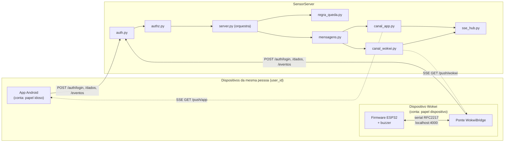
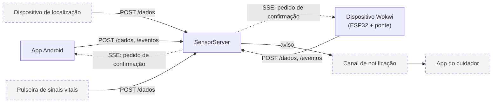
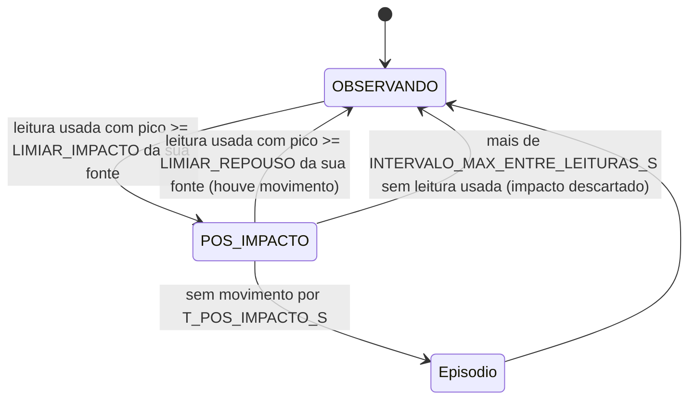
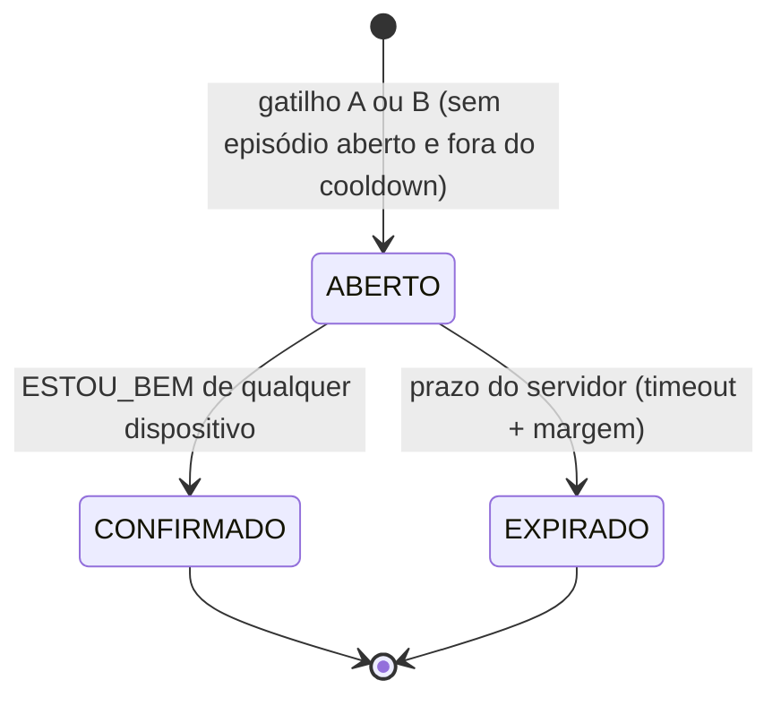
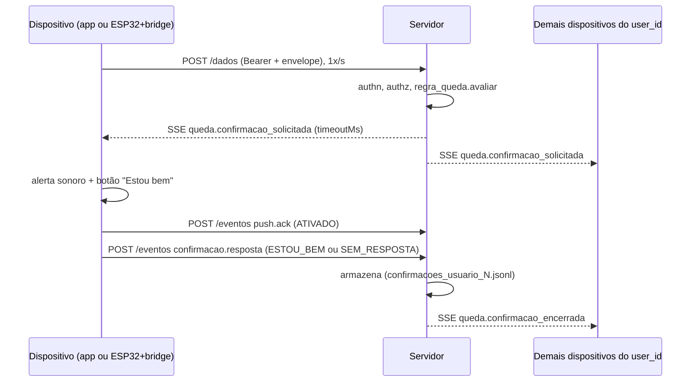

# Arquitetura Geral — Flow

**Disciplina:** Software para Sistemas Ubíquos
**Cenário do projeto:** Monitoramento e assistência a uma pessoa idosa (ver `README.md` para a análise inicial completa)

Este documento é o registro **único e versionável** das decisões de arquitetura do projeto Flow: os componentes envolvidos, o fluxo de comunicação entre eles, a responsabilidade de cada parte, o mecanismo de comunicação escolhido (e por que outros foram descartados) e as condições de falha já consideradas. Ele cobre tanto a visão **geral** (o que vale independentemente de qual protótipo está em campo) quanto o **estado atual do protótipo** (o que já está de fato implementado no código deste repositório).

---

## 1. Cenário e atores

- **Usuário primário:** a pessoa idosa monitorada. Uso passivo: o sistema só pede interação quando suspeita de uma queda.
- **Usuário secundário *(abstrato)*:** cuidadores e familiares, que receberão informações e alertas (papel `cuidador`, reservado no modelo de contas).
- **Situação de uso:** ambiente residencial, com um ou mais dispositivos junto ao idoso coletando dados continuamente.

O sistema é **IoT** (dispositivos conectados enviando dados continuamente a um servidor) e **ubíquo** (sensoriamento contínuo, sem interação explícita do idoso no uso normal).

- **Concreto:** o laço **percepção → decisão → atuação** está fechado. O servidor analisa o movimento, decide que uma queda é provável, aciona um alerta sonoro no próprio idoso (celular e buzzer), que responde por um botão, e registra um aviso ao cuidador em arquivo.
- **Abstrato:** o aviso ao cuidador chegando a ele por um canal real, novos sensores (localização, sinais vitais) e outras ações de atuação.

Pelo laço concreto o sistema se aproxima de um **sistema ciber-físico**; o efeito completo sobre o cuidador depende da parte abstrata.

---

## 2. Componentes

### 2.1 Papéis lógicos

| Elemento | Papel | Concreto (existe) | Abstrato (visão) |
| --- | --- | --- | --- |
| **Sensores** | Percebem o ambiente e o comportamento do idoso | Luz/CCT, acelerômetro, orientação, magnetômetro (celular); acelerômetro MPU6050 (ESP32 simulado) | Localização, sinais vitais (pulseira, dados mockados), microfone para sons de queda |
| **Produtor / gateway** | Concentra um ou mais sensores, monta o evento, cifra e envia ao servidor. Também é **consumidor**: recebe do servidor os pedidos de confirmação | App Android; dispositivo Wokwi (firmware ESP32 + ponte `WokwiBridge`, um único dispositivo lógico) | Dispositivo dedicado por sensor não coberto pelo celular (ex.: localização) |
| **Servidor central** | Autentica, autoriza, valida, agrega, decide e envia mensagens de volta | `SensorServer`: um único ponto lógico de consumo, com visão consolidada por pessoa | Atender mais de uma residência (servidor assíncrono, estado externo), **mantendo a topologia em estrela** |
| **Atuadores** | Produzem efeito observável a partir de uma decisão | Alerta sonoro e botão "Estou bem" (app); buzzer e botão (Wokwi); aviso ao cuidador registrado em arquivo de alerta | Notificação real ao cuidador; histórico consultável; outras ações |

Cada pessoa monitorada pode ter **mais de um produtor simultâneo** (por exemplo, o celular para luz/movimento e um dispositivo dedicado para localização), todos ligados à mesma pessoa pelo `user_id` da conta com a qual autenticaram.

### 2.2 Componentes concretos

Há **dois dispositivos** concretos, cada um com a sua conta e falando diretamente com o servidor: o **app Android** e o **dispositivo Wokwi**. Este último é formado por duas pastas, `sketch/` (firmware) e `WokwiBridge/` (ponte), que **juntas representam um único dispositivo**: para o servidor há uma conta, um `user_id` e um conjunto de eventos, e a ponte é apenas o meio pelo qual o ESP32 simulado, que só fala serial, alcança a rede.

| Pasta | Componente | Responsabilidade |
| --- | --- | --- |
| `SensorApp/` | App Android (Kotlin) | Produtor real: sensores do celular. Faz login, envia telemetria, mantém o canal de push aberto e exibe o pedido de confirmação. |
| `sketch/` | Dispositivo Wokwi: firmware ESP32 (`sketch.ino`, simulado no Wokwi) | Acelerômetro MPU6050, máquina de imobilidade local, buzzer e botões. Só fala serial. |
| `WokwiBridge/` | Dispositivo Wokwi: ponte (`bridge.py`) | Parte do dispositivo que o liga à rede: autentica-se, repassa a telemetria da serial ao servidor e traduz as mensagens de push em comandos de texto para o firmware. |
| `SensorServer/` | Servidor (Flask) | Módulos abaixo. |

Módulos do servidor:

| Arquivo | Responsabilidade |
| --- | --- |
| `server.py` | Orquestração: rotas, pipeline de ingestão, buffer de agregação, threads de flush e vigia, despacho dos pedidos de confirmação. |
| `const.py` | **Constantes e parâmetros ajustáveis** (porta, caminhos, validade de tokens, versão do contrato, limiares, timeouts, retenções). Definição única de cada valor. Ver 14. |
| `auth.py` | **Autenticação:** contas, senhas, login, refresh, emissão e verificação de tokens. Não conhece Flask. |
| `authz.py` | **Autorização:** papel → permissões, escopo por pessoa, auditoria. |
| `mensagens.py` | Mensagens de push (criação, validade) e validação dos eventos de retorno. Sem I/O de rede. |
| `sse_hub.py` | Mecanismo comum de push por SSE: conexões, fila limitada por conexão, keepalive, replay. |
| `canal_app.py` | **Servidor → app.** Rota `GET /push/app` e envio ao alvo `app`. |
| `canal_wokwi.py` | **Servidor → Wokwi.** Rota `GET /push/wokwi` e envio ao alvo `wokwi`. |
| `regra_queda.py` | Análise do acelerômetro (fusão das fontes por usuário), episódios de confirmação, timeout, mapa `messageId` → episódio, armazenamento da resposta. |
| `regra_luz.py`, `regra_imobilidade.py` | Regras de negócio (luz inadequada à noite; imobilidade prolongada). |
| `crypto_utils.py` | Envelope AES-256-GCM. |
| `simular_queda.py` | Utilitário (fora do servidor): simula um wokwi que sofre impacto e fica imóvel, para testar o push sem Wokwi nem celular. |
| `tests/` | Suíte pytest (`unit/` e `integration/`); ver 14.1. |

Dependências: `canal_*` não conhecem `regra_queda`; `regra_queda` não conhece os canais, `regra_imobilidade` nem `mensagens` (devolve um `PedidoConfirmacao`; é `server.py` que cria a mensagem e a despacha); `auth` não conhece Flask. `const.py` é um módulo folha: não importa nada do projeto, e os demais fazem `import const` e leem `const.X` na hora do uso, de modo que um único ajuste vale para todos os pontos de uso.

### 2.3 Elementos abstratos (visão do sistema)

Ainda sem implementação. Cada um é descrito pelo papel e pelo ponto em que se encaixa na arquitetura concreta.

| Elemento *(abstrato)* | Papel previsto | Ponto de encaixe |
| --- | --- | --- |
| App ou painel do cuidador | Receber alertas e consultar o histórico das pessoas vinculadas | Conta de papel `cuidador` (`user_ids` como lista, leitura escopada pelas claims); recebe push por um canal próprio. |
| Canal de notificação ao cuidador | Entregar o aviso ao cuidador (hoje só registrado em arquivo) | Novo módulo `canal_*.py` com a mesma interface `enviar(user_id, mensagem)`. |
| Dispositivo de localização | Produtor dedicado, para sensor que o celular não cobre | Novo `source`; segue o contrato mínimo de qualquer produtor (6.1). |
| Pulseira de sinais vitais | Frequência cardíaca e oximetria (dados mockados) | Idem. |
| Push em segundo plano | Alertar o idoso com a tela bloqueada | Foreground Service e/ou FCM no `canal_app.py`, sem mudar o contrato da mensagem. |

---

## 3. Topologia e sentidos de comunicação



- **Ida (dispositivo → servidor):** `POST` HTTP. Telemetria em `/dados`; eventos discretos (ack e resposta do idoso) em `/eventos`.
- **Volta (servidor → dispositivo):** push por **SSE** (por que não WebSocket: seção 10.5). O **dispositivo abre** a conexão (`GET`) e o servidor empurra mensagens por ela. Nenhum dispositivo expõe porta; o servidor nunca precisa conhecer o endereço de um dispositivo.
- **Estrela:** cada dispositivo fala diretamente com o servidor; não há nível intermediário entre dispositivos e servidor. O dispositivo Wokwi é um só: firmware e ponte compartilham uma conta e uma conexão com o servidor, e a ponte existe porque o ESP32 simulado só fala serial.

### 3.1 Sistema completo (concreto e abstrato)

Contorno contínuo: concreto. Contorno tracejado: abstrato.



As setas tracejadas entre `SensorServer` e os dispositivos concretos são o push SSE (conexão aberta pelo dispositivo); só os quatro blocos de contorno tracejado e suas setas são abstratos.

---

## 4. Identidade, autenticação e autorização

### 4.1 Contas e papéis

Tudo que se conecta ao servidor é uma **conta** com `papel`, `user_ids` (pessoas monitoradas a que se refere) e `fontes` permitidas (`app`, `wokwi`).

| Papel | Quem usa | Fonte | Observação |
| --- | --- | --- | --- |
| `idoso` | App do idoso | `app` | Exatamente um `user_id`. |
| `dispositivo` | Dispositivo Wokwi (a conta é usada pela ponte, em nome do conjunto firmware + ponte) | `wokwi` | Exatamente um `user_id`. |
| `admin` | Operação/depuração | — | Lê `GET /dados` e `GET /estado/<id>`. |
| `cuidador` *(abstrato)* | App do cuidador | — | Reservado; `user_ids` é lista para vincular várias pessoas. A política vigente concede **conjunto vazio** de permissões (negar por padrão); a coluna `cuidador` da tabela 4.3 é o desenho futuro, sem implementação. |

O `user_id` é uma consequência da conta: não é digitado no app nem no bridge. Dois produtores da mesma pessoa têm contas apontando para o mesmo `user_id`, e é isso que faz o servidor agregá-los.

### 4.2 Login e tokens

- **Senhas:** `scrypt` com sal por conta, comparação em tempo constante. Contas criadas por CLI (`python auth.py criar-conta ...`); não há auto-cadastro. Persistidas em `contas.json`.
- **`POST /auth/login`** (corpo em envelope cifrado): `identificador`, `segredo`, `fonte`, `device_id`. Resposta (também cifrada): `access_token`, `refresh_token`, `expires_in`, `papel`, `user_ids`. A senha nunca trafega em claro.
- **Access token:** JWT HS256, validade padrão 1 h; claims `sub`, `papel`, `user_ids`, `fonte`, `device_id`, `iat`, `exp`, `jti`. Enviado em `Authorization: Bearer`.
- **Refresh token:** opaco, validade padrão 7 dias, **uso único** (rotativo). O servidor guarda só o hash em `sessoes.json`, de modo que reiniciar o servidor não derruba as sessões.
- **Bloqueio:** 5 falhas em 15 minutos para o mesmo identificador bloqueiam novas tentativas por 15 minutos (`429`). A resposta é idêntica para conta inexistente e senha errada.
- **Segredo de assinatura:** variável `FLOW_JWT_SECRET` (mínimo 32 bytes). Sem ela o servidor não sobe.

### 4.3 Autorização

RBAC com escopo por pessoa, **negando por padrão**.

| Permissão | `idoso` | `dispositivo` | `admin` | `cuidador` *(abstrato)* |
| --- | --- | --- | --- | --- |
| `dados:enviar` (`POST /dados`) | sim, fonte `app` | sim, fonte `wokwi` | não | não |
| `eventos:enviar` (`POST /eventos`) | sim | sim | não | não |
| `push:receber` (`GET /push/...`) | sim, canal `app` | sim, canal `wokwi` | não | canal próprio |
| `dados:ler`, `estado:ler` (`GET`) | não | não | sim | só pessoas vinculadas |

Dois estágios de verificação:

1. **Papel e permissão**, antes de decifrar o corpo (decorador `exige(permissao, fonte=...)`): token válido, papel com a permissão, fonte do token igual à exigida. Falha → `401` ou `403`.
2. **Escopo**, depois de decifrar: `user_id` do payload deve estar em `token.user_ids`, `source` deve ser a `fonte` do token e o `device_id`/`deviceId` do payload, se declarado, deve ser o `device_id` do token (o do login; o bridge usa o `deviceId` do firmware). Falha → `403`. Payload **sem** `source` válido (ausente ou fora de `app`/`wokwi`) é recusado com `400` antes da checagem de escopo, em `/dados` e em `/eventos`: nenhum caminho aceita dado ou evento sem `source`. `source` presente e diferente da fonte do token é `403`. O `user_id` precisa ser um número inteiro JSON; string (mesmo só de dígitos), booleano, decimal, `null` ou ausente é `400`. Esse estágio existe porque o `user_id` está dentro do envelope cifrado.

Nos canais SSE o escopo é implícito: a conexão é registrada no `user_id` do token; o cliente não escolhe de quem recebe.

**Auditoria:** toda negação (`401`/`403`, e também `413` por corpo grande, com o motivo `corpo_grande`) vai para `dataUsers/auditoria.jsonl` (instante, rota, motivo, conta, IP), nunca o conteúdo da requisição. O arquivo é rotacionado por tamanho: ao passar de `AUDITORIA_MAX_BYTES` (5 MB) vira `auditoria.1.jsonl`, sobrescrevendo o anterior, e um novo começa; o espaço máximo fica em torno do dobro do limite. A rotação existe porque o estágio 1 roda antes de decifrar, e quem está na rede poderia encher o disco com negações sem conhecer a chave.

---

## 5. Transporte e criptografia

- **HTTP** na rede local, com **envelope AES-256-GCM** em todo corpo: `{"nonce": "<base64>", "ciphertext": "<base64>"}` (nonce de 12 bytes aleatório por mensagem, tag de 128 bits ao final do ciphertext).
- O mesmo envelope cifra o **push**: o `data:` de cada evento SSE é um envelope.
- Implementações equivalentes em Python (`crypto_utils.py`, no servidor e no bridge) e Kotlin (`CryptoUtils.kt`, `javax.crypto`); ambas oferecem `encrypt` e `decrypt`.
- O firmware **não** faz rede nem criptografia: a cifragem do Wokwi começa no bridge. A serial entre ESP32 e bridge é local e em texto.

Por que HTTP+AES-GCM e não MQTT, gRPC ou Kafka: o sistema tem um único consumidor lógico, eventos pequenos e periódicos e nenhuma necessidade de replay ou fan-out; HTTP é o menor mecanismo que atende. O volume e o número de consumidores são a premissa que, se mudar, reabre essa decisão; a topologia, mesmo assim, continua em estrela.

---

## 6. Contratos de mensagem

### 6.1 Campos de roteamento

Todo payload de produtor traz, no texto decifrado:

| Campo | Papel |
| --- | --- |
| `schemaVersion` (raiz) | Versão do schema daquele payload. Cada schema tem versão própria; as versões atuais ficam em `docs/schemas.md`. |
| `user_id` | Pessoa monitorada; deve estar nas claims do token. |
| `source` | `"app"` ou `"wokwi"`; deve ser a fonte do token. |

Fora disso **não há schema de aplicação unificado**: cada produtor define seu contrato (campos, unidades, tipo de evento). O servidor exige de qualquer fonte nova: um identificador de evento, um identificador do dispositivo e um contador de sequência para deduplicação, e o instante gerado na origem.

### 6.2 Contratos existentes

| Contrato | Origem | Rota | Conteúdo |
| --- | --- | --- | --- |
| Telemetria do app | App | `POST /dados` | `sensores`, `leitura_ambiente` (luz/CCT) e `acelerometro` (`magnitude`, `magnitude_max_janela`, `amostras`, `janela_ms`). |
| Telemetria do Wokwi | Firmware via bridge | `POST /dados` | `imobilidade.leitura` (com `value` e `valueMax`) e `imobilidade.decisao`. |
| Retorno | App ou firmware | `POST /eventos` | `push.ack` (`ATIVADO`, `REJEITADO`) e `confirmacao.resposta` (`ESTOU_BEM`, `SEM_RESPOSTA`), com o `messageId` a que respondem. |
| Push | Servidor | SSE | `queda.confirmacao_solicitada` (`timeoutMs`, `motivo`) e `queda.confirmacao_encerrada` (`resultado`). |
| Comando serial | Ponte (servidor → firmware) | Serial local, texto, sem `schemaVersion` | `CMD;BUZZER_ON;<messageId>;<timeoutMs>` e `CMD;BUZZER_OFF;<messageId>;<motivo>`. |
| Diagnóstico do firmware | Firmware via bridge | `POST /dados` | `sistema.erro`, com o código da falha (hoje `MPU_NAO_ENCONTRADO`, quando o MPU6050 não é detectado). Fica fora do vocabulário que o servidor processa: é descartado e logado, sem alerta e sem resposta de erro (`200`). |
| Autenticação | App e bridge | `POST /auth/*` | Seção 4.2. |

Detalhe campo a campo em `docs/schemas.md`.

### 6.3 Regras de contrato

- **`timeoutMs` é relativo**, nunca um prazo absoluto: celular e servidor não têm relógios sincronizados. `issuedAt`/`expiresAt` servem ao servidor e ao bridge.
- **Idempotência:** o dispositivo ignora `messageId` já tratado.
- **Faixa física plausível:** aceleração de `0` a `160` m/s² (o sensor do Wokwi opera em ±8 g, magnitude máxima mensurável ≈136 m/s²; o teto é o mesmo do app).
- **Versionamento tolerante, por schema:** a versão atual de cada schema está em `docs/schemas.md` e é definida em um único lugar do servidor (`const.SCHEMA_VERSION_ATUAL`); nenhum outro ponto do código escreve o número. Versão ausente = 1. Versão de `1` até a atual é **aceita e usada**, e as regras logam o aviso de "desatualizada". Versão maior que a atual, abaixo da mínima ou que não seja inteiro é descartada e logada (resposta em 7). Na análise de queda a versão tem papel próprio: entre as leituras de um usuário vale a de maior versão presente (9.2).

---

## 7. API do servidor

| Rota | Método | Autorização | Papel |
| --- | --- | --- | --- |
| `/auth/login`, `/auth/refresh` | POST | pública | Autenticação (corpo cifrado). |
| `/dados` | POST | `dados:enviar` | Ingestão de telemetria. |
| `/eventos` | POST | `eventos:enviar` | Eventos de retorno; não passam pelo buffer de agregação. |
| `/push/app` | GET (SSE) | `push:receber`, fonte `app` | Canal servidor → app. |
| `/push/wokwi` | GET (SSE) | `push:receber`, fonte `wokwi` | Canal servidor → bridge. |
| `/dados` | GET | `dados:ler` (admin) | Depuração: últimos registros agregados. |
| `/estado/<device_id>` | GET | `estado:ler` (admin) | Tabela de estado da imobilidade por dispositivo. |
| `/`, `/health` | GET | pública | Disponibilidade. |

O servidor escuta em `0.0.0.0:5000` e roda com `threaded=True` (uma thread por stream SSE). Falhas de autenticação/autorização são `4xx`. **Corpo acima de `MAX_CONTENT_LENGTH` (64 KiB) é `413`** em qualquer rota com corpo (`/dados`, `/eventos`, `/auth/*`): o servidor não processa o conteúdo e a negação vai para a auditoria sem ele. O maior corpo legítimo é um envelope de telemetria, de poucos KB. Sem token, a resposta continua `401`, antes de o corpo ser lido. conteúdo inválido de um evento já autenticado é descartado internamente e responde `200`.

Entrada malformada **antes** de haver conteúdo interpretável é `400`: corpo decifrado que não é um objeto JSON, `source` ausente ou inválido, `user_id` inválido, `device_id` inválido no login (não string ou acima de 64 caracteres). `Last-Event-ID` inválido nunca é erro: vale `0`. `schemaVersion` não suportado em `/dados` e `/eventos` responde `200` com `descartado: true` e `motivo: "schemaVersion_nao_suportado"`, e o conteúdo não chega ao buffer nem às regras; em `/auth/login` e `/auth/refresh`, a versão maior que a atual ou inválida é `400` (a ausência é aceita).

---

## 8. Ingestão e processamento

```markdown
Evento bruto (envelope cifrado)
    ↓ authn/authz (estágio 1) → decifrar → authz (estágio 2: escopo)
    ↓ buffer de agregação (por user_id e fonte)
    ↓ validação (schema + faixa física)  ↓ deduplicação (device_id + sequência)
    ↓ atualização de estado  ↓ regra de decisão
    ↓ atuação (alerta em arquivo; pedido de confirmação por push)
```

**Responsabilidades:** o dispositivo captura, gera o tempo do evento e descarta leituras claramente inválidas; o servidor deduplica, mantém estado, decide, dispara a atuação e guarda o histórico.

### 8.1 Buffer de agregação por usuário

Produtores assíncronos da mesma pessoa não enviam sincronizados. O servidor mantém, por `user_id`, a leitura mais recente de cada fonte e, a cada `JANELA_AGREGACAO_S` (1 s), grava **uma linha** em `dataUsers/usuario_<user_id>.jsonl`:

```json
{ "timestamp": "<flush, ISO 8601>", "user_id": 1, "app": {...} | null, "wokwi": {...} | null }
```

Fonte sem dado na janela fica `null` (não repete o último valor). Se uma fonte atrasar além da janela, aparece sozinha na linha seguinte: é telemetria, vale a leitura mais recente. As regras de negócio rodam **imediatamente**, sem esperar o flush.

### 8.2 Regra "luz inadequada à noite" (`regra_luz.py`, dados do app)

Validação (`luminosidade >= 0`, `1000 <= cct <= 12000`, `event_time` ISO 8601), deduplicação por `device_id`+`seq_num`, condição noturna (18h–6h) com `cct > 4500K`, debounce de 3 leituras consecutivas, sem repetição no mesmo episódio. Atuação: `alerta_<device_id>_<timestamp>.json` em `dataUsers/`.

### 8.3 Regra "imobilidade prolongada" (`regra_imobilidade.py` + `sketch.ino`)

Decisão compartilhada. No firmware: máquina `NORMAL → AGUARDANDO_CONFIRMACAO → ALERTA_CONFIRMADO` com histerese (`LIMIAR_BAIXO`/`LIMIAR_ALTO`), persistência (`T_PERSISTENCIA_MS`), janela de confirmação humana (`T_CONFIRMACAO_MS`, botão "Estou bem") e rearme manual. No servidor: validação em cascata (`eventType` → `state` → faixa de `value`), deduplicação por `sequence`, tabela de estado por `device_id` (exposta em `GET /estado/<device_id>`) e atuação só quando chega `ALERTA_IMOBILIDADE` sem alerta ativo no episódio, gravando `alerta_imobilidade_<device_id>_<timestamp>.json`. O servidor não confia cegamente no firmware: só rearma ao receber um estado que encerra o episódio.

---

## 9. Análise de queda e ciclo de confirmação

`regra_queda.py` recebe as leituras de aceleração das duas fontes, decide se há **queda provável** e devolve um `PedidoConfirmacao`; `server.py` o transforma em mensagem e o despacha.

### 9.1 Entrada normalizada

As fontes medem coisas diferentes: no Wokwi o repouso é magnitude ≈ 0; no celular é ≈ 9,81 m/s² (gravidade). A regra compara **aceleração dinâmica**:

| Fonte | Leitura | Dinâmica atual | Pico da janela |
| --- | --- | --- | --- |
| `wokwi` | `imobilidade.leitura`: `value`, `valueMax` | `value` | `valueMax` |
| `app` | `acelerometro`: `magnitude`, `magnitude_max_janela` | `abs(magnitude − 9,81)` | `max(magnitude_max_janela − 9,81; 0)` |

O pico existe porque uma amostra por segundo perderia o impacto, que dura frações de segundo: o firmware amostra o sensor a cada ~50 ms e o app a ~50 Hz, e ambos enviam o máximo da janela.

**Só leitura válida e não repetida alimenta a regra.** A telemetria do wokwi passa antes pela validação e pela deduplicação de `regra_imobilidade` (evento inválido ou duplicado não chega a `regra_queda`). A do app é deduplicada pelo `timestamp_envio` (epoch ms, raiz do payload), por `(user_id, source, device_id)`: valor menor ou igual ao último aceito é duplicado; se regredir mais que `TOLERANCIA_RELOGIO_S` (60 s), considera-se reajuste de relógio do celular e o valor vira a nova referência, para não bloquear a análise. Payload sem `acelerometro` aproveitável, ou wokwi sem os campos de leitura, simplesmente não contribui. Como o `device_id` vem do cliente, a tabela de referências da deduplicação é limitada a `MAX_REFERENCIAS_DEDUP` (1000): passando disso, sai a mais antiga.

### 9.2 Gatilhos

| Gatilho | `motivo` | Fontes | Detecção |
| --- | --- | --- | --- |
| **A** (preferencial) impacto seguido de imobilidade | `IMPACTO_SEGUIDO_DE_IMOBILIDADE` | app e wokwi | Máquina de estados **por usuário**, alimentada pelas leituras de todas as fontes (9.2.1). |
| **B** imobilidade prolongada | `IMOBILIDADE_PROLONGADA` | wokwi | Alerta de `regra_imobilidade`, repassado por `server.py` a `regra_queda.abrir_por_imobilidade`. |



### 9.2.1 Fusão de fontes e prioridade por versão

O mesmo idoso pode estar com o celular e com o dispositivo Wokwi ao mesmo tempo. A máquina é **uma por usuário** e usa as leituras das duas fontes, de modo que um movimento visto por qualquer dispositivo cancela a suspeita de impacto visto por outro.

| Termo | Definição |
| --- | --- |
| Leitura | Amostra aproveitável de uma fonte, já validada e deduplicada (9.1): fonte, `device_id`, versão, dinâmica atual, pico da janela e instante de chegada (relógio do servidor). |
| Leitura fresca | A última leitura de cada dispositivo (`fonte` + `device_id`) com no máximo `JANELA_FUSAO_S` (2 s) de idade. |
| Versão de referência | A **maior** versão entre as leituras frescas do usuário naquele instante. É relativa ao que está presente, não à versão atual do contrato: assim o modo degradado funciona quando só há dispositivos antigos. |
| Leitura usada | Leitura fresca da versão de referência. Entre várias leituras usadas vale o máximo (qualquer uma pode abrir ou cancelar a suspeita). |
| Leitura desatualizada | Leitura fresca de versão menor que a de referência. Fica **fora do sinal**, é logada (no máximo uma vez a cada 60 s por usuário, fonte e versão) e não renova o relógio da máquina. |
| Impacto | Leitura usada com pico `>= LIMIAR_IMPACTO` da sua fonte. |
| Movimento | Leitura usada com pico `>= LIMIAR_REPOUSO` da sua fonte. O que conta é o **pico da janela**, não a última amostra: um movimento entre amostras não passa despercebido. |

Cada leitura usada move a máquina **uma única vez, na chegada**; a leitura de impacto não é recontada como movimento nem como novo impacto quando outra fonte chega depois. Os limiares são por fonte, então combinar por máximo equivale a "alguma leitura usada alcança o limiar da sua própria fonte", sem misturar unidades. Consequência assumida: para concluir "parado", **nenhuma** leitura usada pode ter alcançado o repouso da sua fonte.

Regras da máquina:

- Em `OBSERVANDO`, um impacto leva a `POS_IMPACTO` e guarda o instante.
- Em `POS_IMPACTO`, um movimento volta a `OBSERVANDO`; se a mesma leitura também for impacto, recomeça em `POS_IMPACTO` com novo instante. Sem movimento por `T_POS_IMPACTO_S`, abre o episódio.
- Em `POS_IMPACTO`, se passar mais de `INTERVALO_MAX_ENTRE_LEITURAS_S` (3 s, a calibrar) sem nenhuma leitura usada, o impacto é descartado: uma única leitura calma depois de um silêncio longo não prova imobilidade.

Dados degradados:

| Situação | Tratamento |
| --- | --- |
| App v1 ou v2 (sem bloco `acelerometro`) | Não gera leitura; continua alimentando o buffer e a regra de luz. |
| Wokwi v1 ou v2 (sem `valueMax`) | Gera leitura com pico igual ao valor da amostra e marca `degradada`. Se só houver dispositivos antigos, eles são a referência. |
| Versão maior que a atual | Descartada antes de chegar à regra (6.3). |

Nada disso altera o gatilho B, o episódio único, o cooldown nem o ciclo de confirmação. Quando os dois gatilhos disparam, vale o primeiro a chegar.

A preferência pelo gatilho A é temporal: ele age cerca de `T_POS_IMPACTO_S` (3 s) depois do impacto, enquanto o B só chega depois da persistência (5 s) e da janela de confirmação local (8 s) do firmware. O B cobre quedas sem impacto detectável (desmaio, queda lenta).

### 9.3 Episódios



- **Um único episódio aberto por `user_id`**, qualquer que seja o número de fontes e gatilhos; após o encerramento, `COOLDOWN_S` até o próximo.
- O pedido vai a **todos os dispositivos** do usuário com canal ativo, na mesma mensagem (mesmo `messageId`).
- A primeira resposta `ESTOU_BEM` encerra o episódio (`CONFIRMADO`) e o servidor envia `queda.confirmacao_encerrada` aos canais, para que o outro dispositivo cale o alarme. Resposta tardia é armazenada como tardia e não reabre nada.
- **O episódio de um retorno é o da sua `messageId`**, resolvido por um mapa `messageId` → (usuário, episódio, validade) preenchido a cada pedido emitido. Retorno (`push.ack`, `SEM_RESPOSTA` ou `ESTOU_BEM`) de episódio já encerrado, inclusive de um anterior ao mais recente, é gravado com `tardia: true`. Retorno de `messageId` desconhecida ou de outro usuário é gravado com `episodeId: null` e `mensagem_desconhecida: true` e não encerra nada. Só `ESTOU_BEM` de mensagem conhecida com episódio aberto encerra como `CONFIRMADO`. O mapa é podado pelo vigia, `RETENCAO_MENSAGENS_S` (1 h) depois de a mensagem expirar.
- Um vigia (a cada 1 s) encerra como `EXPIRADO` o episódio cujo prazo venceu. Falha ao gravar ou despachar o encerramento de um episódio não impede os demais nem derruba a thread; o episódio fica encerrado e o erro vai para o log. A thread de flush do buffer tem a mesma proteção, por usuário.



### 9.4 Parâmetros (`const.py`)

| Constante | Padrão | Observação |
| --- | --- | --- |
| `TIMEOUT_CONFIRMACAO_S` | **5** | **Fonte única** do tempo do botão; viaja na mensagem como `timeoutMs`. |
| `MARGEM_SERVIDOR_S` | 2 | Prazo do servidor = timeout + margem. |
| `LIMIAR_IMPACTO` | wokwi 20, app 15 (m/s²) | Valores iniciais, a calibrar. |
| `LIMIAR_REPOUSO` | wokwi 2, app 1,5 (m/s²) | |
| `T_POS_IMPACTO_S` | 3 | Imobilidade exigida após o impacto. |
| `COOLDOWN_S` | 60 | Entre episódios do mesmo usuário. |
| `JANELA_FUSAO_S` | 2 | Idade máxima de uma leitura para participar da fusão (9.2.1). |
| `INTERVALO_MAX_ENTRE_LEITURAS_S` | 3 | Sem leitura usada por mais que isso, o impacto é descartado. A calibrar. |
| `LOG_DESATUALIZADA_INTERVALO_S` | 60 | Frequência máxima do log de leitura desatualizada. |
| `TOLERANCIA_RELOGIO_S` | 60 | Regressão de `timestamp_envio` acima da qual a deduplicação do app assume reajuste de relógio. |
| `RETENCAO_MENSAGENS_S` | 3600 | Tempo que o mapa `messageId` → episódio guarda a entrada depois de a mensagem expirar. |
| `TTL_ENCERRAMENTO_S` | 10 | Validade da mensagem `queda.confirmacao_encerrada`. Deve ser maior que `TIMEOUT_CONFIRMACAO_S` + `MARGEM_SERVIDOR_S`, para o encerramento sobreviver ao pedido no replay após reconexão. |
| `MAX_REFERENCIAS_DEDUP` | 1000 | Dispositivos do app rastreados na deduplicação (9.1). |

### 9.5 Armazenamento

`dataUsers/confirmacoes_usuario_<user_id>.jsonl`, uma linha por ocorrência com `timestamp`: `episodio.aberto`, `push.entrega` (resultado por canal), `push.ack`, `confirmacao.resposta`, `episodio.encerrado`. Todo retorno leva o `episodeId` da sua `messageId` (ou `null`, com `mensagem_desconhecida: true`) e, quando o episódio já estava encerrado, `tardia: true`. A linha `episodio.aberto` do gatilho A registra também a fusão: `fonte_do_disparo`, `versao_referencia`, `fontes_usadas` e `fontes_desatualizadas` (campos em `docs/schemas.md`). **É tudo que o servidor faz com a resposta do idoso**; o uso posterior dessa informação não está definido.

---

## 10. Push servidor → dispositivo

### 10.1 Mensagem

```json
{
  "schemaVersion": 3,
  "messageId": "<uuid>",
  "messageType": "queda.confirmacao_solicitada",
  "userId": 1,
  "episodeId": "<uuid>",
  "issuedAt": "2026-10-09T18:30:00.000Z",
  "expiresAt": "2026-10-09T18:30:07.000Z",
  "payload": { "timeoutMs": 5000, "motivo": "IMPACTO_SEGUIDO_DE_IMOBILIDADE" }
}
```

`schemaVersion` é a versão atual do schema de push (no exemplo, 3). `expiresAt` é verificado pelo servidor (antes de enviar) e pela ponte do Wokwi; o app não depende de relógio absoluto e usa apenas `timeoutMs` (6.3).

Tipos: `queda.confirmacao_solicitada` e `queda.confirmacao_encerrada` (`payload.resultado`: `CONFIRMADO`, `EXPIRADO`, `CANCELADO`). Mensagem expirada não é entregue nem executada.

### 10.2 Hub SSE (`sse_hub.py`)

- Registro `(user_id, canal) → conexões`. Nova conexão do mesmo `device_id` substitui a anterior. A conexão só é registrada quando o stream de fato começa; um cliente que cai antes disso não deixa conexão fantasma.
- Cada evento SSE: `id:` (contador por usuário e canal), `event: push`, `data:` (envelope cifrado). Comentário `: keepalive` a cada 15 s. O contador parte de um valor derivado do instante de subida do servidor (em segundos, para caber em inteiro de 32 bits), de modo que o `Last-Event-ID` guardado pelo cliente nunca fica à frente do contador depois de um reinício.
- **Fila por conexão:** pequena (`TAMANHO_FILA_CONEXAO`, 16), em memória. É só o amortecedor entre quem publica e a thread que escreve no stream, não uma fila de mensagens. Cliente que não consome e enche a fila tem a conexão fechada e não conta como entregue; ao reconectar com `Last-Event-ID` recebe o que ainda não expirou.
- **Replay:** anel das últimas 20 mensagens por usuário e canal; na reconexão com `Last-Event-ID`, reenvia só o **não expirado**, com `timeoutMs` **recalculado** para o tempo restante. O replay entra na fila antes de a conexão ficar visível para novas publicações, então os `id` saem em ordem crescente; se houver mais pendentes que a fila comporta, vão os mais recentes. O servidor não define o cabeçalho `Connection` (é específico de salto e fica com o servidor HTTP).
- **Presença:** o hub informa se há conexão ativa por canal, de onde vem o resultado de entrega `ENTREGUE_AO_CANAL` ou `SEM_CANAL_ATIVO` (`ERRO_NO_CANAL` quando o canal levanta exceção).

### 10.3 Canais

`canal_app.py` e `canal_wokwi.py` expõem a mesma interface: a constante `CANAL` e `enviar(user_id, mensagem)` que devolve o resultado de entrega. Diferem na rota, na fonte exigida e nos tipos de mensagem que o alvo suporta, e evoluem separadamente. `server.py` percorre a lista `CANAIS`.

No Wokwi, `ENTREGUE_AO_CANAL` significa apenas que o **bridge** está conectado; que o firmware recebeu e agiu só é conhecido pelo `push.ack`.

### 10.4 Ciclo de vida do stream

1. O cliente chama `GET /push/<canal>` com `Authorization: Bearer`.
2. O servidor limita a duração do stream ao `exp` do token; a poucos segundos do vencimento envia `event: reautenticar` e fecha.
3. O cliente renova o token e reconecta com `Last-Event-ID`.
4. Qualquer queda de conexão: reconexão com recuo exponencial (1 s até 30 s). `401` → renovar o token; `403` → parar.

### 10.5 Por que SSE e não WebSocket

A escolha vem de uma pergunta: **o que o servidor precisa dizer ao dispositivo, e o que o dispositivo precisa dizer de volta?** O servidor precisa apenas *empurrar* mensagens pontuais e de baixa frequência (um pedido de confirmação de queda e o seu encerramento). Tudo que o dispositivo diz ao servidor (telemetria, `push.ack`, `confirmacao.resposta`) já tem um caminho próprio: `POST` autenticado, que existe independentemente do canal de push. Com a volta *unidirecional* resolvida, a bidirecionalidade do WebSocket não é necessária.

| Critério neste projeto | SSE (escolhido) | WebSocket |
| --- | --- | --- |
| **Direção** | Servidor → cliente, o que o caso exige. O retorno vai por `POST`. | Bidirecional, mas o sentido extra duplicaria o `POST` que já existe. |
| **Protocolo** | HTTP comum (`GET` com resposta em fluxo). Passa por onde HTTP passa; sem *handshake* de *upgrade*. | HTTP seguido de *upgrade* para outro protocolo. |
| **Autenticação e autorização** | O estágio 1 de autorização (`exige(...)`, `Authorization: Bearer`) roda no próprio `GET`, igual a toda rota. Cada evento de retorno é autenticado na sua própria requisição. | A autenticação acontece uma vez, no *handshake*; mensagens no socket aberto exigiriam um desenho próprio de autorização por mensagem. |
| **Dependências no servidor** | Nenhuma: um gerador do Flask com `Response(mimetype="text/event-stream")` e `threaded=True`. | Biblioteca adicional (por exemplo `flask-sock` ou `Flask-SocketIO`) e atenção ao servidor WSGI usado. |
| **Dependências nos clientes** | App: `okhttp-sse` (mesma versão do OkHttp já usado). Bridge: `requests` em modo *stream*, que já era dependência. | App: o OkHttp já suporta WebSocket. Bridge: biblioteca nova (`websocket-client` ou equivalente). |
| **Reconexão e retomada** | O protocolo define `id:` por evento e o cabeçalho `Last-Event-ID`, que o servidor usa para reenviar só o que ainda não expirou (10.2). A lógica de reconectar é do cliente (recuo exponencial). | Sem convenção equivalente: a retomada de mensagens perdidas seria inteiramente projeto próprio. |
| **Depuração** | Texto puro: `curl -N -H "Authorization: Bearer ..." .../push/app` mostra o fluxo. | Exige cliente WebSocket para observar. |
| **Criptografia do conteúdo** | O `data:` de cada evento é o mesmo envelope AES-GCM usado em todo o sistema (texto/base64). | Aceitaria binário, vantagem que aqui não se usa: o envelope já é texto. |
| **Detecção de conexão morta** | Não há *ping/pong* nativo: o servidor envia comentário `: keepalive` a cada 15 s e o cliente usa *read timeout* maior que isso (40 s). | *Ping/pong* nativo: ponto a favor do WebSocket. |
| **Expiração do token com o canal aberto** | Tratada com um evento explícito (`reautenticar`) e fechamento; o cliente renova e reconecta com `Last-Event-ID`. | Teria de ser desenhada à parte (mensagem de controle, fechamento com código). |

**O que se aceita ao escolher SSE** (e por que não pesa aqui):

- **Só um sentido.** Não pesa porque o retorno é pontual e já passa por `POST`; o desenho até se beneficia de um retorno que não depende de a conexão de push estar viva no instante da resposta.
- **Uma conexão HTTP aberta por cliente**, e no Flask de desenvolvimento uma thread por stream. Não pesa na escala de uma residência.
- **Keepalive e reconexão manuais.** São poucas linhas em cada cliente e ficam documentadas e testadas.
- **Sem binário.** O sistema trafega JSON cifrado em base64, que é texto.

**Quando reavaliar WebSocket:** se o mesmo canal precisar carregar tráfego de **alta frequência nos dois sentidos** (por exemplo, telemetria contínua e comandos de latência crítica no mesmo socket), se surgirem **payloads binários**, ou se o número de clientes simultâneos exigir um servidor assíncrono em que o WebSocket seja o modelo natural. Como `sse_hub.py` isola o mecanismo de entrega e os canais (`canal_app.py`, `canal_wokwi.py`) expõem só `enviar(user_id, mensagem)`, trocar o transporte de um alvo não altera as regras nem o contrato da mensagem.

---

## 11. Dispositivos

Os dois dispositivos concretos são o **app Android** (11.1) e o **dispositivo Wokwi** (11.2 e 11.3), que é um só dispositivo composto por firmware e ponte.

### 11.1 App Android

- **Ciclo de vida:** o canal de push e o envio de telemetria existem enquanto o monitoramento está ativo e o app em primeiro plano (`Iniciar` abre ambos; `Parar` e `onPause` fecham). A tela fica acesa enquanto monitora.
- **Componentes:** `AuthClient` (login, renovação, interceptor e authenticator do OkHttp), `PushClient` (SSE com reconexão; confere a **forma** da mensagem antes de entregá-la, e mensagem fora do formato é descartada em silêncio), `MensagemPush` (validação pura da mensagem de push, testável na JVM), `AlertaController` (alarme, botão e contagem regressiva; o encerramento só vale para o episódio em curso), `MainActivity` (sensores, montagem do payload na versão atual do schema, orquestração).
- **Acelerômetro:** registrado a ~50 Hz; a cada envio informa a magnitude da última amostra e o **máximo** desde o envio anterior.
- **Alerta:** toca no stream de alarme do sistema (volume elevado e restaurado ao fim), mostra o botão "Estou bem" com contagem regressiva de `timeoutMs`, envia `push.ack` ao apresentar e `confirmacao.resposta` ao tocar ou ao esgotar o tempo.
- **Credenciais:** usuário e senha só no login; o aparelho guarda os tokens. Aceita apenas o papel `idoso`; outros papéis recebem "tipo de conta ainda não suportado", que é o ponto de entrada do login único por tipo de conta.

### 11.2 Dispositivo Wokwi: firmware (`sketch.ino`)

- MPU6050 em **±8 g** (`ACCEL_CONFIG = 0x10`, 4096 LSB/g), teto plausível 160 m/s²; amostragem a cada ~50 ms para o `valueMax` do ciclo de 1 s.
- Lê comandos da serial sem bloquear: `CMD;BUZZER_ON;<messageId>;<timeoutMs>` e `CMD;BUZZER_OFF;<messageId>;<motivo>`.
- **Buzzer** (pino D13, `tone`/`noTone`): liga com timeout válido (`0 < t ≤ BUZZER_MAX_MS`), responde `push.ack`. Com o buzzer tocando, um `BUZZER_ON` com o **mesmo** `messageId` é ignorado (não reinicia o tempo nem repete o `push.ack`); com `messageId` **diferente**, substitui o episódio em curso. O botão "Estou bem" o desliga e emite `confirmacao.resposta ESTOU_BEM`; o fim do tempo emite `SEM_RESPOSTA`.
- **Diagnóstico:** se não encontra o MPU6050, emite `sistema.erro` (`MPU_NAO_ENCONTRADO`); o evento segue pela ponte até `/dados` e o servidor o descarta e loga (6.2).
- **Teto de segurança** `BUZZER_MAX_MS` (30 s): independente do servidor, impede que o buzzer fique ligado se o bridge ou o servidor falharem. É a única exceção a "o timeout vem só do servidor": `TIMEOUT_CONFIRMACAO_S` (em ms) precisa ser `≤ BUZZER_MAX_MS`, senão o firmware rejeita todo pedido (`push.ack REJEITADO`).
- O botão "Estou bem" tem o mesmo significado na máquina de imobilidade do Marco 2 e no pedido do servidor: um clique vale para os dois, com efeitos independentes. O "Rearme" continua sendo o único que rearma a máquina local.

### 11.3 Dispositivo Wokwi: ponte (`bridge.py`)

A ponte liga o firmware à rede. É bidirecional, com duas atividades concorrentes que compartilham a sessão e a conexão serial:

- **Serial → servidor:** anexa `user_id` (vindo do login) e `source`, roteia por `eventType` (`imobilidade.*` → `/dados`; `push.ack` e `confirmacao.resposta` → `/eventos`), cifra e envia com Bearer; em `401` renova e repete uma vez; sem fila de retransmissão.
- **Servidor → serial:** mantém `GET /push/wokwi`, decifra, confere `userId`, `schemaVersion` e validade, ignora `messageId` repetido, **valida a forma** do que vira linha serial (`messageId` só com `A-Z a-z 0-9 -` e até 39 caracteres; `payload` objeto; `timeoutMs` inteiro; `resultado` entre `CONFIRMADO`, `EXPIRADO` e `CANCELADO`; mensagem fora disso é descartada com log e nada é escrito) e traduz a mensagem em comando de texto escrito na serial (escrita protegida por lock; a conexão serial pode ser recriada pela reconexão).
- A ponte não filtra a **faixa** do `timeoutMs`: quem rejeita valor fora de `0 < t ≤ BUZZER_MAX_MS` é o firmware, e o `push.ack REJEITADO` é a informação que chega ao servidor.
- A ponte não toma decisões: decifra, valida, traduz, escreve.

---

## 12. Resiliência e falhas

A telemetria é leitura de estado, não comando irreversível; por isso a resiliência é por **substituição** (a leitura seguinte prevalece), não por reenvio.

| Situação | Comportamento |
| --- | --- |
| Falha de rede no envio (app ou bridge) | Evento descartado; o ciclo seguinte envia dados frescos. Sem fila. |
| Fonte de dados indisponível (serial) | O bridge reconecta sozinho (`RECONECTAR_A_CADA_S`). |
| Nenhum canal ativo no pedido | `push.entrega = SEM_CANAL_ATIVO`; o episódio segue até o prazo e fecha `EXPIRADO`. Não há fila nem retransmissão: o anel guarda a mensagem só até expirar, e um dispositivo que conecte antes do `expiresAt` a recebe com `timeoutMs` reduzido (a linha `push.entrega` continua `SEM_CANAL_ATIVO`). Depois de expirar, o pedido não vale. |
| Bridge conectado, firmware mudo (simulação pausada) | Entrega ao canal, mas nenhum `push.ack`; o bridge descarta comandos expirados; o firmware tem o teto do buzzer. |
| Conexão SSE cai | Reconexão com recuo exponencial e `Last-Event-ID`; reenvio só do não expirado, `timeoutMs` recalculado. |
| Cliente SSE conectado que não consome | Fila de 16 enche, o servidor fecha a conexão; o cliente reconecta e recebe o não expirado. |
| Falha ao gravar um encerramento, o flush de um usuário ou despachar um canal | Registrada no log; não derruba as threads de vigia e de flush nem impede os demais episódios, usuários ou canais. Canal que levanta exceção vira `push.entrega = ERRO_NO_CANAL` e os outros canais recebem a mensagem. Falha ao avisar o encerramento em `/eventos` ou ao emitir o pedido em `/dados` fica no log e a resposta segue `200`. |
| Token expira com o stream aberto | `event: reautenticar`, fechamento, renovação e reconexão. |
| Refresh recusado | Bridge refaz login com o segredo do ambiente; app pede nova autenticação. |
| Servidor reinicia | Episódios e o mapa de mensagens em memória se perdem (expirariam em segundos); sessões persistem; streams reconectam sozinhos, e os novos `id` de push são maiores que os da execução anterior. |
| `messageId` repetido | Ignorado pelo dispositivo. |
| Resposta duplicada ou tardia | Armazenada com `tardia: true` e o `episodeId` da sua mensagem; não reabre nem altera episódio encerrado. `messageId` desconhecida: `mensagem_desconhecida: true`. |
| Duas fontes ou dois gatilhos disparam | Um episódio só. |
| Dispositivos de versões diferentes do mesmo usuário | Vale a maior versão presente; as menores ficam fora do sinal e são logadas (9.2.1). |
| Credencial errada repetida | Bloqueio temporário; negação em `auditoria.jsonl`. |
| Corpo de requisição acima de 64 KiB | `413` sem processar o conteúdo; negação em `auditoria.jsonl` (sem o corpo). |
| Tabelas em memória com chave vinda do cliente | Limitadas (`MAX_IDENTIFICADORES_LOGIN`, `MAX_ESTADOS_LEGADOS`, `MAX_REFERENCIAS_DEDUP`): ao estourar, saem as mais antigas, para o consumo de memória não crescer sem limite. |
| Dispositivo silencioso *(abstrato)* | Política registrada (alerta de "sem comunicação"), ainda sem rotina que a dispare; os dados para calculá-la existem (`null` no `.jsonl`, `ultima_atualizacao` na tabela de estado). |
| Entrada inválida ou repetida | Descartada e logada; resposta `200`. |
| MPU6050 não encontrado *(firmware)* | O firmware emite `sistema.erro` (`MPU_NAO_ENCONTRADO`); o servidor o descarta e loga, sem alerta ao cuidador. |

---

## 13. Segurança

### 13.1 Mecanismos

- **Confidencialidade e integridade** por mensagem: AES-256-GCM em todo corpo e no push.
- **Autenticação** por conta (senha com scrypt, tokens de curta duração, refresh rotativo, bloqueio por tentativas).
- **Autorização** negando por padrão, em dois estágios, com a identidade vinda do token e nunca do que o cliente declara.
- **Auditoria** de negações.
- **Segredos fora do repositório:** `FLOW_JWT_SECRET` por variável de ambiente; `contas.json` e `sessoes.json` ignorados pelo Git; sem o segredo o servidor não sobe.

### 13.2 Limitações assumidas (projeto acadêmico)

São escolhas de escopo; cada uma traz o caminho para produção.

- **Chave AES fixa e compartilhada**, embutida no código dos dois lados. Produção: chave por dispositivo, negociada no pareamento (ECDH) ou guardada no Android Keystore.
- **HTTP sem TLS:** o token trafega em claro no cabeçalho; quem captura tráfego na rede local e possui a chave lê e forja envelopes. Mitigações desta fase: token de curta duração, `jti`, conferência de escopo contra o payload. Produção: TLS.
- **Criptografia do Wokwi começa no bridge;** a serial local ESP32 ↔ bridge é texto claro.
- **App só em primeiro plano:** o pedido de confirmação não chega com a tela bloqueada ou o app em segundo plano. Produção: Foreground Service e/ou FCM no `canal_app.py`, sem mudar o contrato.
- **Tokens no aparelho** em `SharedPreferences` privado; produção: Android Keystore.
- **Detecção de queda** por limiares iniciais, sem validação com dados reais.

---

## 14. Configuração e operação

| Item | Onde | Observação |
| --- | --- | --- |
| `FLOW_JWT_SECRET` | ambiente do servidor | Obrigatório; ≥ 32 bytes. |
| `FLOW_CONTAS_PATH`, `FLOW_SESSOES_PATH` | ambiente do servidor | Opcionais; padrão `contas.json`, `sessoes.json`. |
| `FLOW_SEM_THREADS` | ambiente do servidor | `1` desliga as threads de flush e vigia (e a exigência do segredo na subida); usado pela suíte de testes. |
| `FLOW_SENHA` | ambiente da CLI `auth.py` | Opcional; senha sem prompt ao criar contas. |
| `FLOW_BRIDGE_ID`, `FLOW_BRIDGE_SECRET`, `FLOW_SERVIDOR`, `FLOW_BRIDGE_DEVICE` | ambiente do bridge | Os dois primeiros são obrigatórios. `FLOW_BRIDGE_DEVICE` (padrão: o `DEVICE_ID` de `sketch.ino`) é registrado no login e deve ser igual ao `deviceId` dos eventos do firmware (`403` se diferir, 4.3). |
| Usuário e senha, IP e porta | tela "Configurações" do app | |
| Timeout do botão, limiares, cooldown, fusão de fontes, retenções | `SensorServer/const.py` | Sem recompilar app nem firmware. |
| Porta, pasta de dados, limite de corpo (`MAX_CONTENT_LENGTH`), validade dos tokens, bloqueio de login, rotação da auditoria, fila do SSE, versão atual do contrato | `SensorServer/const.py` | Cada constante tem comentário com unidade e efeito. Os caminhos de contas e sessões podem ser sobrescritos por variável de ambiente (acima). |
| Versão do core ESP32 | `arduino-cli core list` | 3.x (usa `tone`/`noTone`). |

Ordem de subida: contas criadas → servidor → simulação Wokwi (aba visível, `rfc2217ServerPort = 4000`) → bridge → app. O firewall do computador libera a **entrada** na porta 5000 (celular e bridge conectam *no servidor*; nada conecta no celular).

Arquivos produzidos em `dataUsers/`: `usuario_<id>.jsonl` (agregado), `confirmacoes_usuario_<id>.jsonl`, `auditoria.jsonl` (e `auditoria.1.jsonl` depois da rotação), `alerta_*.json`, `alerta_imobilidade_*.json`. O `device_id` que entra no nome dos arquivos de alerta é sanitizado (só `A-Z a-z 0-9 _ . -`, até 64 caracteres).

### 14.1 Testes

| Alvo | Como | Observação |
| --- | --- | --- |
| Servidor | `cd SensorServer && python -m pytest` (`pytest.ini`) | `tests/unit/` (módulos isolados: auth, authz, mensagens, hub SSE, regra de queda por entrada, estado e retorno, regras legadas, constantes) e `tests/integration/` (rotas HTTP, autenticação e autorização, push SSE e sua resiliência, falha de canal, isolamento entre dispositivos, `user_id`, limite de corpo, inicialização e queda ponta a ponta). Usa segredo próprio, sem threads de fundo, e grava contas, sessões e `dataUsers/` em pasta temporária: não toca nos dados reais. |
| Ponte | `cd WokwiBridge && python -m pytest` (`pytest.ini`) | `tests/test_bridge.py`: tradução e validação das mensagens de push, roteamento das linhas da serial, parser SSE e renovação de sessão. Sem rede e sem serial. |
| Ponte, ponta a ponta | `WokwiBridge/tests/fake_firmware.py` | Substitui a serial por um firmware falso (impacto, `push.ack`, `ESTOU_BEM`). Exige servidor no ar e `FLOW_BRIDGE_DEVICE=esp32-falso`. Não é pytest. |
| Firmware | `sketch/host_test/` | Lógica do firmware no PC, com um Arduino falso; opcional. |
| App | `SensorApp/app/src/test/` | Testes de unidade na JVM da validação das mensagens de push (`validarPush`). O restante do app (sensores, som, rede) não tem teste automatizado. |
| Fim a fim sem hardware | `SensorServer/simular_queda.py` | Dispara o ciclo completo contra um servidor real. |

O cooldown de 60 s entre episódios vale para os testes manuais: para repetir `simular_queda.py` ou `fake_firmware.py`, reinicie o servidor ou aguarde.

---

## 15. Evolução

Itens abstratos que **não** são elementos novos do sistema (esses estão em 2.3), e sim decisões ou rotinas em aberto sobre o que já existe:

- **Login único com tipos de conta:** o modelo já separa papéis e escopos; falta o papel `cuidador` na política e o app correspondente (2.3).
- **Destino da confirmação:** definir o que fazer com a resposta do idoso (escalar ao cuidador, silenciar regras). Hoje o servidor só armazena.
- **Dispositivo silencioso:** rotina que dispare o alerta de "sem comunicação"; os dados para calculá-la já existem.
- **Segurança de transporte:** TLS e chave por dispositivo (13.2).
- **Calibração da detecção de queda** com dados reais (9.4).
