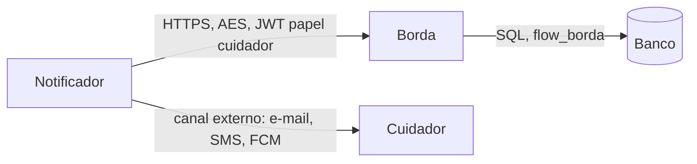

# Serviço de notificação ao cuidador (receita, não implementado)

O aviso ao cuidador (mensagem, push ou e-mail quando há um alerta ou um episódio sem resposta) **não faz parte do servidor**. Este documento só registra como um terceiro serviço o faria, sem mudar a borda nem a análise além de uma rota de leitura.

## Princípio

O notificador é **cliente da borda**, como o app e o bridge: não lê o banco e não fala com a análise. Toda a comunicação é HTTPS, confiando só na CA do projeto, com o envelope AES-GCM e autenticação por token (`docs/arquitetura.md`, seções 4 e 5). Nenhum segredo de banco ou de dispositivo vai para ele; as credenciais dele são só as da própria conta.

## O que precisaria existir

1. **Conta com papel próprio.** O papel `cuidador` já é aceito na criação de contas (`PAPEIS_VALIDOS`) e hoje não tem nenhuma permissão. A conta do notificador seria `papel=cuidador`, com a lista de `user_ids` das pessoas que ele acompanha (`python -m borda.auth criar-conta --id notificador1 --papel cuidador --user-id 1 ...`). Ele faz login em `POST /auth/login` e renova pelo refresh, como os outros clientes.
2. **Uma rota de leitura na borda**, por exemplo `GET /alertas?desde=<id>`, que devolve os alertas e os registros de `confirmacoes` com `id` maior que o informado, em ordem crescente, **só dos `user_id` do token**. Pede uma permissão nova (`alertas:ler`) concedida apenas ao papel `cuidador` na política de `borda/authz.py` e usa o `Repo`; a negação por padrão e o isolamento por `user_id` valem como nas demais rotas. Nada disso existe hoje.
3. **O próprio notificador:** um laço que consulta a rota a cada poucos segundos, guarda no próprio disco o último `id` entregue (o cursor) e envia a notificação por um canal externo. Se cair, retoma do cursor; o prazo de retenção (90 dias) é muito maior que qualquer pausa razoável.

## O que ele notifica

- **Alerta** de luz inadequada ou de imobilidade (`alertas`).
- **Episódio sem resposta:** registro `episodio.encerrado` com resultado `EXPIRADO` em `confirmacoes`. O `CONFIRMADO` (a pessoa respondeu "Estou bem") normalmente não gera aviso.
- A mensagem não deve repetir dados pessoais além do necessário. A localização (`docs/arquitetura.md`, 13.3) **não** entra na rota: continua só para o `admin`.

## Cuidados

- **Idempotência:** cada alerta e cada registro têm `id`; o notificador não envia duas vezes o mesmo.
- **Falha do canal externo** não pode avançar o cursor: só se avança depois de entregar.
- **Cuidador não é o idoso:** a conta do notificador nunca recebe o pedido de confirmação (`/push/*` é só `idoso` e `dispositivo`).
