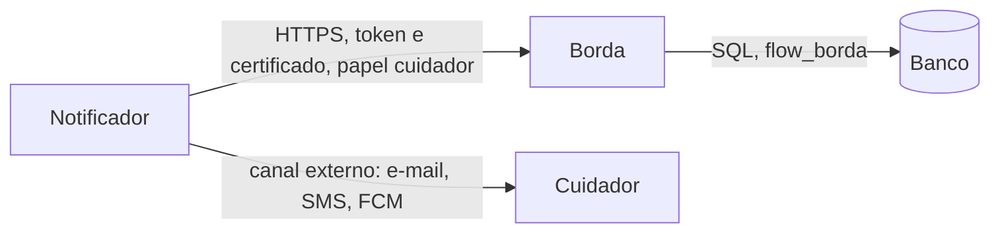

# Aviso ativo ao cuidador (receita, não implementado)

Hoje o cuidador **consulta** o estado e o histórico pelo app (`GET /cuidador/<user_id>/estado` e `/historico`). Avisá-lo
**no momento** de um alerta ou de um episódio sem resposta (push, e-mail, SMS) não faz parte do sistema. Este documento
registra como um terceiro serviço o faria, sem mudar a borda nem a análise.

## Princípio

O notificador é **cliente da borda**, como o app e o bridge: não lê o banco e não fala com a análise. Toda a comunicação
é HTTPS, confiando só na CA do projeto, com o envelope AES-GCM, token e certificado de cliente (`docs/arquitetura.md`,
seções 4 e 5). As credenciais dele são só as da própria conta.

## O que precisaria existir

1. **Conta de cuidador** para o notificador, com os `user_ids` das pessoas acompanhadas (`python -m borda.auth
   criar-conta --id notificador1 --papel cuidador --user-id 1 --fontes app`). Ele faz login, pede o certificado e renova
   o token como o app.
2. **A rota de leitura já existe:** `GET /cuidador/<user_id>/historico` devolve alertas, confirmações e episódios dos
   últimos 90 dias, só das pessoas do token.
3. **O próprio notificador:** um laço que consulta a rota a cada poucos segundos, guarda no próprio disco o instante do
   último item entregue (o cursor) e envia a notificação por um canal externo. Se cair, retoma do cursor.

## O que ele notifica

- **Alerta** de luz inadequada ou de imobilidade.
- **Episódio sem resposta:** episódio encerrado com resultado `EXPIRADO`. O `CONFIRMADO` (a pessoa respondeu "Estou bem")
  normalmente não gera aviso.
- A mensagem não repete dados pessoais além do necessário; a localização não sai das rotas do cuidador.

## Cuidados

- **Idempotência:** o notificador não envia duas vezes o mesmo item.
- **Falha do canal externo** não avança o cursor: só se avança depois de entregar.
- **Cuidador não é o idoso:** a conta de cuidador nunca recebe o pedido de confirmação (`/push/*` é só `idoso` e
  `dispositivo`).
